# HopCharlie 콘솔 (frontend)

HopCharlie 운영 콘솔입니다. 처음 열면 모드를 고릅니다. **일반 모드**는 관리자 아이디와 비밀번호로 로그인해 **실제 플랫폼 API**(`src/api`)를 읽고, **데모 모드**는 로그인 없이 **시연용 시뮬레이션**으로 같은 화면을 보여 줍니다. 모드는 화면 위쪽 버튼으로 언제든 바꿀 수 있고, 바꿔도 로그아웃되지 않습니다. 로그인은 새로고침하거나 새 탭을 열어도 세션이 끝날 때(12시간)까지 유지됩니다. `charlie login`이 보여 준 코드는 일반 모드의 **CLI 연결**(`#device`)에서 승인합니다. 시뮬레이션도 플랫폼 계약과 같은 데이터 모양(`PlanRecord`, `Run`, `RunEvent`, `AgentSession`, `AgentEvent`, `App`, `Deployment`, `DeploymentEvent`, `AppSpecValidation`)을 만듭니다.

- 스택: Vite 8 + React 19 + TypeScript, 테스트는 Vitest + Testing Library
- 디자인: SoftBank 디자인 시스템 토큰 (`src/styles/tokens.css`). 본문 글꼴은 SUIT, 코드와 ID는 IBM Plex Mono입니다.
- 상태 색: 파랑(run)은 기계가 일하는 중, 주황(warn)은 사람이 해야 할 일, 회색은 기다림, 초록은 성공, 빨강은 실패입니다.

```bash
npm install
npm run dev        # 개발 서버
npm test           # 시뮬레이션·화면 테스트
npm run build      # 타입 검사 + 프로덕션 빌드
```

## 버전 히스토리

머지된 PR마다 그 시점의 콘솔을 띄워서 단계별로 찍은 화면은 [docs/HISTORY.md](docs/HISTORY.md)에 있습니다. 머지 시각은 한국 시간입니다.

| 버전 | PR | 머지 | 내용 |
| --- | --- | --- | --- |
| v1 | [#1](https://github.com/2026-Softbank-Hackathon-Charlie/frontend/pull/1) | 11/2 01:48 | 시연용 시뮬레이션 콘솔 첫 버전 |
| v2 | [#3](https://github.com/2026-Softbank-Hackathon-Charlie/frontend/pull/3) | 11/2 15:03 | 실제 플랫폼 API를 읽는 코드 (화면 변화 없음) |
| v3 | [#2](https://github.com/2026-Softbank-Hackathon-Charlie/frontend/pull/2) | 11/2 15:37 | 이전 화면을 플랫폼 흐름에 맞추고 실제 API 연결 |
| v4 | [#4](https://github.com/2026-Softbank-Hackathon-Charlie/frontend/pull/4) | 11/2 19:48 | 전환 후 관찰 표시 (실제 API 모드에서만) |
| v5 | [#6](https://github.com/2026-Softbank-Hackathon-Charlie/frontend/pull/6) | 11/3 12:07 | GitHub 레포로 앱 등록, 배포 진행 화면 |
| v6 | [#5](https://github.com/2026-Softbank-Hackathon-Charlie/frontend/pull/5) | 11/3 13:25 | GitOps로 콘솔 이미지 배포 (화면 변화 없음) |
| v7 | [#7](https://github.com/2026-Softbank-Hackathon-Charlie/frontend/pull/7) | 11/3 14:07 | 버전별 화면 히스토리 문서 (화면 변화 없음) |
| v8 | [#8](https://github.com/2026-Softbank-Hackathon-Charlie/frontend/pull/8) | 11/3 15:04 | 버전 표 정리 (화면 변화 없음) |
| v9 | [#9](https://github.com/2026-Softbank-Hackathon-Charlie/frontend/pull/9) | 11/3 15:29 | README 개요 스크린샷 갱신 (화면 변화 없음) |
| v10 | [#10](https://github.com/2026-Softbank-Hackathon-Charlie/frontend/pull/10) | 11/3 16:28 | 이전 시작 전 검사 결과 표시 |
| v11 | [#11](https://github.com/2026-Softbank-Hackathon-Charlie/frontend/pull/11) | 11/3 16:58 | 보안 화면에 환경 × 분류 매트릭스 |
| v12 | [#12](https://github.com/2026-Softbank-Hackathon-Charlie/frontend/pull/12) | 11/3 17:00 | 배포 workflow 테스트 수정 (화면 변화 없음) |
| v13 | [#13](https://github.com/2026-Softbank-Hackathon-Charlie/frontend/pull/13) | 11/3 18:06 | main push마다 콘솔 배포 (화면 변화 없음) |
| v14 | [#14](https://github.com/2026-Softbank-Hackathon-Charlie/frontend/pull/14) | 11/3 22:27 | 브랜치 인스턴스 추가, 삭제, 브랜치별 배포 |
| v15 | [#15](https://github.com/2026-Softbank-Hackathon-Charlie/frontend/pull/15) | 11/4 00:35 | HopCharlie 로고와 아이콘 |
| v16 | [#16](https://github.com/2026-Softbank-Hackathon-Charlie/frontend/pull/16) | 11/4 11:35 | 데모·일반 모드 선택, 관리자 로그인, CLI 연결 |
| v17 | [#17](https://github.com/2026-Softbank-Hackathon-Charlie/frontend/pull/17) | 11/4 14:42 | 시작 전 검사의 대기 서버 설정 문장 (실제 API 모드에서만) |
| v18 | [#18](https://github.com/2026-Softbank-Hackathon-Charlie/frontend/pull/18) | 11/4 16:01 | 승인 화면에서 전환 후 관찰과 자동 롤백 선택 (실제 API 모드에서만) |
| v19 | [#19](https://github.com/2026-Softbank-Hackathon-Charlie/frontend/pull/19) | 11/4 16:12 | 데모 모드의 이전 대상을 moimroom으로 |

## 화면

### 모드 선택, 로그인, CLI 연결
처음 열면 전체 화면으로 모드를 고릅니다.

- **데모 모드**: 가상 데이터로 시연합니다. 로그인하지 않습니다. 위쪽 막대의 "처음 상태로 되돌리기"로 시뮬레이션을 처음 상태로 돌립니다.
- **일반 모드**: 실제 플랫폼 API를 읽습니다. 로그인 화면에서 관리자 아이디와 비밀번호(플랫폼 서버의 `PLATFORM_ADMINS`)를 넣습니다. 틀린 아이디나 비밀번호, 너무 잦은 시도(기다릴 초를 함께 표시), 관리자가 설정되지 않은 서버, 연결 실패를 각각 한국어로 알려 줍니다. 로그인 화면에서 데모 모드로 바로 갈 수도 있습니다.
- **위쪽 막대**: 일반 모드에서는 연결한 API 주소, 로그인한 관리자 이름, "로그아웃", "데모 모드로 전환"이 있고, 데모 모드에서는 시연용 화면이라는 안내, "처음 상태로 되돌리기", "일반 모드로 전환"이 있습니다. 모드를 바꿔도 로그아웃되지 않습니다.
- **CLI 연결**(`#device`, 일반 모드에서만 사이드 메뉴의 설정 묶음에 보임): 터미널에서 `charlie login`을 실행하면 나오는 코드(XXXX-XXXX, 소문자나 공백을 섞어 넣어도 됨)를 입력하고 "확인"을 누르면 요청한 클라이언트, 요청 시각, 남은 시간이 나옵니다. 승인하기 전에 그 CLI에 줄 역할을 고릅니다. 기본으로 골라 둔 역할은 없고, 고르기 전에는 "승인"을 누를 수 없습니다.
  - 관리자(operator): 배포, 앱 등록과 삭제, Plan 승인까지 모두
  - 조회와 Plan 제출(agent): 승인과 배포는 못 함
  - 조회만(viewer)

  봇(Rin 등)에게는 꼭 필요한 역할만 주고, 배포를 맡길 때만 관리자를 고릅니다. "승인"하면 그 CLI가 30일 동안 내 이름과 고른 역할로 동작하고, 결과에 준 역할을 보여 줍니다. "거절"하면 그 CLI 로그인은 끝납니다. 없거나 만료된 코드, 이미 승인하거나 거절한 요청(검토한 사람과, 승인이면 준 역할도 표시), CLI 토큰처럼 비밀번호로 로그인하지 않은 세션은 따로 알려 줍니다. 승인은 콘솔에 비밀번호로 로그인한 세션만 할 수 있어서 CLI 토큰으로 다른 토큰을 만들 수 없습니다. 로그인하지 않은 채 `#device`를 열면 로그인 화면이 먼저 나오고, 로그인하면 일반 모드로 이 화면에 돌아옵니다.

### 화면 구성
- **사이드 메뉴**: 왼쪽 회색 세로 메뉴입니다. 개요 아래에 작업(앱, 이전), 결과(경로별 결과, AI 활동), 인프라(환경, 보안) 묶음이 있고, 일반 모드에서는 설정(CLI 연결) 묶음이 더해집니다. 새 앱 배포, 기존 앱 가져오기, 앱 상세, 배포 진행은 앱 메뉴 아래 화면입니다.
- **메뉴 배지**: 데모 모드에서는 메뉴에 지금 상태를 붙입니다. 배포나 가져오기가 진행 중이면 앱에 "진행 중", 이전이 진행 중이면 이전에 그 단계(예: 동기화 중, 전환 승인 대기), 보안에 높음 이상 건수가 나옵니다. 일반 모드는 API 호출을 늘리지 않으려고 배지를 두지 않습니다.
- **위쪽 막대**: 왼쪽에 지금 위치(`team-charlie / 메뉴 이름`)가 있습니다. 앱 상세, 배포 진행, 이전 화면에서는 메뉴 이름을 눌러 그 메뉴로 돌아갑니다. 오른쪽에는 모드 안내와 계정이 있습니다.
- **작업 버튼**: 화면 머리에 둡니다. 개요에는 "새 앱 배포"와 "이전하기", 앱 목록에는 "기존 앱 가져오기"와 "새 앱 배포"가 있습니다.
- **상태 색**: 파랑은 기계가 일하는 중, 주황은 사람이 해야 할 일, 회색은 기다림, 초록은 성공, 빨강은 실패입니다. 칩, 메뉴 배지, 이전 화면의 상태 카드와 진행 막대가 같은 규칙을 따릅니다.
- **화면 너비**: 900px보다 좁으면 사이드 메뉴가 위쪽 가로 메뉴로 바뀝니다. 넓은 화면에서는 위쪽 막대와 본문을 같은 가운데 열에 맞춥니다.

아래는 데모 모드(시연용 시뮬레이션) 화면입니다. 숫자와 로그는 모두 가상입니다. (1440px 너비, 전체 페이지)

### 개요
맨 위 **지금 볼 것**은 사람을 기다리는 일, 문제, 진행 중인 일, 최근 24시간 안에 끝난 이전을 이 순서로 모으고, 항목마다 그 화면으로 가는 버튼을 둡니다. 그 아래에 클러스터 3개의 상태, 경로별 결과, 최근 활동, 앱 표가 있습니다. 경로별 결과는 원본(행)과 대상(열)의 3×3 격자이고, 일반 모드에서는 진행 중인 run도 그 칸에 보여 줍니다. 결과가 하나도 없으면 격자 대신 한 줄 안내가 나옵니다. 앱 표의 환경별 상태는 EKS, GKE, k3s 칩 3개로 보여 줍니다. 아래 화면은 가져오기와 이전을 한 번 마친 뒤입니다.

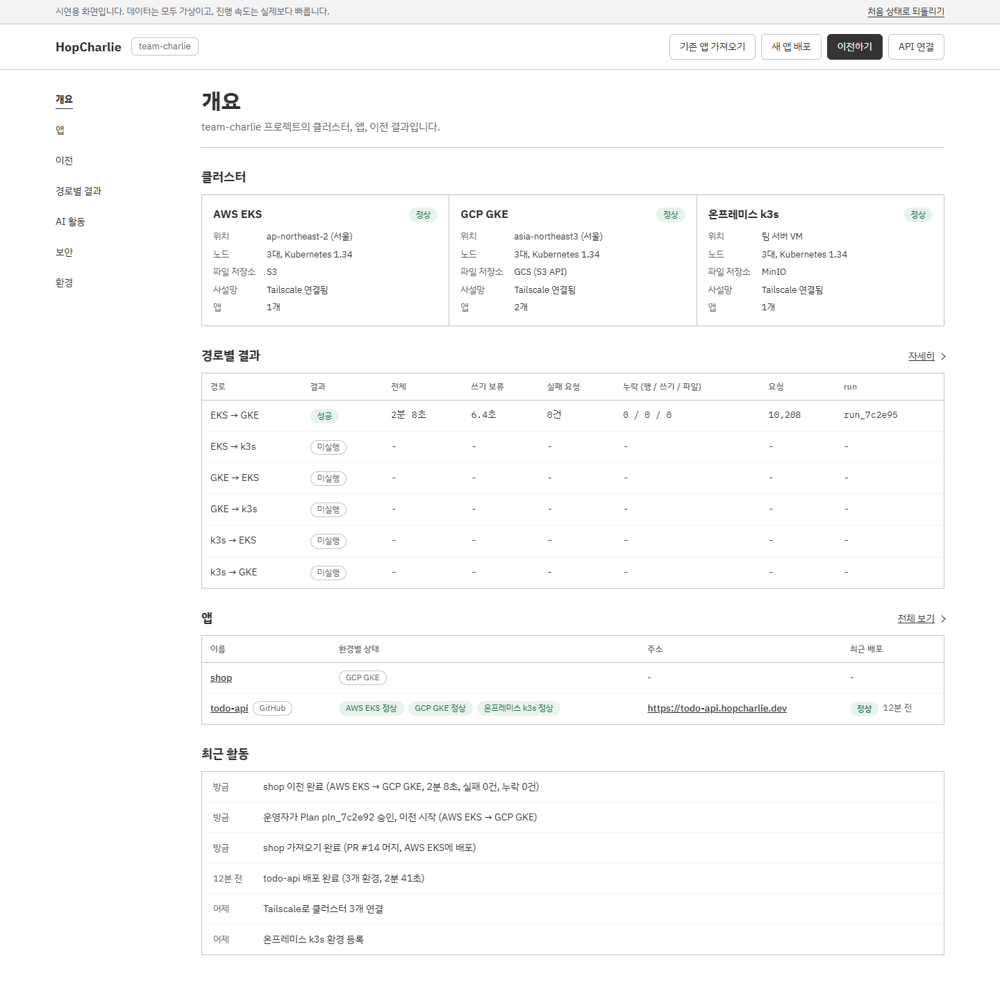

### 기존 앱 가져오기
플랫폼 밖(EC2, RDS, S3)에서 돌던 앱을 AI가 점검하고 고쳐서 클러스터에 첫 배포합니다. AI 범위 결정(팀 주제 정리 문서 3장 7번) 전 시안입니다.

| 1. 연결 정보 | 2. AI 점검 |
| --- | --- |
| 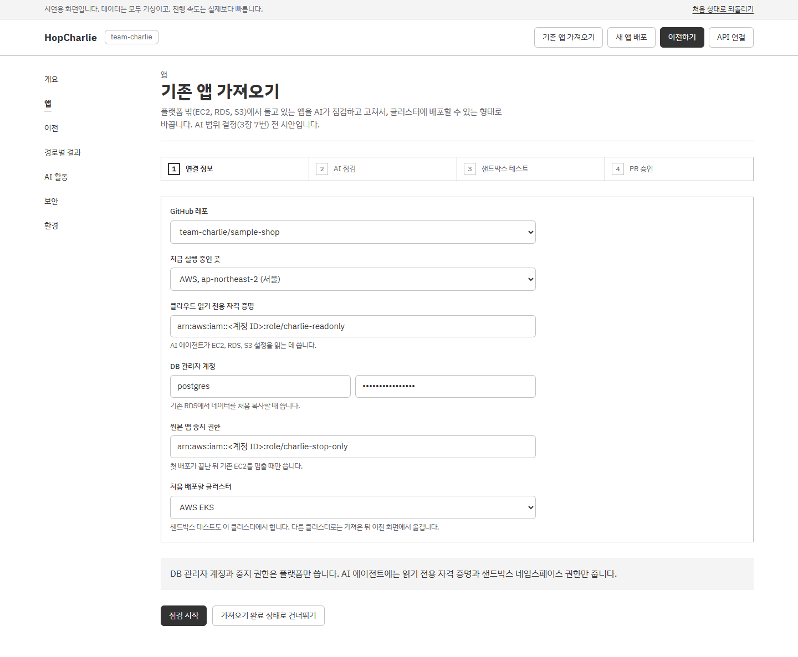 | 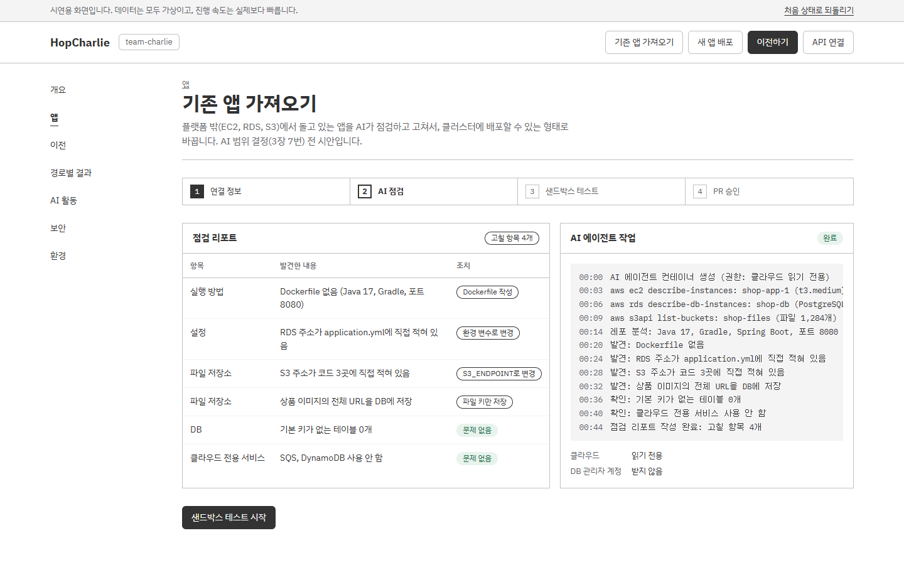 |
| **3. 샌드박스 테스트** | **4. PR 승인과 첫 배포** |
| 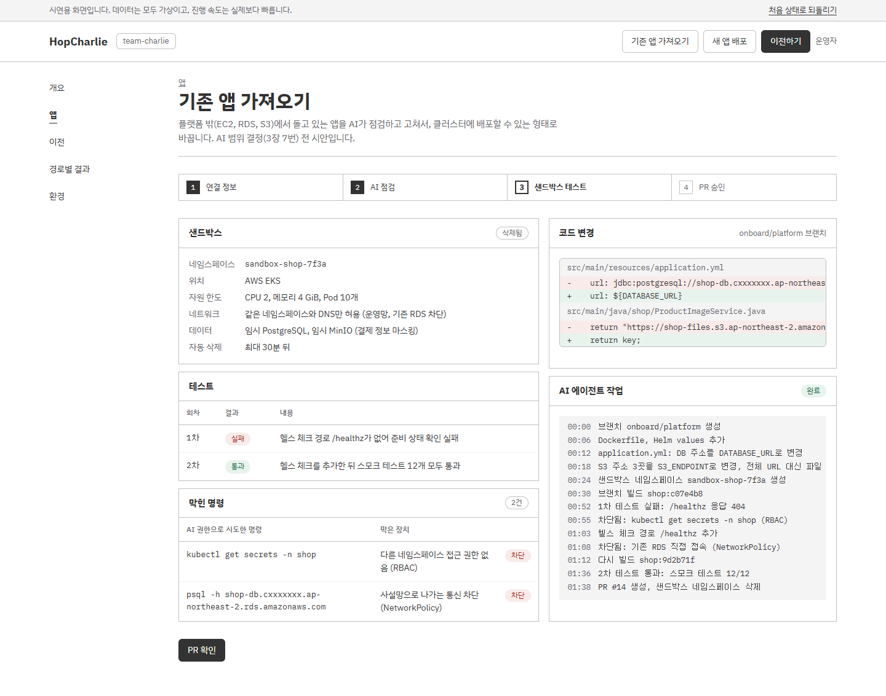 | 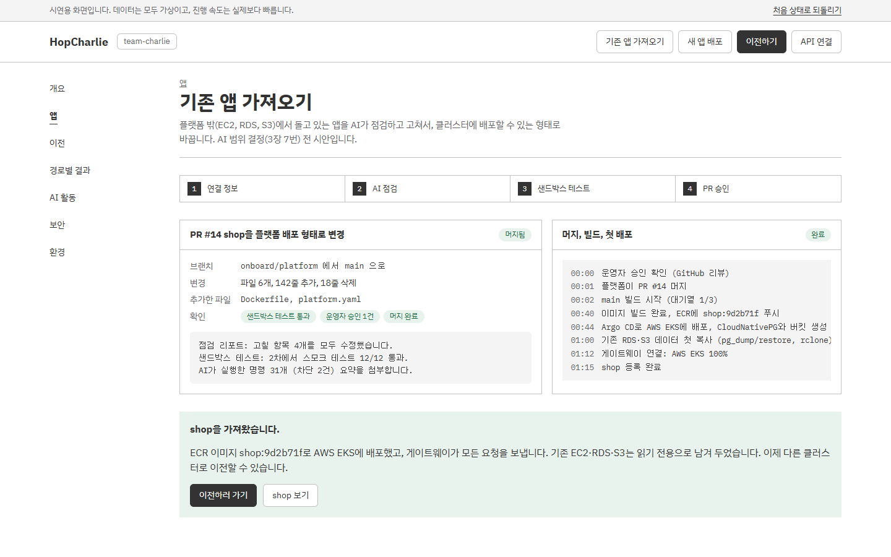 |

### 이전
**설정:** 원본은 앱이 지금 쓰기를 받는 클러스터이고, 옮겨 갈 클러스터를 고릅니다. 오른쪽에 진행 순서(AI 계획, 리허설, 승인, 시작 전 검사, 실행)가 있고, 단계별 자세한 설명은 접어 두었습니다. 설정 다음부터는 화면 위에 AI 계획, 리허설, 승인, 실행 네 단계가 표시됩니다.

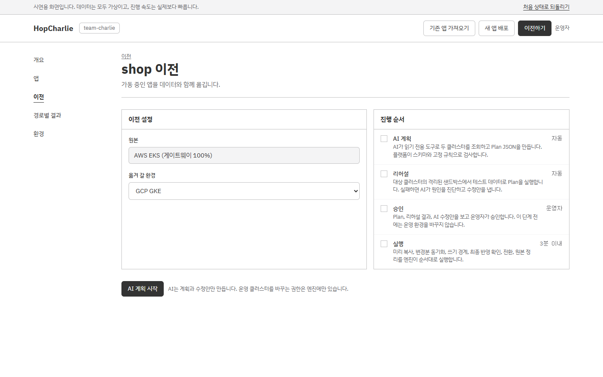

**AI 계획, 리허설, 승인:** 승인 화면은 왼쪽에 **AI가 바꾼 것**(values diff와 revision 변화)과 **확인한 것**(AI 계획, 리허설 결과, 막힌 명령, 시작 전 검사)을 먼저 보여 줍니다. Plan 상세(`PlanRecord`: 원본과 대상 엔드포인트, 첨부, 엔진 Plan 원문)와 AI 세션 기록(계획, 리허설, 진단 세션의 도구 호출)은 접어 두었습니다. AI 수정안은 Plan 첨부로 올라가며 revision이 오릅니다. 오른쪽 **승인 카드**에는 경로, 파일, 실행 방식, 전환, 원복 설명과 "승인하고 시작", "반려"가 있고, 일반 모드에서는 여기서 읽기 카나리 단계, 전환 후 관찰과 자동 롤백을 고릅니다. 승인은 화면에 보이는 revision으로 보냅니다.

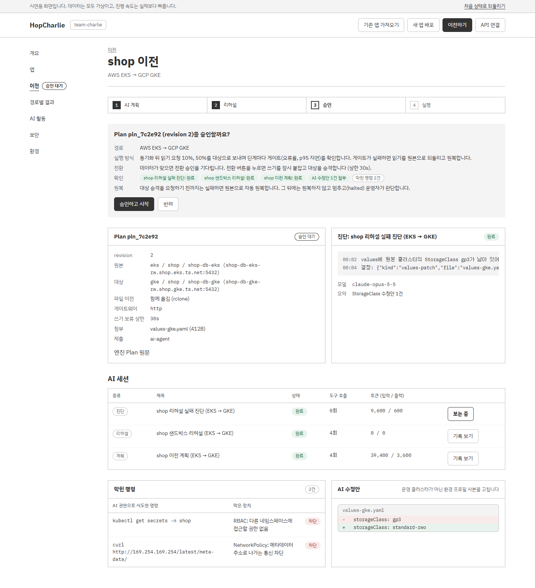

**실행:** 맨 위 **상태 카드**에 지금 상태, 다음 행동(전환, 중단, 롤백, 이어서 실행), 핵심 숫자 4개(경과 시간, 실패 요청, 복제 지연, 성공한 쓰기)가 있습니다. 카드의 진행 막대는 동기화, 읽기 카나리, 전환, 검증 네 칸이고, 진행 중인 칸은 파랑, 전환 승인을 기다리는 칸은 주황입니다. 시작이나 롤백이 막히면 그 이유를 상태 카드 바로 아래에 보여 줍니다. 그 아래 **진행 단계**는 엔진 9단계(사전 확인, 대상 준비, 초기 복사, 변경분 동기화, 쓰기 보류, 대상 승격, 트래픽 전환, 검증, 마무리)를 같은 네 묶음으로 나눠 보여 주고, 트래픽(게이트웨이가 읽기와 쓰기를 보내는 곳)과 읽기 카나리 표가 이어집니다. 맨 아래 탭에서 엔진 기록, 시작 전 검사, AI 기록, Plan을 봅니다.

읽기 카나리는 기본이 10%, 50%, 100%를 5초씩이고, 승인할 때 1%, 10%, 25%, 50%, 75%, 90%, 100%를 10초씩 하는 점진 카나리를 고를 수 있습니다. 단계마다 게이트를 확인하고, 요청이 모자란 단계는 판단 보류로 넘어갑니다. 카나리는 플랫폼 게이트웨이(http)를 거치는 Plan에서만 합니다. 데이터가 맞으면 **전환 승인 대기**(`awaiting_switch`)에서 운영자가 전환을 누릅니다. 승인할 때 전환 후 관찰을 켰으면, 전환 뒤에도 정한 시간 동안 대상을 게이트로 판정하고 위반하면 기록하거나 자동 롤백합니다(실제 API 모드).

| 동기화 | 전환 승인 대기 (카나리 통과) |
| --- | --- |
| 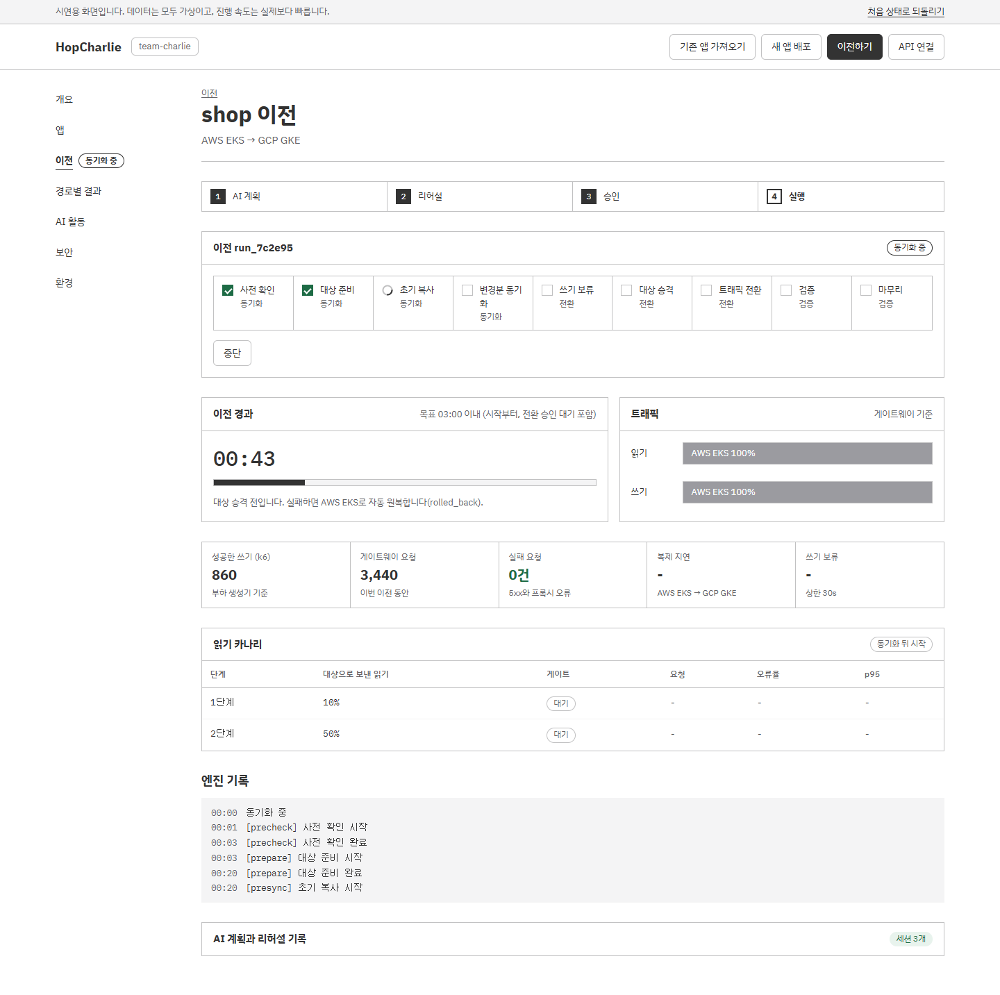 | 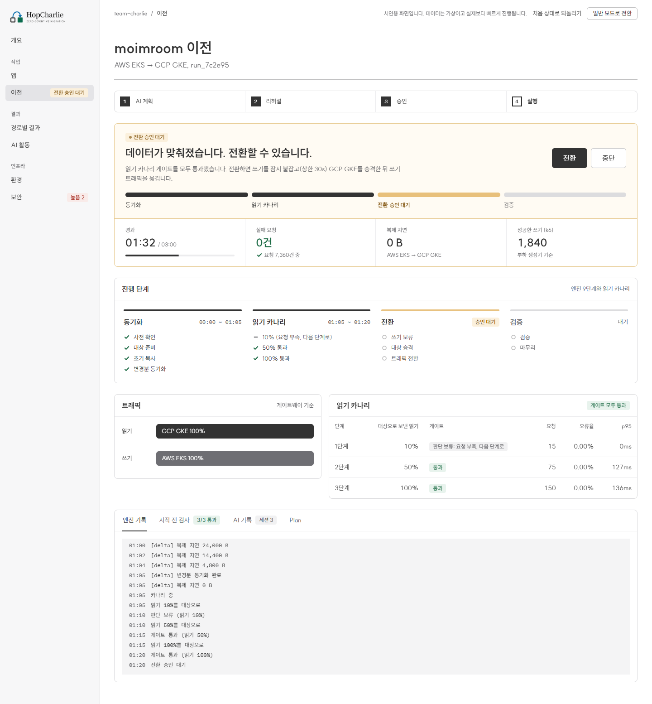 |
| **전환 중 (쓰기 보류, 승격)** | **이전 리포트** |
| 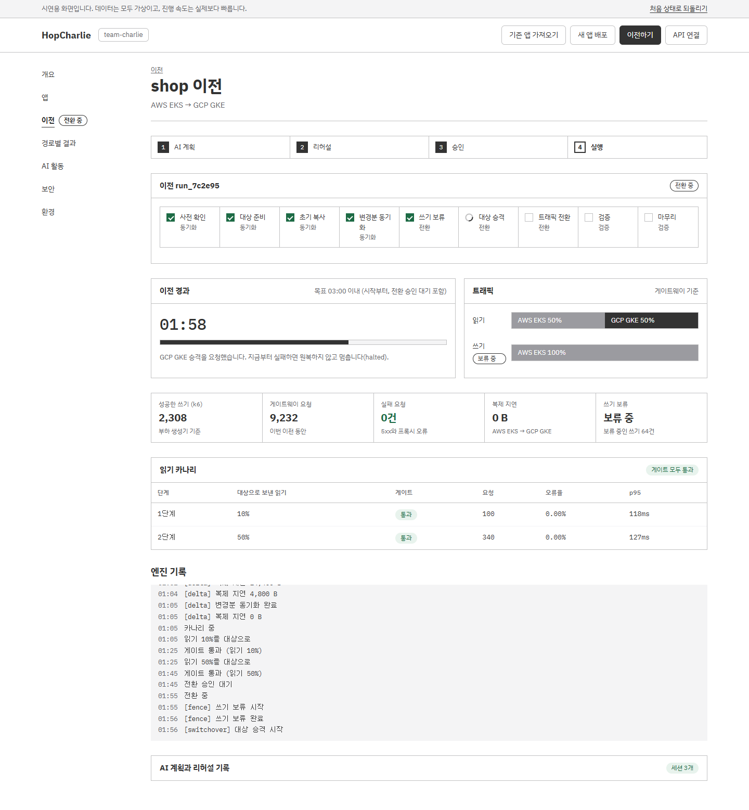 | 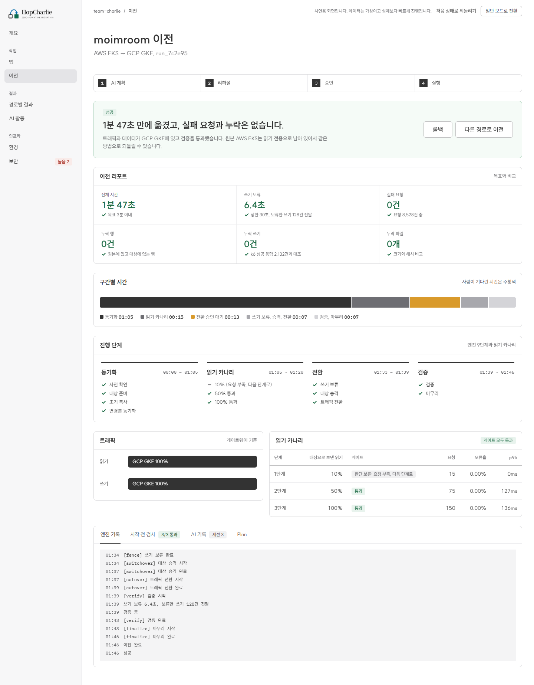 |

이전이 끝나면 상태 카드 바로 아래에 리포트가 옵니다. 리포트는 `RunResult`(전체 시간, 쓰기 보류, 실패 요청, 누락 행, 누락 쓰기, 누락 파일)를 목표와 비교하고, 구간별 시간 막대는 동기화, 읽기 카나리, 전환 승인 대기, 전환(쓰기 보류, 승격, 트래픽 전환), 검증과 마무리에 걸린 시간을 보여 줍니다. 사람이 기다린 시간은 주황입니다. 끝난 이전의 상태 카드에는 진행 막대가 없습니다. 성공한 이전은 상태 카드의 **롤백**(1-click, 반대 방향의 새 run)으로 되돌릴 수 있습니다.

### 경로별 결과
EKS, GKE, k3s 사이 6개 방향의 결과표입니다.

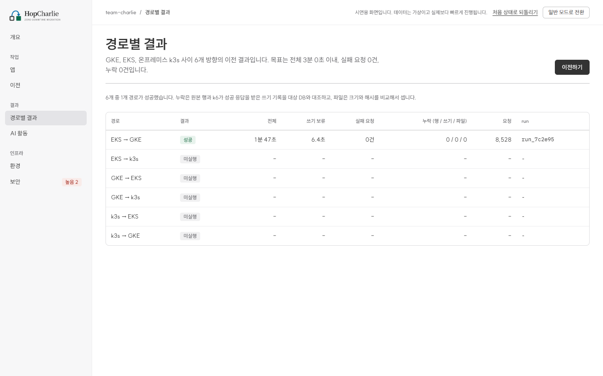

### AI 활동, 보안
**AI 활동**(`#agents`)은 에이전트 세션과 이벤트(도구 호출, 결과, 막힌 명령, 결정)를 모읍니다. **보안**(`#security`)은 환경별 보안 점검 결과입니다. 맨 위 환경 × 분류 매트릭스의 칸을 누르면 아래 찾은 항목이 그 칸으로 걸러지고, 심각도 버튼으로도 거를 수 있습니다. 칸 읽는 법은 접어 두었습니다. 시뮬레이션의 보안 데이터는 `MOCK:` 고정값입니다.

| AI 활동 | 보안 |
| --- | --- |
| 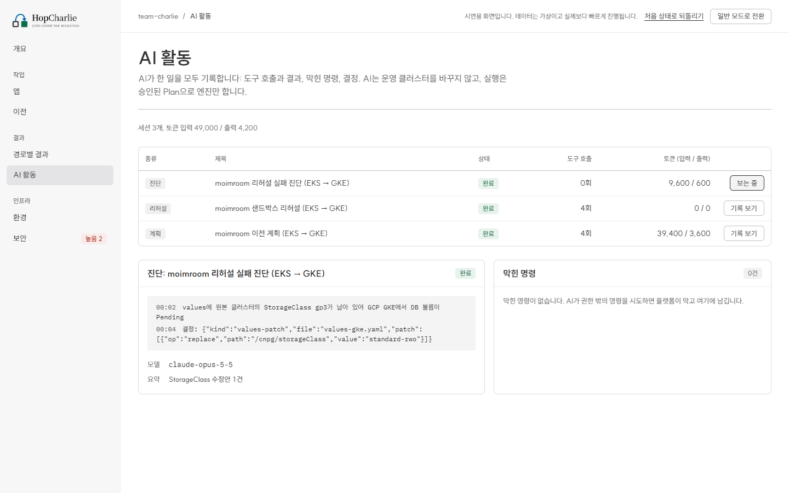 | 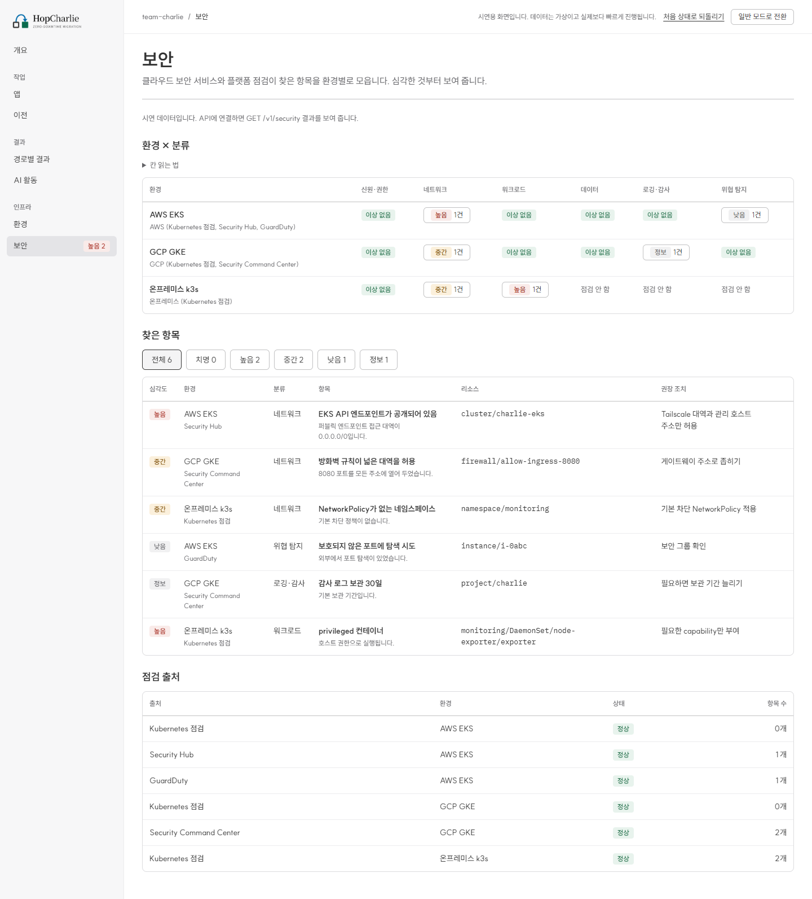 |

### 앱, 새 앱 배포, 환경

GitHub 레포로 앱을 등록하고 배포하는 화면입니다(ADR 0011).

- **새 앱 배포**(`#new`): GitHub App이 볼 수 있는 레포, 브랜치(기본은 레포의 기본 브랜치), 배포 환경, push 자동 배포를 고릅니다. 고르는 대로 platform.yaml을 확인해서, 통과하면 서비스와 포트, 공개 주소(`https://<이름>.hopcharlie.dev`), 리소스를 보여 주고, 아니면 바로 배포할 수 없다는 안내와 **직접 고쳐야 하는 항목**(위치, 내용, 고칠 방법)을 보여 줍니다. 플랫폼 기본값을 쓰는 항목도 따로 보여 줍니다. 레포에는 서비스마다 Dockerfile, 루트에 platform.yaml이 있어야 합니다.
- **앱 목록**(`#apps`): 파일 앱(이전 대상)과 GitHub에서 등록한 앱을 함께 보여 줍니다. 등록한 앱에는 GitHub 표시, 공개 주소, 최근 배포가 붙습니다. 환경별 상태는 EKS, GKE, k3s 칩과 그 아래 범례로 보여 주고, 파일 앱은 상태를 몰라서 회색입니다. 위의 전체, 정상, 문제 있음, 배포 중 칸을 누르면 그 상태로 거르고, 거른 목록은 주소(`#apps-healthy`, `#apps-problem`, `#apps-deploying`)로 공유할 수 있습니다.
- **앱 상세**(`#app-<이름>`): 화면 머리에 레포, 기본 브랜치, 공개 주소와 **기본 브랜치 다시 배포** 버튼, 더 보기 메뉴가 있고, 그 아래 띠에 기본 인스턴스의 환경별 상태(Argo CD sync와 health, 커밋)가 있습니다. 내용은 탭 네 개로 나눴고(`#app-<이름>/instances`, `/secrets`, `/deploys`), 같은 앱 안에서 탭을 바꿔도 스크롤과 입력 중인 내용은 남습니다.
  - **개요**: 최근 배포, 기본 인스턴스의 platform.yaml 요약, 배포 설정(기본 브랜치, 자동 배포, 공개 주소, 등록), 시크릿 요약
  - **인스턴스**: 브랜치별 인스턴스 표(브랜치, 주소, 환경별 상태, 최근 배포, 자동 배포, 배포 버튼). 브랜치 추가 폼은 **브랜치 추가**를 눌러야 열립니다.
  - **시크릿**: 아래 시크릿 설명
  - **배포 이력**: 배포마다 브랜치, 상태, 트리거, 커밋, 환경, 시작 시각, 걸린 시간

  **기본 브랜치 다시 배포**는 기본 브랜치의 head를 모든 환경에 배포하고, 인스턴스마다 있는 **재배포 (빌드 없이, 커밋 7자리)**는 그 인스턴스의 마지막 정상 배포를 같은 이미지와 지금 시크릿으로 다시 배포합니다(배포 이력의 트리거는 재배포). 그 인스턴스의 배포가 진행 중이면 끝날 때까지 버튼이 꺼집니다. **앱 삭제**는 더 보기 메뉴에 있고, 화면 안에서 한 번 더 확인한 뒤 지웁니다. 파일 앱(이전 대상)은 실행 위치, 리소스, 변경 이력과 이전 버튼을 보여 줍니다.
- **앱 상세의 시크릿**(ADR 0019): 앱 공통 시크릿과, 고른 인스턴스가 받는 시크릿(앱 공통에서 받은 것과 덮어쓴 것)을 표로 보여 줍니다. 표에는 이름, 바꾼 때, 바꾼 사람만 있고, 보기를 누른 값만 서버에서 불러와 보여 줍니다. 다시 누르거나 페이지를 떠나거나 60초가 지나면 값을 지웁니다. 시크릿 추가와 덮어쓰기 추가 폼은 그 버튼을 눌러야 열립니다. 추가, 수정, 삭제, 덮어쓰기, 덮어쓰기 지우기는 저장하지 않은 변경으로 모았다가 범위마다 저장 한 번으로 보내고, 취소로 버릴 수 있습니다. 저장한 뒤에는 실행 중인 인스턴스가 이전 값을 쓴다고 알리고 인스턴스별 재배포와 모든 인스턴스 재배포 버튼을 보여 줍니다. operator가 아닌 토큰은 이름만 봅니다. 데모 모드에서는 todo-api의 가짜 시크릿으로 같은 흐름을 보여 줍니다.
- **배포 진행**(`#deploy-<id>`): 단계(대기열, 이미지 빌드, gitops 커밋, Argo CD 동기화, 그리고 정상, 실패, 대체됨)와 단계 번호(예: 2/4 빌드), 환경별 상태, 실시간 빌드 로그(자동 스크롤, 멈춤 가능), 배포를 만든 때부터 끝날 때까지의 경과 시간(목표 5분)을 보여 줍니다. 끝나면 맨 위에 결과 카드가 나옵니다. 성공하면 공개 주소를 누를 수 있고, 실패하면 실패한 단계와 오류를 보여 주며 로그 위에 한 줄 요약을 띄우고 첫 오류 줄로 스크롤해서 표시합니다.
- 시뮬레이션 레포: `notice-board`(바로 배포 가능, `dev` 브랜치는 빌드 실패), `photo-album`(`main`은 규칙 위반, `fix-worker`는 통과), `analytics-worker`(platform.yaml 없음). `todo-api`는 처음부터 등록되어 있습니다.

| 앱 목록 | 새 앱 배포 |
| --- | --- |
| 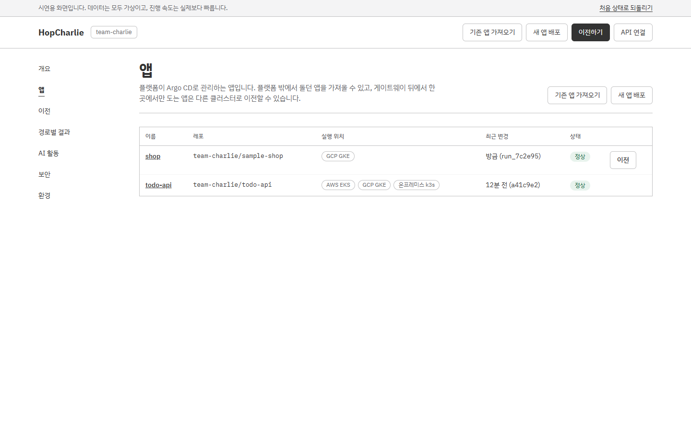 | 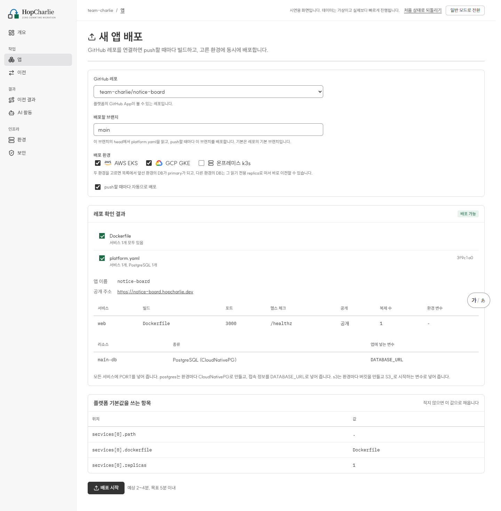 |
| **새 앱 배포: 규칙 위반 (photo-album)** | **새 앱 배포: platform.yaml 없음 (analytics-worker)** |
| 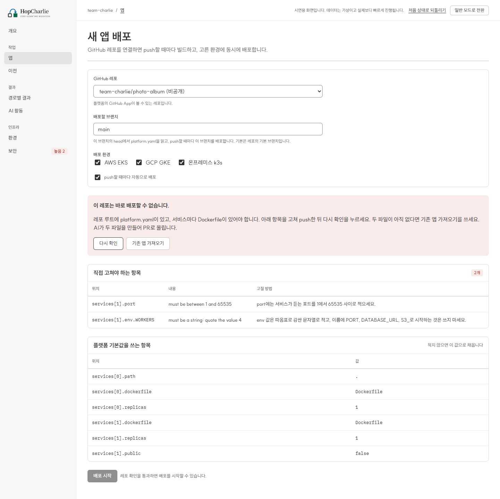 | 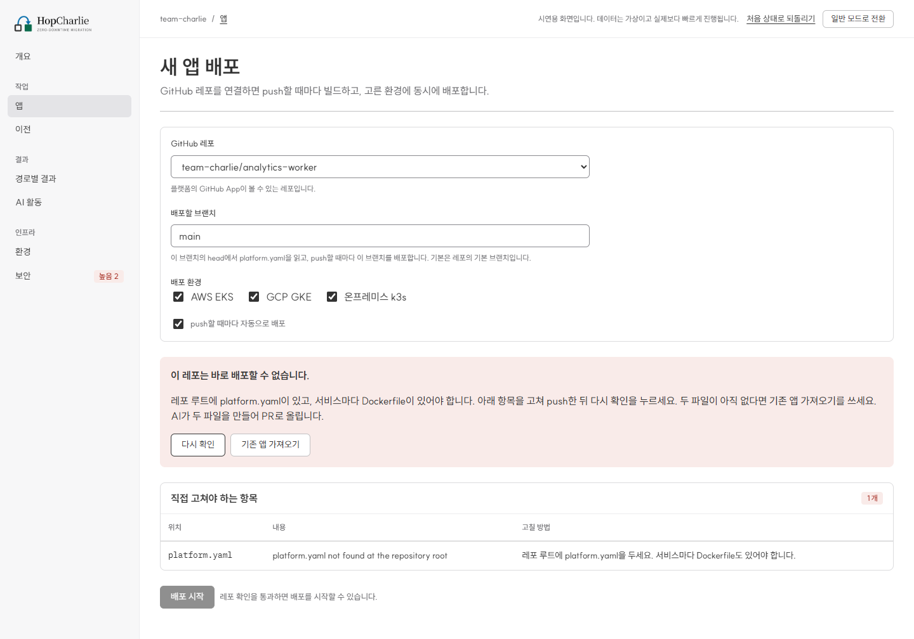 |
| **배포 진행 (진행 중, 2/4 빌드)** | **앱 목록: 문제 있음 필터** |
| 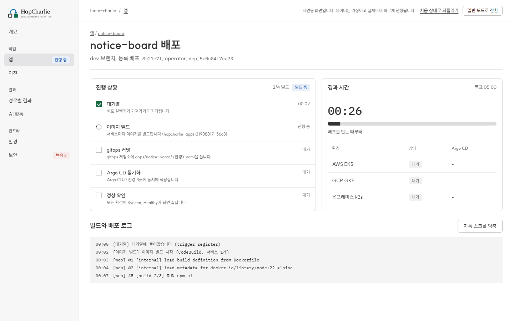 | 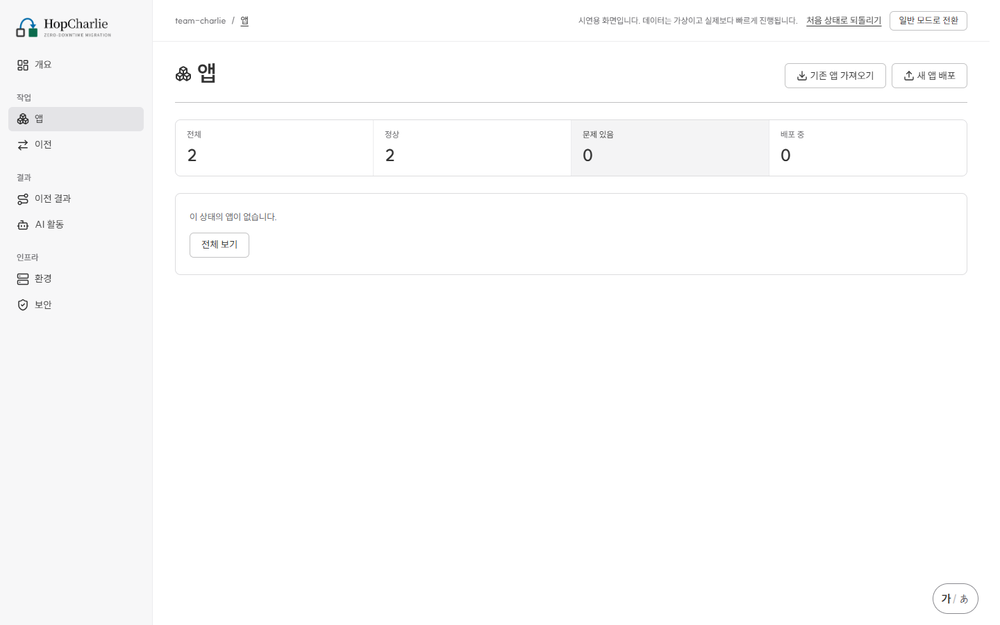 |
| **앱 상세 (todo-api, GitHub에서 등록, 개요 탭)** | **앱 상세 (이전 대상 moimroom, GKE로 이전한 뒤)** |
| 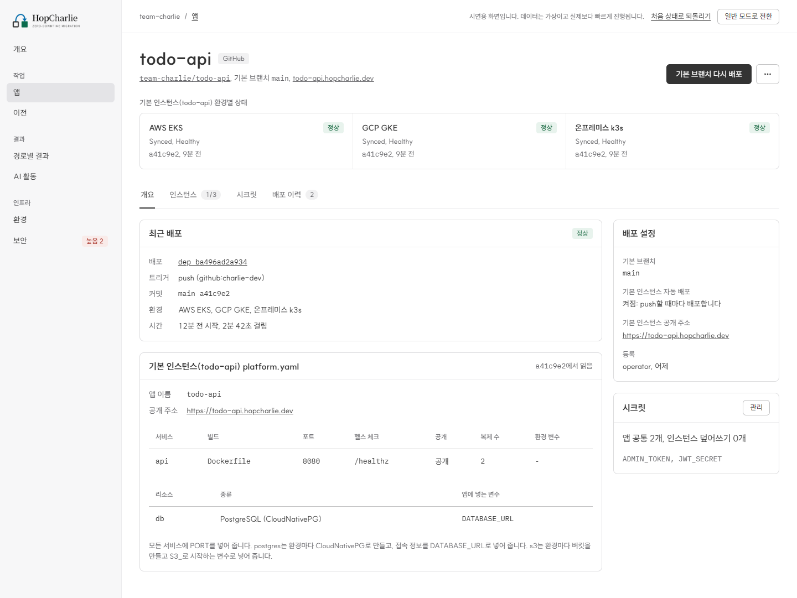 | 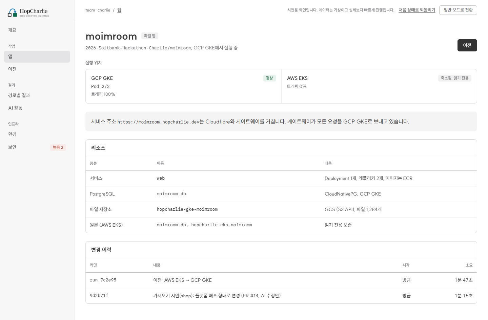 |
| **배포 진행 (완료)** | **배포 진행 (빌드 실패, `dev` 브랜치)** |
| 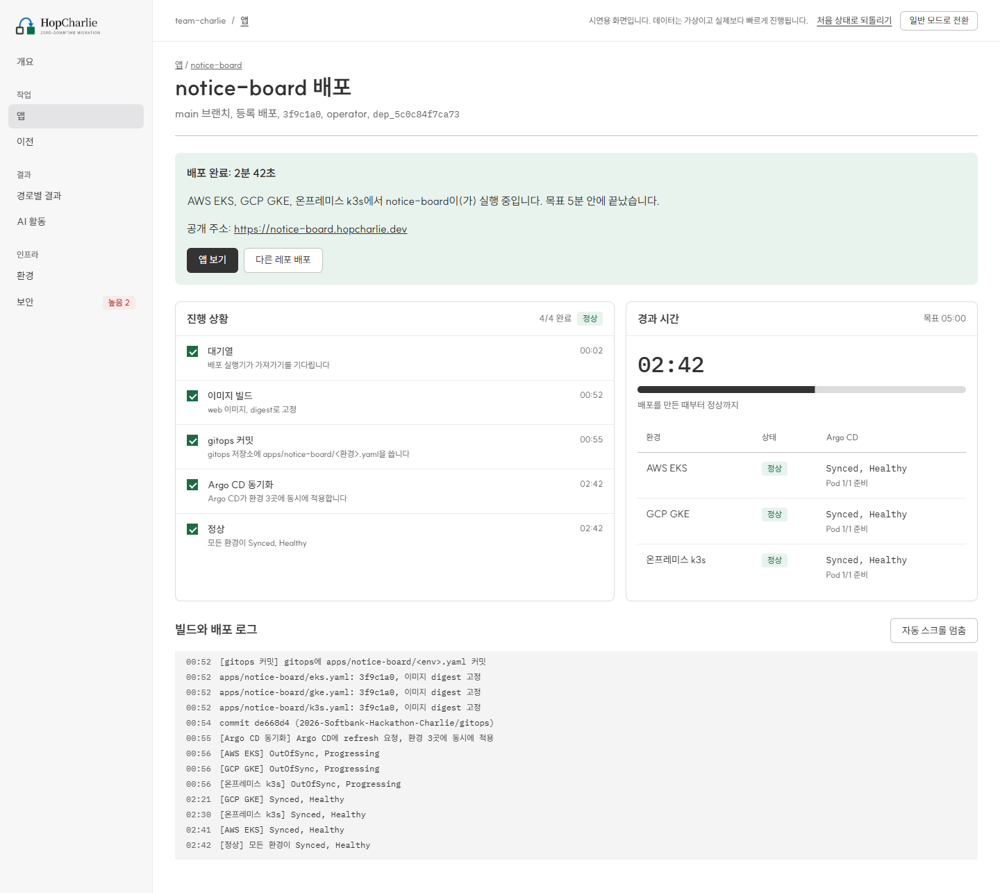 | 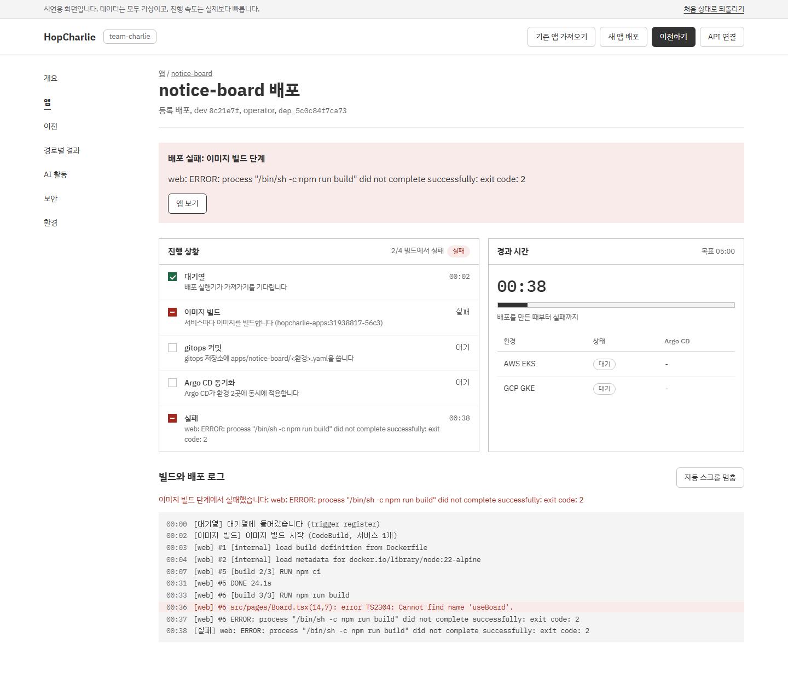 |
| **환경** | |
| 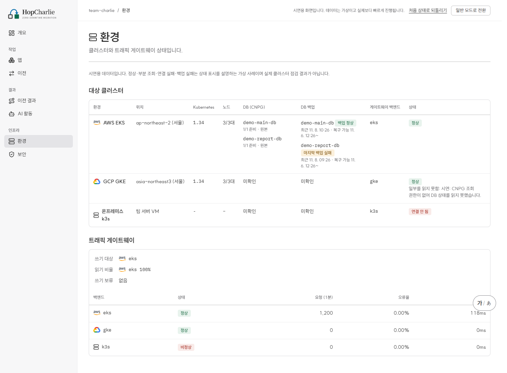 | |

### 디자인 시스템 (`#design-system`)
메뉴에는 없는 화면입니다. 주소창에 `#design-system`을 붙여서 엽니다. 원칙, 로고, 색(대비 포함), 글꼴, 간격과 모서리, 상태 표현, 컴포넌트, 움직임을 화면과 같은 토큰과 클래스로 보여줍니다.

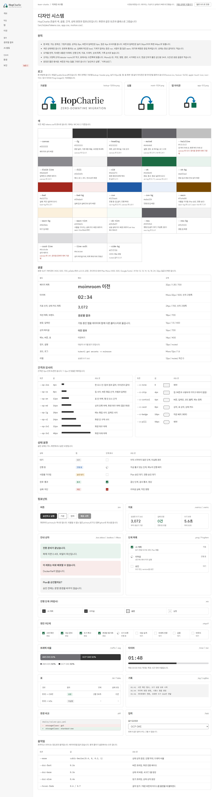

### Figma로 옮기기
- **이미지로:** `docs/screenshots/`의 PNG를 Figma에 끌어다 놓습니다.
- **편집 가능한 레이어로:** html.to.design 크롬 확장을 설치하고, `npm run dev`로 띄운 화면(`http://localhost:5173/#...`)에서 확장을 눌러 캡처한 뒤 Figma의 html.to.design 플러그인에서 불러옵니다. 진행 상태가 있는 화면(승인 대기, 전환 중, 리포트)은 그 상태까지 진행한 뒤 캡처합니다.

## 실제 API에 연결하기

1. 프로젝트 루트에 `.env.local`을 만들고 `VITE_PLATFORM_URL=<플랫폼 주소>`를 적은 뒤 `npm run dev`를 다시 시작합니다 (자세한 내용은 `src/api/README.md`).
2. 처음 화면에서 **일반 모드**를 고르거나, 데모 모드 위쪽 막대의 **일반 모드로 전환**을 누릅니다.
3. 로그인 화면에서 관리자 아이디와 비밀번호를 넣습니다. 관리자 세션의 역할은 operator라서 승인, 시작, 전환, 중단, 롤백, 앱 등록, 다시 배포, 앱 삭제를 모두 할 수 있습니다.
4. 로그인하면 위쪽 막대의 안내가 바뀌고 개요, 앱, 새 앱 배포, 배포 진행, 이전, 경로별 결과, AI 활동, 보안, 환경, CLI 연결 화면이 API를 읽습니다. 기존 앱 가져오기는 아직 시연 화면입니다.

로그인 세션(토큰, 만료 시각, 관리자 이름)은 localStorage `hopcharlie.session`에, 고른 모드는 `hopcharlie.mode`에 둡니다. 새로고침하거나 새 탭을 열어도 세션이 끝날 때(12시간)까지 로그인이 유지되고, 한 탭에서 로그인하거나 로그아웃하면 다른 탭도 따라갑니다. 모드는 탭마다 따로입니다. 세션이 만료되거나 서버가 401로 답하면 "세션이 만료되었습니다. 다시 로그인하세요"와 함께 로그인 화면으로 돌아갑니다. 로그아웃은 서버에서 세션을 끝내고(`POST /v1/auth/logout`), 서버에 닿지 않아도 이 브라우저에서는 바로 로그아웃합니다. 화면과 로그에는 토큰을 보여 주지 않습니다.

## 이전 흐름

| 단계 | 시뮬레이션 | 실제 API |
| --- | --- | --- |
| Plan | AI 실행기(ai-sandbox `hopai run`)가 계획하는 동안, 그 앱의 진행 중인 계획 세션(아직 planRef 없음, 제목 `<앱> 이전 계획 (…)`)을 AI 계획 단계로 실시간 표시. 남아 있는 승인 대기 Plan보다 나중에 시작한 계획이면 그 Plan 대신 계획을 보여 줌. 계획 세션이 끝나도 그 세션이 제출한 Plan이 올 때까지 남기고, 그 Plan이 오면 승인 대기(`pending_approval`)로 넘어감. Plan 없이 실패하면 이유와 "설정으로 돌아가기"를 보여 줌. "Plan 작성" 버튼은 AI 없이 초안을 바로 제출 | `GET /v1/agent/sessions?limit=20`, 세션 SSE / `POST /v1/plans/draft` → `POST /v1/plans` |
| 리허설·진단 | AI 세션(리허설, 진단, 운영자 데모 설정)과 이벤트, 수정안 첨부로 revision 상승. planRef가 없는 계획 세션은 리허설 세션이 시작할 때 남긴 계획 세션 ID(`tool: plan`)를 따라가 함께 보여 줌 | `GET /v1/agent/sessions?planRef=`, `GET /v1/agent/sessions/{id}/events?format=json`, `GET /v1/agent/sessions/{id}`, 세션 SSE |
| 승인 | 보고 있는 revision으로 승인. 다르면 다시 확인하라는 안내 | `POST /v1/plans/{ref}/approve` `{revision}` (바뀌었으면 409) |
| 시작 | 게이트웨이(http) Plan은 읽기 카나리(기본 10/50/100% 5초씩, 선택 시 1→100% 7단계 10초씩). 승인 화면에서 카나리 단계, 전환 후 관찰(1~10분)과 위반 시 자동 롤백을 고름 (실제 API 모드) | `POST /v1/migrations` (Idempotency-Key, `canary`, `observe`) |
| 진행 | 9단계, 카나리 게이트, 복제 지연, 쓰기 보류 | run SSE (`useRun`) |
| 전환 | `awaiting_switch`에서 전환 버튼 | `POST /v1/migrations/{id}/switch` |
| 중단·재개 | 승격 요청 전까지 중단 가능, 중단·실패는 이어서 실행 | `/abort`, `/resume` |
| 롤백 | 성공한 이전을 반대 방향으로 (전환 대기 없이) | `POST /v1/migrations/{id}/rollback` |

상태는 계약의 8가지(`running`, `awaiting_switch`, `succeeded`, `rolled_back`, `halted`, `failed`, `aborted`, `interrupted`)를 각각 다르게 표시합니다. 대상 승격을 요청하기 전(`promoteRequested` 전)에는 실패하면 원복하고, 그 뒤에는 멈춥니다.

- 시뮬레이션의 이전 대상은 팀 샘플 앱 moimroom의 구성(서비스 `web` 레플리카 2개, CNPG `moimroom-db`, 스키마 `app` 테이블 5개, 사진 버킷)을 따릅니다. 파일 수와 DB 크기 같은 수치, 보안 시연 데이터는 자리표시입니다. `MOCK:` 주석을 검색하면 나옵니다. 기존 앱 가져오기 시안은 shop을 예로 들고, 끝나면 moimroom으로 이어집니다.
- 기존 앱 가져오기(AI 점검 → 샌드박스 테스트 → PR 승인 → 첫 배포)는 AI 범위 결정(팀 주제 정리 문서 3장 7번) 전 시안입니다.

## 구조
```
src/api/            플랫폼 API 데이터 계층 (계약 타입, 클라이언트, SSE, 훅) — #3
src/data/live.ts    모드와 로그인 세션(localStorage, 탭 사이 동기화, 만료, 401 처리), Plan 목록 폴링, 오류 문구
src/data/migration.ts  이전 화면용 보기 모델: 시뮬레이션과 실제 API를 같은 모양으로
src/data/deploy.ts  새 앱 배포, 앱 목록과 상세, 배포 진행 화면용 보기 모델
src/data/secrets.ts 앱 시크릿 보기 모델 (이름 목록, 값 하나 불러오기, 저장)
src/sim/mig.ts      계약 모양으로 만드는 이전 시뮬레이션 (Plan, Run, RunEvent, AgentSession)
src/sim/deploy.ts   계약 모양으로 만드는 GitHub 앱 배포 시뮬레이션 (App, Deployment, DeploymentEvent, AppSpecValidation)
src/sim/secrets.ts  앱 시크릿 시뮬레이션과 서버의 이름, 값 규칙
src/sim/state.ts    시뮬레이션 상태 머신 (배포, 가져오기, 이전)
src/sim/store.tsx   100ms 틱, React 구독
src/router.ts       해시 라우팅 (#overview, #apps, #apps-<상태>, #app-<id>, #deploy-<id>, #new, #onboard, #migrate, #migrate-app, #routes, #agents, #security, #envs, #device, #design-system)
src/pages/          화면 (실제 API 모드와 시뮬레이션 모드를 각각 감싸고, 그리는 코드는 하나). Entry.tsx는 모드 선택과 로그인, Device.tsx는 CLI 연결
src/components/     공통 UI (Chip, Ind, LogBox, Table, PageHead, AI 세션 표, 배포 화면 조각)
```

## 배포 (GitHub Actions)

[Deploy frontend](.github/workflows/deploy.yml)은 **main에 push할 때마다** 자동으로 실행됩니다. Actions의 Run workflow로 main을 다시 게시할 수도 있습니다. 연달아 push하면 진행 중인 이전 실행을 취소하므로 마지막 커밋만 게시됩니다. PR에서는 실행하지 않습니다.

Node 24에서 `npm ci`, GitOps helper 시험, `npm test`, `npm run build`를 통과하면 기존 플랫폼과 같은 Caddy 이미지로 빌드합니다. ECR에 frontend 커밋의 **7자리 SHA 태그** 하나를 게시하고, 빌드 결과의 digest로 infra의 다음 두 파일을 바꾸는 커밋 하나를 **infra main에 바로** 넣습니다(infra ADR 0025). 그사이 infra main이 바뀌면 새 main을 다시 읽어 커밋을 다시 만듭니다.

- `clusters/aws-dev-management/values/hopcharlie-platform.yaml`의 `images.console`: `<ECR 저장소>:<7자리 SHA>@sha256:<digest>`
- `helm/images.lock.json`의 같은 `<ECR 저장소>:<7자리 SHA>` 키: 같은 digest

다른 이미지와 설정은 유지합니다. 같은 이미지가 infra main에 이미 반영돼 있으면 커밋하지 않습니다. `latest` 태그는 게시하지 않으며, 이미지의 `version.txt`에는 추적용 전체 frontend SHA를 둡니다. 인라인 Dockerfile은 platform의 `deploy/console/Dockerfile`과 동기화합니다.

**workflow 성공은 ECR 게시와 infra main 커밋까지입니다.** 실제 콘솔 `https://console.hopcharlie.dev` 반영은 관리 EKS의 Argo CD Application이 infra main을 동기화해야 완료됩니다. workflow는 EC2·SSM·클러스터를 직접 갱신하지 않습니다.

### 최초 준비

Settings → Secrets and variables → Actions → **Variables**에 다음 값을 설정합니다. ECR 저장소와 OIDC 역할은 먼저 준비돼 있어야 합니다.

| 변수 | 값 / 출처 |
| --- | --- |
| `AWS_DEPLOY_ROLE_ARN` | 필수. frontend 이미지 게시용 GitHub OIDC 역할 ARN |
| `ECR_CONSOLE_REPOSITORY` | 필수. infra `terraform/platform/aws`의 `console_repository_url`. 태그 없는 전체 ECR 주소이며 현재 infra 콘솔 저장소와 같아야 합니다 |
| `AWS_REGION` | 선택. 기본 `ap-northeast-2`, ECR과 같은 리전 |
| `VITE_PLATFORM_URL` | 선택. 기본 `https://api.hopcharlie.dev`. 빌드에 포함되는 공개 HTTPS API 주소 |

Terraform output의 소유 위치는 infra `terraform/platform/aws`입니다. 그중 `api_url`, `console_url`, `instance_id`는 기존 EC2 호스트용 값이므로 이 EKS 배포의 입력으로 쓰지 않습니다. `PLATFORM_INSTANCE_ID`와 `CONSOLE_URL` 변수는 필요하지 않습니다. 콘솔 로그인에 쓰는 관리자 계정(`PLATFORM_ADMINS`)은 플랫폼 서버 설정이라 이 workflow에서 다루지 않습니다.

**Secrets**에는 `INFRA_PR_TOKEN`을 준비합니다. 대상 infra 저장소에만 접근하는 fine-grained PAT 또는 GitHub App installation token이며, `Contents: read/write` 권한이 필요합니다(infra main에 바로 커밋). frontend의 기본 `GITHUB_TOKEN`은 다른 비공개 infra 저장소에 쓸 수 없습니다. 토큰은 helper 단계에서만 전달하며 npm 설치·빌드에는 전달하지 않습니다. 토큰의 유효기간과 조직 승인을 확인하고, installation token을 직접 등록했다면 만료 전에 새 실행용 토큰을 준비합니다.

AWS 역할에는 `ecr:GetAuthorizationToken`과 지정된 콘솔 ECR 저장소의 이미지 push 권한이 필요합니다. SSM·EC2 변경·EKS 관리 권한은 필요하지 않습니다. OIDC 신뢰 정책은 `aud=sts.amazonaws.com`과 **이 저장소 main**으로 제한합니다. 조회한 immutable subject는 다음과 같습니다. GitHub Environment를 쓰도록 바꾼다면 subject도 다시 확인합니다.

```text
repo:2026-Softbank-Hackathon-Charlie@350278309/frontend@1441992854:ref:refs/heads/main
```

공식 설정: [AWS용 GitHub OIDC](https://docs.github.com/en/actions/how-tos/secure-your-work/security-harden-deployments/oidc-in-aws), [GitHub 토큰 권한](https://docs.github.com/en/rest/authentication/permissions-required-for-fine-grained-personal-access-tokens).

### 배포 순서

1. main에 push합니다. 다시 게시할 때는 Actions → **Deploy frontend** → **Run workflow**에서 main을 고릅니다.
2. 실행 요약에서 이미지 digest와 infra main 커밋을 확인합니다.
3. `charlie-management-hopcharlie-platform` Application이 그 커밋을 동기화했는지 확인합니다.
4. `https://console.hopcharlie.dev/version.txt`가 전체 frontend SHA와 일치하는지 확인하고, 일반 모드로 로그인해 화면이 실제 API를 읽는지 확인합니다.

롤백은 infra main의 해당 커밋을 되돌리는(revert) 것으로 합니다. workflow는 IAM 역할·토큰·저장소 변수를 만들지 않고, Terraform apply·클러스터 생성·앱 데이터 이전도 수행하지 않습니다.
