# HopCharlie 콘솔 (frontend)

HopCharlie 운영 콘솔입니다. 처음 열면 모드를 고릅니다. **일반 모드**는 관리자 아이디와 비밀번호로 로그인해 **실제 플랫폼 API**(`src/api`)를 읽고, **데모 모드**는 로그인 없이 **시연용 시뮬레이션**으로 같은 화면을 보여 줍니다. 모드는 화면 위쪽 버튼으로 언제든 바꿀 수 있고, 바꿔도 로그아웃되지 않습니다. 로그인은 새로고침하거나 새 탭을 열어도 세션이 끝날 때(12시간)까지 유지됩니다. `charlie login`이 보여 준 코드는 일반 모드의 **CLI 연결**(`#device`)에서 승인합니다. 시뮬레이션도 플랫폼 계약과 같은 데이터 모양(`PlanRecord`, `Run`, `RunEvent`, `AgentSession`, `AgentEvent`, `App`, `Deployment`, `DeploymentEvent`, `AppSpecValidation`, `Onboarding`, `OnboardingEvent`)을 만듭니다.

- 스택: Vite 8 + React 19 + TypeScript, 테스트는 Vitest + Testing Library
- 디자인: SoftBank 디자인 시스템 토큰 (`src/styles/tokens.css`). 본문 글꼴은 SUIT, 코드와 ID는 IBM Plex Mono입니다.
- 상태 색: 파랑(run)은 기계가 일하는 중, 주황(warn)은 사람이 해야 할 일, 회색은 기다림, 초록은 성공, 빨강은 실패입니다.

```bash
npm install
npm run dev        # 개발 서버
npm test           # 시뮬레이션·화면 테스트
npm run build      # 타입 검사 + 프로덕션 빌드
```

일반·데모 모드는 같은 화면 컴포넌트를 사용하고 데이터 공급 경로를 분리합니다. 데모의 실행 기능은 정해진 시나리오 범위이며, 지원하지 않는 설정은 바꿀 수 없게 표시합니다.

| 화면 | 일반 모드 | 데모 모드 |
| --- | --- | --- |
| 환경 | 클러스터·CNPG·DB 백업·게이트웨이 API, 앱별 트래픽 보기, 온프렘 연결 코드 발급(관리자) | 같은 표와 상태 표현, 가상 정상·부분 조회·연결 실패·백업 실패 사례. 온프렘 연결과 앱 선택은 없음 |
| 앱 상세 | 파일 앱은 이전 설정, 등록 앱은 인스턴스·시크릿·배포 탭, 환경 추가·빼기, DB 짝과 트래픽 수신 표시 | 같은 구분과 화면. 환경 추가·빼기와 DB 짝 준비 상태는 시뮬레이션(wiki 앱), 트래픽 수신 별은 없고 DB 역할은 처음 만든 역할. 파일 앱의 실행 위치·리소스·이력은 시연 정보 |
| 이전 | AI 계획·리허설, 수동 Plan, 카나리·관찰 설정 | AI 계획·리허설과 빠른 카나리 시나리오. 수동 Plan·관찰·자동 롤백은 비활성화 |
| 보안 | 공통 6개 탭(개요, 통제 점검, 취약점, 발견 항목, 수집 상태, OCSF 내보내기). 발견 항목·수집 상태·저장소 키는 `GET /v1/security`, 통제 평가는 `GET /v1/security/controls`, 취약점·실행 컨테이너는 `GET /v1/security/vulnerabilities`, OCSF는 `GET /v1/security/ocsf`. 응답이 없거나 형식이 다르면 이유와 함께 "결과 없음"으로 두고 데모 데이터로 채우지 않음. 발견 항목·취약점 예외 등록·해제 가능 | 같은 6개 탭과 필터·상세, 명시적으로 표시한 가상 통제·CVE·자산 관계. 실행 컨테이너 표, 관측 상태, 예외 등록 버튼은 없음 |
| AI 활동 | `GET /v1/agent/sessions`(5초마다)와 고른 세션의 이벤트 스트림. 앱·From·To는 계획·실행·앱 목록의 정확한 참조로 연결 | 시뮬레이션의 계획·리허설·진단 세션. 앱·From·To는 연결하지 않아 "미확인" |
| 기존 앱 가져오기 | 플랫폼 온보딩 API(`/v1/onboardings`): 시작 폼, 목록, 단계별 상태(SSE), 승인·전환·정리·삭제. 시작·승인·전환·삭제는 관리자(operator)만. 서버가 구현하지 않았으면(501) 안내만 | 같은 화면을 시뮬레이션이 조사부터 완료까지 진행. 실제 VM이나 자격증명에는 접근하지 않음 |
| 개요 | `GET /v1/envs`, `/v1/apps`, `/v1/migrations`, `/v1/security`, `/v1/audit`, `/v1/matrix`, 앱별 `/v1/traffic?app=`. "AI 이전 판단"(`/v1/migration-recommendations`)은 일반 모드만 | 같은 구성. 클러스터 카드 3장, 지금 볼 것, 최근 활동을 시뮬레이션이 만듦. AI 이전 판단 없음 |
| 앱 목록 | 줄마다 `관측` 버튼(앱 관측 팝업: HyperDX 로그 요약, Langfuse) | `관측` 버튼 없음 |

## 버전 히스토리

머지된 PR마다 그 시점의 콘솔을 띄워서 단계별로 찍은 화면은 [docs/HISTORY.md](docs/HISTORY.md)에 있습니다. 머지 시각은 한국 시간입니다.

| 버전 | PR | 머지 | 내용 |
| --- | --- | --- | --- |
| v1 | [#1](https://github.com/2026-Softbank-Hackathon-Charlie/frontend/pull/1) | 11/2 01:48 | 시연용 시뮬레이션 콘솔 첫 버전 |
| v2 | [#3](https://github.com/2026-Softbank-Hackathon-Charlie/frontend/pull/3) | 11/2 15:03 | 실제 플랫폼 API를 읽는 코드 (화면 변화 없음) |
| v3 | [#2](https://github.com/2026-Softbank-Hackathon-Charlie/frontend/pull/2) | 11/2 15:37 | 이전 화면을 플랫폼 흐름에 맞추고 실제 API 연결 |
| v4 | [#4](https://github.com/2026-Softbank-Hackathon-Charlie/frontend/pull/4) | 11/2 19:48 | 전환 후 관찰 표시 (실제 API 모드에서만) |
| v5 | [#6](https://github.com/2026-Softbank-Hackathon-Charlie/frontend/pull/6) | 11/3 12:07 | GitHub 레포로 앱 등록, 배포 진행 화면 |
| v6 | [#5](https://github.com/2026-Softbank-Hackathon-Charlie/frontend/pull/5) | 11/3 13:25 | GitOps로 콘솔 이미지 배포 (화면 변화 없음) |
| v7 | [#7](https://github.com/2026-Softbank-Hackathon-Charlie/frontend/pull/7) | 11/3 14:07 | 버전별 화면 히스토리 문서 (화면 변화 없음) |
| v8 | [#8](https://github.com/2026-Softbank-Hackathon-Charlie/frontend/pull/8) | 11/3 15:04 | 버전 표 정리 (화면 변화 없음) |
| v9 | [#9](https://github.com/2026-Softbank-Hackathon-Charlie/frontend/pull/9) | 11/3 15:29 | README 개요 스크린샷 갱신 (화면 변화 없음) |
| v10 | [#10](https://github.com/2026-Softbank-Hackathon-Charlie/frontend/pull/10) | 11/3 16:28 | 이전 시작 전 검사 결과 표시 |
| v11 | [#11](https://github.com/2026-Softbank-Hackathon-Charlie/frontend/pull/11) | 11/3 16:58 | 보안 화면에 환경 × 분류 매트릭스 |
| v12 | [#12](https://github.com/2026-Softbank-Hackathon-Charlie/frontend/pull/12) | 11/3 17:00 | 배포 workflow 테스트 수정 (화면 변화 없음) |
| v13 | [#13](https://github.com/2026-Softbank-Hackathon-Charlie/frontend/pull/13) | 11/3 18:06 | main push마다 콘솔 배포 (화면 변화 없음) |
| v14 | [#14](https://github.com/2026-Softbank-Hackathon-Charlie/frontend/pull/14) | 11/3 22:27 | 브랜치 인스턴스 추가, 삭제, 브랜치별 배포 |
| v15 | [#15](https://github.com/2026-Softbank-Hackathon-Charlie/frontend/pull/15) | 11/4 00:35 | HopCharlie 로고와 아이콘 |
| v16 | [#16](https://github.com/2026-Softbank-Hackathon-Charlie/frontend/pull/16) | 11/4 11:35 | 데모·일반 모드 선택, 관리자 로그인, CLI 연결 |
| v17 | [#17](https://github.com/2026-Softbank-Hackathon-Charlie/frontend/pull/17) | 11/4 14:42 | 시작 전 검사의 대기 서버 설정 문장 (실제 API 모드에서만) |
| v18 | [#18](https://github.com/2026-Softbank-Hackathon-Charlie/frontend/pull/18) | 11/4 16:01 | 승인 화면에서 전환 후 관찰과 자동 롤백 선택 (실제 API 모드에서만) |
| v19 | [#19](https://github.com/2026-Softbank-Hackathon-Charlie/frontend/pull/19) | 11/4 16:12 | 데모 모드의 이전 대상을 moimroom으로 |
| v20 | [#20](https://github.com/2026-Softbank-Hackathon-Charlie/frontend/pull/20) | 11/4 16:36 | 앱 시크릿 편집과 빌드 없는 재배포 |
| v21 | [#21](https://github.com/2026-Softbank-Hackathon-Charlie/frontend/pull/21) | 11/4 16:40 | 버전 히스토리에 v8~v19 추가 (화면 변화 없음) |
| v22 | [#22](https://github.com/2026-Softbank-Hackathon-Charlie/frontend/pull/22) | 11/4 16:56 | 읽기 카나리 7단계와 판단 보류 표시 |
| v23 | [#24](https://github.com/2026-Softbank-Hackathon-Charlie/frontend/pull/24) | 11/4 17:35 | 읽기 카나리 기본값을 10%, 50%, 100%로 |
| v24 | [#25](https://github.com/2026-Softbank-Hackathon-Charlie/frontend/pull/25) | 11/4 21:18 | 콘솔 게시를 self-hosted runner에서 (화면 변화 없음) |
| v25 | [#23](https://github.com/2026-Softbank-Hackathon-Charlie/frontend/pull/23) | 11/4 21:46 | 이전 화면에 AI 실행기의 계획 세션 (실제 API 모드에서만) |
| v26 | [#26](https://github.com/2026-Softbank-Hackathon-Charlie/frontend/pull/26) | 11/5 10:20 | 콘솔 개편 1단계: 묶음 사이드 메뉴, 상태 색, SUIT 글꼴 |
| v27 | [#27](https://github.com/2026-Softbank-Hackathon-Charlie/frontend/pull/27) | 11/5 10:27 | 콘솔 개편 2단계: 이전 상태 카드, 앱 상세 탭, 개요 |
| v28 | [#28](https://github.com/2026-Softbank-Hackathon-Charlie/frontend/pull/28) | 11/5 12:04 | 콘솔 마감 다듬기, 넓은 화면 정렬 |
| v29 | [#29](https://github.com/2026-Softbank-Hackathon-Charlie/frontend/pull/29) | 11/5 12:09 | 광고 차단 확장이 앱 상세를 숨기지 않게 클래스 접두사 변경 (화면 변화 없음) |

v29 이후의 PR(#30부터)은 위 표에 정리하지 않았습니다. 화면에 생긴 변화는 아래 각 화면 절에 반영했고, 전체 목록은 GitHub의 [병합된 PR](https://github.com/2026-Softbank-Hackathon-Charlie/frontend/pulls?q=is%3Apr+is%3Amerged)에서 볼 수 있습니다.

## 화면

### 모드 선택, 로그인, CLI 연결
처음 열면 전체 화면으로 모드를 고릅니다.

- **데모 모드**: 가상 데이터로 시연합니다. 로그인하지 않습니다. 위쪽 막대의 "처음 상태로 되돌리기"로 시뮬레이션을 처음 상태로 돌립니다.
- **일반 모드**: 실제 플랫폼 API를 읽습니다. 로그인 화면에서 관리자 아이디와 비밀번호(플랫폼 서버의 `PLATFORM_ADMINS`)를 넣습니다. 틀린 아이디나 비밀번호, 너무 잦은 시도(기다릴 초를 함께 표시), 관리자가 설정되지 않은 서버, 연결 실패를 각각 한국어로 알려 줍니다. 로그인 화면에서 데모 모드로 바로 갈 수도 있습니다.
- **위쪽 막대**: 일반 모드에서는 로그인한 관리자 이름, "로그아웃", "데모 모드로 전환"이 있고(연결한 API 주소는 위쪽 막대가 아니라 로그인 화면의 "서버: 주소"에 나옵니다), 데모 모드에서는 시연용 화면이라는 안내, "처음 상태로 되돌리기", "일반 모드로 전환"이 있습니다. 모드를 바꿔도 로그아웃되지 않습니다.
- **CLI 연결**(`#device`, 일반 모드에서만 사이드 메뉴의 설정 묶음에 보임): 터미널에서 `charlie login`을 실행하면 나오는 코드(XXXX-XXXX, 소문자나 공백을 섞어 넣어도 됨)를 입력하고 "확인"을 누르면 요청한 클라이언트, 요청 시각, 남은 시간이 나옵니다. 승인하기 전에 그 CLI에 줄 역할을 고릅니다. 기본으로 골라 둔 역할은 없고, 고르기 전에는 "승인"을 누를 수 없습니다.
  - 관리자(operator): 배포, 앱 등록과 삭제, Plan 승인까지 모두
  - 조회와 Plan 제출(agent): 승인과 배포는 못 함
  - 조회만(viewer)

  봇(Rin 등)에게는 꼭 필요한 역할만 주고, 배포를 맡길 때만 관리자를 고릅니다. "승인"하면 그 CLI가 30일 동안 내 이름과 고른 역할로 동작하고, 결과에 준 역할을 보여 줍니다. "거절"하면 그 CLI 로그인은 끝납니다. 없거나 만료된 코드, 이미 승인하거나 거절한 요청(검토한 사람과, 승인이면 준 역할도 표시), CLI 토큰처럼 비밀번호로 로그인하지 않은 세션은 따로 알려 줍니다. 승인은 콘솔에 비밀번호로 로그인한 세션만 할 수 있어서 CLI 토큰으로 다른 토큰을 만들 수 없습니다. 로그인하지 않은 채 `#device`를 열면 로그인 화면이 먼저 나오고, 로그인하면 일반 모드로 이 화면에 돌아옵니다.

**구현:** `src/App.tsx`의 `App`이 화면을 고릅니다. `#device`를 세션 없이 열면 관리자 로그인이 안내 문장과 함께 먼저 나오고, 모드를 아직 고르지 않았으면 `ModeChoice`, 일반 모드인데 세션이 없으면 `Login`, 그 밖에는 콘솔입니다. 두 화면(`ModeChoice`, `Login`)은 `src/pages/Entry.tsx`에 있고, 모드와 세션은 `src/data/live.ts`(`chooseMode`, `logIn`, `logOut`)가 `localStorage`에 둡니다. 로그인은 `POST /v1/auth/login`이며, 로그인 화면 맨 아래에 요청이 가는 서버를 "서버: 주소"로 보여 줍니다(`VITE_PLATFORM_URL`을 넣지 않은 빌드는 "(같은 주소)"). 위쪽 막대는 `App.tsx`의 `Account`가 모드에 따라 바꿉니다.

CLI 연결(`src/pages/Device.tsx`)은 코드로 요청을 찾고(`GET /v1/auth/device/{코드}`), 고른 역할로 승인하거나(`POST /v1/auth/device/{코드}/approve`, 본문 `{role}`) 거절합니다(`POST /v1/auth/device/{코드}/deny`). 데모 모드에는 로그인이 없고, 로그인 세션이 남은 채 데모 모드에서 `#device`를 열면 다시 로그인하지 않고 일반 모드로 바뀝니다(`App`의 `toLive`).

| 모드 선택 | 관리자 로그인 |
| --- | --- |
| 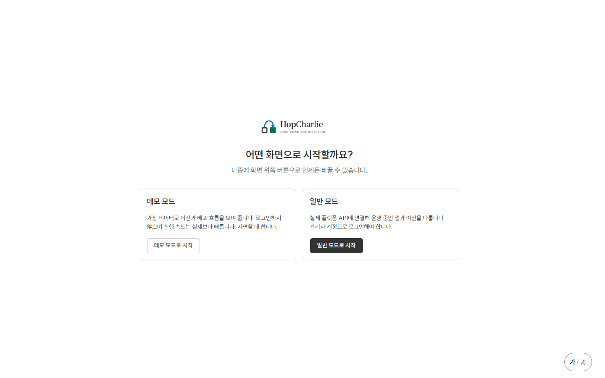 | 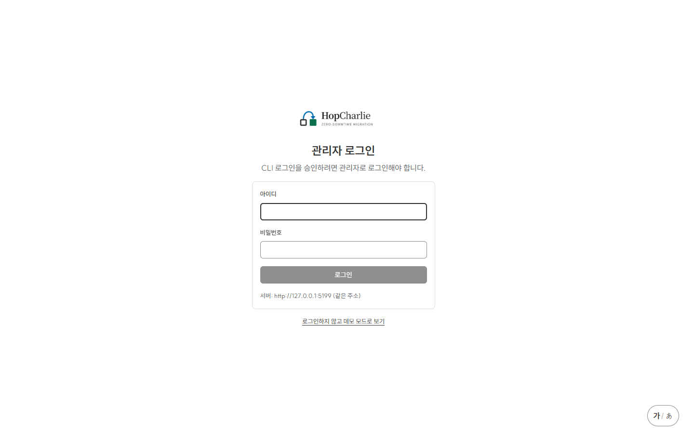 |

위 로그인 화면은 `#device`를 로그인 없이 열었을 때 모습이라 CLI 로그인 안내 문장이 붙어 있습니다.

### 화면 구성
- **사이드 메뉴**: 왼쪽 회색 세로 메뉴입니다. 개요 아래에 작업(앱, 이전), 결과(이전 결과, AI 활동), 인프라(환경, 보안) 묶음이 있고, 일반 모드에서는 설정(CLI 연결) 묶음이 더해집니다. 새 앱 배포, 기존 앱 가져오기, 앱 상세, 배포 진행은 앱 메뉴 아래 화면입니다.
- **메뉴 배지**: 데모 모드에서는 메뉴에 지금 상태를 붙입니다. 배포나 가져오기가 진행 중이면 앱에 "진행 중", 이전이 진행 중이면 이전에 그 단계(예: 동기화 중, 전환 승인 대기)가 나옵니다. 보안 메뉴에는 배지를 붙이지 않고, 치명·높음 발견 항목 건수는 개요의 "지금 볼 것"에서 봅니다. 일반 모드는 API 호출을 늘리지 않으려고 배지를 두지 않습니다.
- **위쪽 막대**: 왼쪽에 지금 위치(`team-charlie / 메뉴 이름`)가 있습니다. 앱 상세, 배포 진행, 이전 화면에서는 메뉴 이름을 눌러 그 메뉴로 돌아갑니다. 오른쪽에는 모드 안내와 계정이 있습니다.
- **작업 버튼**: 화면 머리에 둡니다. 개요에는 "새 앱 배포"와 "이전하기", 앱 목록에는 "기존 앱 가져오기"와 "새 앱 배포"가 있습니다.
- **상태 색**: 파랑은 기계가 일하는 중, 주황은 사람이 해야 할 일, 회색은 기다림, 초록은 성공, 빨강은 실패입니다. 칩, 메뉴 배지, 이전 화면의 상태 카드와 진행 막대가 같은 규칙을 따릅니다.
- **아이콘**: 사이드 메뉴, 화면 제목, 주요 버튼 앞에 단색 윤곽 아이콘을 붙입니다. `src/components/Icon.tsx`의 `Icon`이 Lucide 윤곽 SVG 22개를 글자 색(`currentColor`)으로 그리고, 장식용이라 스크린리더에는 읽히지 않아 버튼과 메뉴의 이름은 그대로입니다. 원본 revision과 라이선스는 `docs/licenses/lucide.md`입니다. (#31)
- **환경 아이콘**: 환경 이름 앞에 AWS, GCP 로고(`public/env/aws.svg`, `public/env/gcp.svg`, 출처 `docs/licenses/provider-logos.md`)를 붙이고, 온프레미스는 서버 아이콘을 붙입니다. `src/components/shared.tsx`의 `EnvLabel`이 개요 카드와 경로 격자, 환경 표와 게이트웨이 백엔드, 앱 목록·상세·배포 진행, 이전 화면(Plan, 이력), 보안 목록에서 같이 씁니다. 환경 이름이 사용자 지정이어도 서버가 준 `provider`를 알면 아이콘을 붙이고, 제공자를 모르는 환경은 글자만 보여 줍니다. 이전 지도(iframe)는 자기 SVG를 그대로 씁니다. (#94)
- **화면 너비**: 900px보다 좁으면 사이드 메뉴가 위쪽 가로 메뉴로 바뀝니다. 넓은 화면에서는 위쪽 막대와 본문을 같은 가운데 열에 맞춥니다.

아래는 데모 모드(시연용 시뮬레이션) 화면입니다. 숫자와 로그는 모두 가상입니다. (1440px 너비, 전체 페이지)

### 개요
맨 위 **지금 볼 것**은 사람을 기다리는 일, 문제, 진행 중인 일, 최근 24시간 안에 끝난 이전을 이 순서로 모으고, 항목마다 그 화면으로 가는 버튼을 둡니다. 그 아래에 클러스터(일반 모드는 서버가 알려 준 환경마다, 데모는 EKS, GKE, 온프레미스 k3s 3개)의 상태, 경로별 결과, 최근 활동, 앱 표가 있습니다. 경로별 결과는 원본(행)과 대상(열)의 3×3 격자이고, 일반 모드에서는 진행 중인 run도 그 칸에 보여 줍니다. 결과가 하나도 없으면 격자 대신 한 줄 안내가 나옵니다. 앱 표의 환경별 상태는 EKS, GKE, On-prem 칩 3개로 보여 줍니다. 아래 화면은 데모 모드의 처음 상태입니다.

- **지금 볼 것의 항목**(`src/pages/Overview.tsx`의 `NowList`): 진행 중이거나 차례를 기다리는 배포(배포 중, 배포 대기), 진행 중이거나 전환 승인을 기다리는 이전과 24시간 안에 끝난 최근 이전 한 건, 치명·높음 보안 발견 항목 한 줄입니다. 보안 줄은 건수와 앞의 두 건 제목을 보여 주고, 버튼은 `#security/priority-findings`로 가서 같은 발견 항목만 거른 목록을 엽니다(#104). 이전 결과 요약은 측정한 종류마다 "행 누락 0건", "파일 누락 0건"으로 따로 쓰고, 재지 않은 쓰기 누락을 0건으로 합치지 않습니다(#78). 이전 목록, 보안 점검, 앱 목록 중 읽지 못한 것이 있으면 "빠진 항목이 있을 수 있습니다" 한 줄을 붙여 "확인할 것 없음"으로 읽히지 않게 합니다.
- **클러스터 카드**(`src/components/shared.tsx`의 `EnvGrid`): 일반 모드는 `GET /v1/envs`(10초마다)가 준 환경마다 한 장입니다. 노드(준비/전체), DB(`N개`, 일부만 준비면 `준비/전체개 준비`, 못 읽으면 `-`), 트래픽을 보여 주고, 연결하지 못한 환경은 "연결 안 됨"과 이유를 붙입니다. **트래픽 칸은 앱별 게이트웨이로 계산합니다.** 게이트웨이가 있는 앱(앱 파일의 앱이거나 DB 짝이 있는 등록 앱, `hasGateway`)마다 `GET /v1/traffic?app=<이름>`(10초마다)의 `writeBackend`를 모아, 그 환경이 쓰기를 받는 앱이 있으면 "쓰기 받음 (앱 N개)", 없으면 "대기", 아직 못 읽었으면 "-"입니다. 앱을 지정하지 않은 기본 게이트웨이(예전 shop 예제용)는 읽을 수 있는 앱이 하나도 없을 때만 씁니다. (#77) 데모는 EKS, GKE, 온프레미스 k3s 3장을 고정으로 두고 앱 수, 파일 저장소, 사설망을 보여 줍니다.
- **최근 활동**: 일반 모드는 `GET /v1/audit?limit=6`의 감사 로그 6줄(시각, 행위자와 역할, 한 일, 결과)이고, 데모는 시뮬레이션이 남긴 기록입니다.
- **AI 이전 판단**(일반 모드만, `src/components/MigrationRecommendations.tsx`, #112, `docs/adr/0014-on-demand-ai-migration-recommendations.md`): 지금 볼 것 카드 아래 영역입니다. 앱마다 "현재 환경 → 대상 환경", 판단 칩(이전 추천, 현재 환경 유지, 판단 보류), 이유 최대 2개를 보여 주고 처음 3개만 펼쳐 두며 나머지는 "다른 앱 N개"로 접습니다. "판단 근거·참고 자료"에는 확인이 더 필요한 항목, 공식 출처 링크(https 주소만 링크, 기준 시각은 KST), "추천 기준"에는 AI 모델이 있습니다. 월 절감액은 값이 있는 "이전 추천"에만 "입력 총비용 견적 기준 월 약 $N 차이"로 쓰고, 값을 모르면 생략하며, AI 결과가 나오기 전에는 추천을 만들지 않습니다. 생성 중, 미연결, 실패를 따로 알립니다.
  - **직접 연결**: "이전하기"는 `#migrate-app?app=<앱>&source=<원본>&target=<대상>`을 엽니다(`recommendationHref`). 이전 화면은 지금 관측한 원본이 추천의 원본과 같고 대상이 앱에 등록돼 있을 때만 대상을 미리 고르고, 원본이 바뀌었거나 대상이 미등록이면 경고를 띄웁니다. 계획·리허설·승인·실행 절차는 그대로입니다(`src/data/migration.ts`).
  - **요청 규칙**: 화면에 들어올 때 한 번 `GET /v1/migration-recommendations`를 부르고, 그 뒤로는 "추천 새로고침" 버튼으로만 다시 읽습니다. 서버가 생성 중이면 버튼이 "추천 결과 확인"이 되어 `GET /v1/migration-recommendations/status`로 읽기만 합니다. 서버가 준 `nextRefreshAt`(생성 중이면 `nextCheckAt`)까지, 오류 뒤에는 최소 60초까지 버튼이 꺼지며 타이머는 버튼만 켜고 네트워크를 부르지 않습니다. 기한이 지났거나 새로 읽지 못하면 "마지막 수신 결과" 칩을 붙이고 이전 링크를 끕니다. 응답은 `src/data/recommendations.ts`의 `recommendationReport`로 모양을 검사하고(맞지 않으면 502 `invalid_recommendations`), 세션별 메모리 캐시와 중복 요청 병합은 `src/data/useRecommendations.ts`가 맡습니다. 계약 타입은 `src/api/recommendations-schema.d.ts`(`npm run gen:recommendations-api`)입니다.
- 앱 표의 환경별 칩은 EKS, GKE, On-prem이고 칩 위에 마우스를 올리면 "온프레미스 <상태>"가 나옵니다(#96, #103). 개요 제목 아래 소개 문장은 없습니다(#115).


### 기존 앱 가져오기
플랫폼 밖에서 docker compose로 VM 한 대에서 돌던 앱(DB는 VM 안의 PostgreSQL 컨테이너)을 조사하고, 계약 PR과 DB 물리 복제로 무중단으로 클러스터에 가져옵니다. 원본 VM과 DB는 승인한 뒤에만 바꿉니다. 화면은 플랫폼의 온보딩 API(`/v1/onboardings`, 플랫폼 ADR 0042)를 따릅니다(#83). 관리형 DB(RDS, Cloud SQL)는 이 흐름의 범위 밖이라 조사 결과에 차단 사유로 나옵니다(`src/pages/Onboard.tsx`의 `FINDING_TEXT`).

- **시작**(`#onboard`, 앱 화면 머리의 "기존 앱 가져오기"): GitHub 레포(`owner/name`), 서비스 주소(`https://<앱 이름>.hopcharlie.dev`), 대상 환경(선택, 비우면 VM의 클라우드에 맞춰 AWS는 eks, GCP는 gke)을 받습니다. 형식이 틀리면 이유를 보여 주고, 맞으면 주소에서 뽑은 앱 이름을 보여 줍니다(`repoProblem`, `urlCheck`). "조사 시작"은 `POST /v1/onboardings`(202)이고 조사는 읽기만 합니다. 아래 "가져오기 목록"(앱, 레포, 상태, 대상, 만든 때)은 `GET /v1/onboardings`를 5초마다 읽고 20건을 넘으면 "모두 보기"가 나옵니다.
- **진행**(`#onboard-<id>`): `GET /v1/onboardings/{id}/events`(SSE, `useOnboarding`과 `watchOnboarding`)로 상태와 이벤트를 받고, 연결이 끊기면 "다시 연결 중"을 띄웁니다. 단계 11개(조사, 계약 PR, 시험, 승인, 원본 연결, 등록, 동기화, 전환 준비, 전환, 정리, 완료)를 완료·진행 중·대기로 표시하고, 실패는 멈춘 단계에 표시하며 "다시 시도"(`POST .../resume`)를 둡니다. 화면은 요약(레포, 서비스 주소, 대상 환경, id), 사람이 할 일(GitHub App 설치 링크, 지울 DNS 레코드의 이름·타입·값, "다시 확인"), 조사 결과(차단 사유와 경고, `OnboardingFinding.code`마다 한국어 문구), 조사한 사실(VM, compose, 원본 DB, 대상 DB 이미지, 파일, 배포 workflow), 실행 중인 코드와 기본 브랜치의 차이 안내, 계약 PR과 시험(PR과 변경 보기 링크, 시험 결과, 앱 시작 시간과 쓰기 보류 예산 비교, 예상 쓰기 보류), 기록(이벤트)으로 이어집니다.
- **승인**: "승인하면 원본에 할 일"을 순서대로 보여 줍니다(`plannedLegacyChanges`: 배포 workflow 끄기, 인스턴스 태그, 복제 계정, pg_hba 줄, wal_keep_size, Tailscale 볼륨·컨테이너·장치, 관리 클러스터 DB 경로). 버튼은 화면에 보이는 "PR head <7자리>로 승인"(PR이 없으면 기본 브랜치 head)이고 한 번 더 확인한 뒤 `POST /v1/onboardings/{id}/approve`에 그 `headSha`를 보냅니다. 그사이 PR이 바뀌었으면(409 `pr_head_mismatch`) 다시 확인하라고 안내합니다. 승인하면 원본 레포의 배포 workflow가 꺼지고, 정리가 끝나거나 가져오기를 삭제할 때까지 "원본 배포가 멈춰 있습니다"가 뜹니다.
- **동기화와 전환**: 동기화 단계는 복제 지연(기준 2초), 복사한 파일, 남은 파일, DNS(게이트웨이를 가리키는지), DB 복제(streaming)를 지표로 보여 줍니다. 기준 안이 되어 "전환 준비"가 되면 "전환"(`POST .../cutover`)을 확인 상자(예상 쓰기 보류 시간)를 거쳐 누릅니다. 전환 run의 상태는 `useRun`으로 보여 주고 "이전 화면에서 보기"로 `#migrate-app?app=<앱>`을 엽니다. 전환 run은 롤백 없이 진행하며, 승격 뒤 멈추면 이전 화면에서 이어서 합니다.
- **정리와 삭제**: 전환이 끝나면 legacy 백엔드와 tailnet 장치를 지운 뒤 "원본 중지"(`POST .../decommission`)를 확인합니다. 원본 인스턴스는 중지만 하고 지우지 않으며 디스크와 원본 버킷은 남습니다. "가져오기 삭제"(`DELETE /v1/onboardings/{id}`, 202)의 확인 문구는 상태에 따라 다릅니다. 승인 전에는 임시 앱을 지우고 계약 PR을 닫으며(원본은 아직 바꾸지 않음), 원본 연결 뒤에는 원본에 더한 것 n개를 거꾸로 되돌립니다(머지한 PR은 되돌리지 않음). 전환부터는 삭제 버튼이 없습니다(`deletable`).
- **권한과 서버 상태**: 시작, 승인, 전환, 정리, 삭제는 operator 역할만 하고 다른 역할은 목록과 상태만 봅니다. 서버가 구현하지 않았거나(501 `not_implemented`) 꺼져 있으면(404, `PLATFORM_ONBOARDING`) 시작 폼을 숨기고 이유만 보여 줍니다. #83이 병합될 때 서버는 모든 온보딩 경로에 501을 답했습니다.
- **데모 모드**(`src/sim/onboard.ts`, `DemoOnboard`): 같은 `Onboarding` 모양을 시뮬레이션이 조사부터 완료까지 진행합니다. 폼은 샘플 앱 moimroom(`2026-Softbank-Hackathon-Charlie/moimroom`, `https://moimroom.hopcharlie.dev`)으로 채워져 있고 자격증명은 받지 않습니다. 사람을 기다리는 곳(승인, DNS 레코드를 지웠는지 "다시 확인", 전환, 원본 중지)에서 멈추고 버튼을 눌러야 진행합니다. 완료하면 moimroom이 등록되어 이전 데모로 이어지며(`src/sim/state.ts`의 `finishOnboard`), "가져오기 완료 상태로 건너뛰기"로 곧바로 그 상태로 갈 수 있습니다. VM, 커밋, 수치는 모두 가상입니다.

| 1. 시작 (데모) | 2. 승인 대기 |
| --- | --- |
| 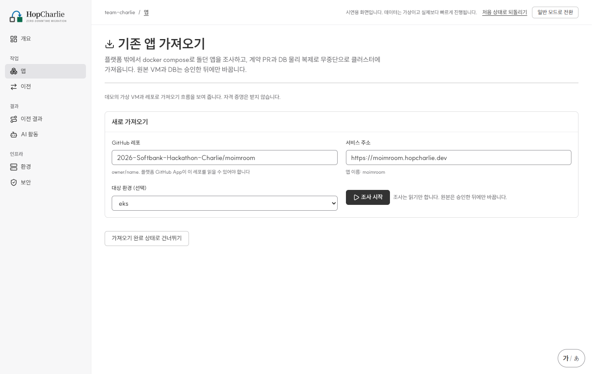 | 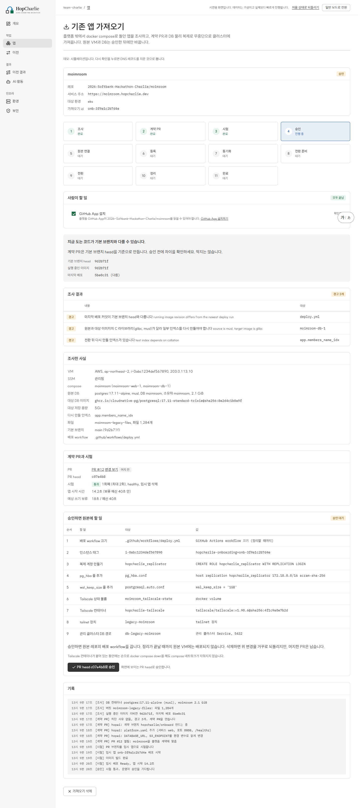 |
| **3. 동기화 (DNS 확인 전)** | **4. 전환 준비** |
| 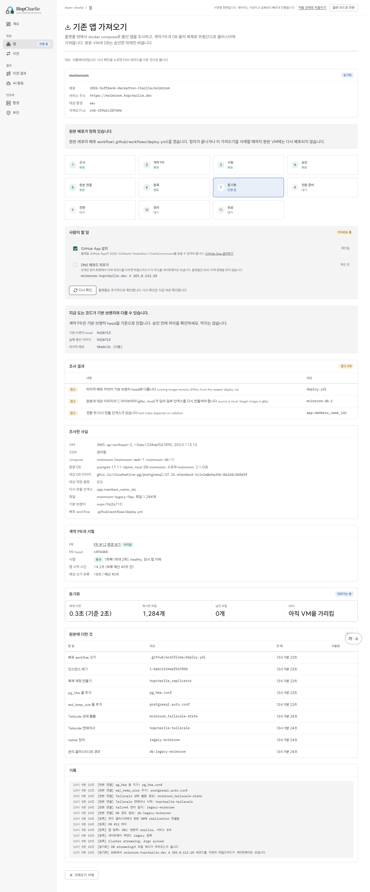 | 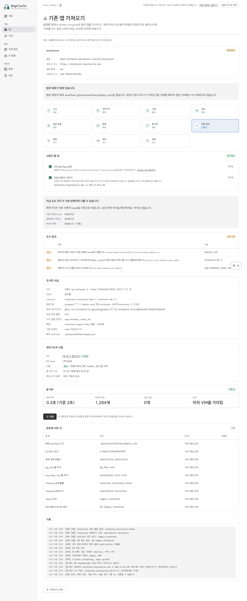 |

### 이전

**이전 목록과 앱 고르기:** 사이드 메뉴의 이전(`#migrate`)은 이전할 수 있는 앱을 표로 보여 줍니다. 일반 모드는 `GET /v1/apps` 중 환경이 있거나 배포 정보가 있는 앱 전부가 행이 되고(#108), 앱 하나만 보이지 않습니다. 열은 앱, 현재 위치(AWS, Google Cloud 로고나 온프레미스 서버 아이콘과 환경 이름, #89), 상태, 버튼입니다. 화면에 올라와 있는 앱(고른 앱)만 상태를 압니다. 나머지 앱은 위치 "미확인", 상태 "상태 미조회"로 두고 다른 앱의 승인·실행 상태를 복사해 보여 주지 않습니다(#108). 고른 앱의 상태 칩은 실행 중이면 그 상태, 아니면 "승인 대기", "리허설 중", "승인됨, 시작 전", "시작 전 검사에서 막힘", "AI 작업 중" 중 하나이고, 진행 중인 일이 없고 끝난 실행이 있으면 "최근 이전 성공, AWS EKS → GCP GKE, 3분 전"처럼 최근 결과를 보여 줍니다(성공, 실패, 정지, 원복됨, 중단됨을 이전 결과 화면과 같은 말과 색으로 구분, #82). 실행 기록이 없을 때만 "이전 전"입니다. 행 끝 버튼은 "이전 설정" 또는 "열기"이고 `#migrate-app?app=<이름>`으로 갑니다.

이전 화면(`#migrate-app`) 오른쪽 위의 **앱 고르기**로 앱을 바꿉니다. 고른 앱은 주소의 `?app=<이름>`에 남고, 앱 목록의 "이전" 버튼과 이전 목록 행도 같은 주소를 씁니다(#44 #46). 원본은 `GET /v1/traffic?app=<이름>`의 `writeBackend`(지금 쓰기를 받는 곳)이고, 읽지 못하면 DB를 처음 primary로 만든 환경이나 첫 환경을 쓰며 그 이유를 원본 칸 아래에 적습니다(#44). DB가 없는 앱은 게이트웨이가 답해야만 원본을 잡고, 답이 없으면 추정하지 않습니다(#91). 옮겨 갈 환경 후보는 `GET /v1/envs`와 앱의 환경 목록에서 만들고, 앱에 아직 추가하지 않은 환경에는 "(앱 환경 추가 필요)"를 붙여 앱 상세의 환경 추가로 안내합니다. 이 화면이 환경을 추가하거나 DB를 전환하지는 않습니다(#91). 구현은 `src/pages/Migrate.tsx`의 `MigrateList`, `AppPick`과 `src/data/migration.ts`의 `useLiveMigration`, `useSimMigration`입니다.

데모 모드는 같은 표에 moimroom과 DB가 없는 docker-doom 두 개만 나옵니다. 가져오기를 마치기 전에는 표 대신 안내와 "가져오기 완료 상태로 건너뛰기" 버튼이 나옵니다.

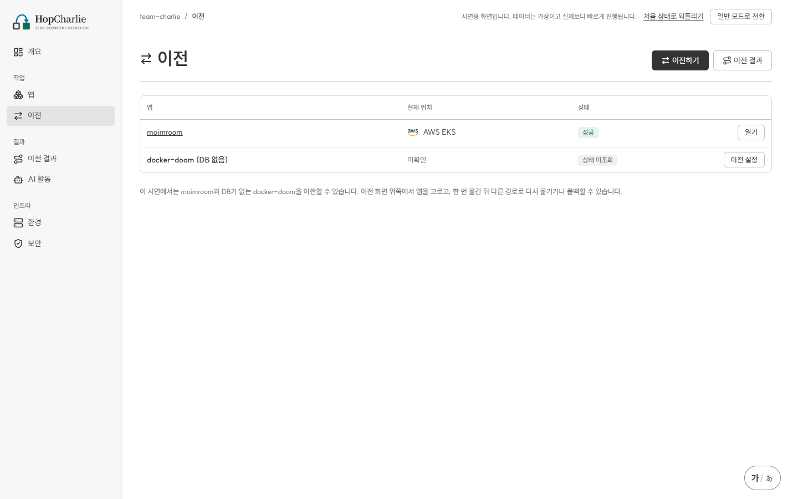

**설정:** 원본은 앱이 지금 쓰기를 받는 클러스터이고, 옮겨 갈 클러스터를 고릅니다. 설정 화면에는 원본, 옮겨 갈 환경, 쓰기 기록 설정(일반 모드), 계획 시작 버튼만 있고 지도는 없습니다. AI 실행이나 Plan 제출을 서버가 수락하면 설정이 사라지고 이주 지도가 열립니다.

**계획 시작 버튼:** 일반 모드에서 서버가 `GET /v1/ai-runs?app=`에 **답했을 때만** 주 버튼 **AI 계획·리허설 실행**과 보조 버튼 **AI 없이 Plan 작성**이 나옵니다(#37). 실행기가 없는 서버는 503, 예전 플랫폼은 404라 **Plan 작성** 버튼 하나와 안내만 나옵니다. AI 버튼은 `POST /v1/ai-runs`(`{app, source, target}`)로 AI 실행기(hopai) Job을 띄웁니다. 앱의 최근 실행(경로, 실행 중/끝남/실패, 요청한 사람, 시각)을 5초마다 한 줄로 보여 주고(`useAIRuns`, `AIRunLine`), 실행 중이면 버튼이 "AI 실행 중"으로 잠깁니다. 서버가 DB 없는 앱이라 409 `no_database`로 답하면 콘솔이 AI 없이 Plan 초안을 만들어 제출합니다(`draftAndSubmit`, `src/data/migration.ts`). 데모는 같은 버튼이 로컬 시나리오를 재현하고, **AI 없이 Plan 작성**은 이유와 함께 꺼 둡니다.

서버가 AI 실행이나 Plan 제출을 **수락한 뒤에야** 설정 화면이 사라지고 이주 지도가 열립니다. 요청이 거절되면 설정과 오류가 그대로 남아 다시 시도할 수 있고, 수락된 AI 실행이 실패하면 "설정으로 돌아가기"가 나옵니다(#99, `docs/adr/0009-migration-map-acceptance-and-progress.md`). 세션 기록이 올라오기 전에는 지도에 "AI 세션 기록 대기"(대상 클러스터 노드)와 "AI 실행 수락"(요약 칩)을 표시하고 조회나 복제 활동을 지어내지 않습니다.

- **시연용 moimroom-mig 열기**(#61): 일반 모드에서 `moimroom`에 GKE가 등록돼 있지 않고(EKS가 원본이면 온프레미스만 대상으로 나옴) 시연 앱 `moimroom-mig`에 EKS와 GKE가 모두 등록돼 있으면, "옮겨 갈 환경" 아래에 이 앱으로 바꾸는 버튼이 나옵니다(`gkeDemoApp`, `src/data/migration.ts`). 앱을 바꿀 때는 AI 계획 요청을 보내지 않습니다.
- **HyperDX에서 보기**(#66): 일반 모드의 이전 화면 머리글 오른쪽에 새 탭 링크가 있습니다. 앱 이름으로 최근 1시간 검색(`/search?where=…&whereLanguage=lucene&isLive=false&from=…&to=…`)을 열고, 시간 범위는 링크를 누르는 순간 계산합니다. 주소는 빌드 때 `VITE_HYPERDX_URL`로 주며 http(s)가 아니거나 비었으면 버튼이 없습니다. 데모는 앱이 어떤 로그에도 없어서 버튼을 두지 않습니다(`HeadActs`의 `v.live &&`). `src/components/HyperDXLink.tsx`.

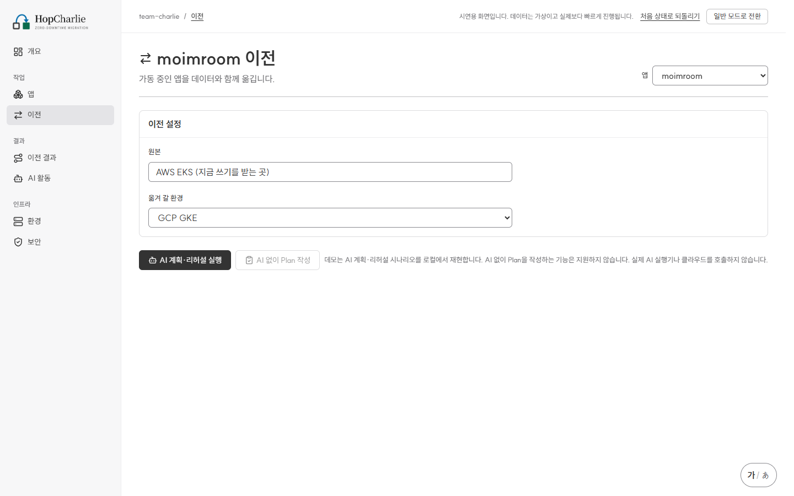

**쓰기 기록 수집(일반 모드):** DB가 있는 앱의 설정 화면에는 **앱 쓰기 기록 수집** 상자가 있습니다. 앱의 기록 스트림(`app-<앱 이름>`)을 `GET /v1/written-records/{stream}`으로 5초마다 읽어 기록 있음·없음, 현재 스트림의 전체 기록 수, 마지막 쓰기 기록 시각, 조회 오류와 재시도를 보여 줍니다(`src/components/WriteCollection.tsx`, #70). 이 숫자는 지금 스트림 전체이지 이전마다 고정한 검증 입력이 아닙니다. 시각은 기록에 담긴 시각 중 가장 최근 값이라 플랫폼 도착 시각이나 DB 커밋 완료 시각이 아닙니다. 수집 범위는 앱 DB 커밋 중 예약 생성이며, 클라이언트가 성공 응답을 받았다는 증명이나 수정·삭제는 포함하지 않습니다. 수집기가 지금 정상인지도 판단하지 않습니다(#70, `docs/adr/0004-written-records-evidence.md`). DB가 없는 앱에는 이 상자를 그리지 않고, 데모에는 없습니다.

**지난 시작 전 검사 기록(일반 모드):** Plan이 아직 화면에 없는 동안(AI가 계획을 만드는 중) 이주 지도의 "상세" 보기에 있는 동등성 검증, 레지던시 검증 카드는 이 앱의 가장 최근 시작이나 롤백 기록을 감사 로그에서 찾아 "지난 실행의 기록입니다 (실행 <runId>)"와 함께 보여 줍니다(#76). 감사 로그(`GET /v1/audit`)는 거절된 요청이 쌓여 시작 기록이 금방 밀리므로 한 쪽 200건씩 최대 5쪽까지 넘겨 찾습니다. 앱 판별은 기록의 runId, planRef, 롤백 원본 run을 이 앱의 run과 Plan에 맞춰서 하고, 다른 앱의 기록은 쓰지 않습니다(`src/data/preflight.ts`의 `searchAudit`, `latestPreflightOfApp`, `src/data/migration.ts`의 `usePastPreflight`). Plan이 화면에 있으면 그 Plan의 기록만 보여 주고 지난 기록을 섞지 않습니다. 데모는 지난 기록을 만들지 않습니다. 설정 화면의 "최근 실행"(AI 실행기 마지막 Job) 시각은 브라우저 언어와 상관없이 `ko-KR` 형식으로 씁니다(#78).

**AI 계획, 리허설, 승인:** 승인 화면은 왼쪽에 **AI가 바꾼 것**(values diff와 revision 변화)과 접힌 **확인한 내용**(AI 계획, 리허설 결과, 막힌 명령, 시작 전 검사)을 먼저 보여 줍니다. Plan 상세(`PlanRecord`: 원본과 대상 엔드포인트, 첨부, 엔진 Plan 원문)와 AI 세션 기록(계획, 리허설, 진단 세션의 도구 호출)은 접어 두었습니다. AI 수정안은 Plan 첨부로 올라가며 revision이 오릅니다. 오른쪽 **승인 카드**에는 경로, 파일, 실행 방식, 전환, 원복 설명과 "승인하고 시작", "반려"가 있고, 일반 모드에서는 여기서 읽기 카나리 단계, 전환 후 관찰과 자동 롤백을 고릅니다. 승인은 화면에 보이는 revision으로 보냅니다.

승인 화면의 구현과 데이터 흐름입니다(`src/pages/Migrate.tsx`의 `AiView`, `ApproveBox`, `FixBox`, `Checked`).

- **AI가 바꾼 것:** 데모는 values diff(`values-gke.yaml`의 StorageClass 변경)와 revision 변화를 보여 줍니다. 일반 모드는 AI가 올린 첨부를 `GET /v1/plans/{ref}/attachments/{name}`로 원본 바이트 그대로 받아 텍스트로 보여 주고(`<pre>`에 문자열로만 넣음), 받은 내용의 SHA-256을 Plan 기록의 `sha256`과 비교해 "SHA-256 일치" 또는 "SHA-256 불일치" 칩을 붙입니다. 불일치하면 승인 전에 Plan을 다시 확인하라고 경고합니다. 텍스트가 아닌 파일은 내용을 보여 주지 않고, 불러오지 못하면 오류를 보여 줍니다. revision이 바뀌면 다시 받습니다(`src/data/attachment.ts`의 `useAttachment`, #33). 브라우저가 해시를 계산할 수 없는 환경(보안 컨텍스트가 아닌 주소)에서는 일치 여부 칩이 나오지 않습니다. 긴 줄(예: 해시 64자)은 카드를 넓히지 않고 첨부 상자 안에서 가로로 스크롤됩니다(`.mg-attach`의 `min-width: 0; max-width: 100%`, #119).
- **확인한 내용:** 예전 "확인한 것"입니다. "Plan 상세"처럼 기본이 접힌 카드이고, 접힌 줄 오른쪽에 `AI 세션 N개, 막힌 명령 N건`이 보입니다(#119). 펼치면 AI 계획, 리허설(실패 횟수, 수정안 첨부), 막힌 명령(목록은 펼쳐진 채로), 시작 전 검사 네 줄입니다. 일반 모드는 화면에 고른 세션 하나만 SSE로 받고, 나머지 세션은 `GET /v1/agent/sessions/{id}/events`로 저장된 이벤트를 읽어 막힌 명령과 도구 호출 수가 모든 세션을 포함합니다. 목록 폴링에서 이벤트 수나 상태가 바뀌면 마지막 seq 이후만 이어서 읽고, 읽기가 실패해도 계속 다시 시도하지 않으며, 못 받은 세션이 있으면 숫자가 실제보다 적을 수 있다고 알립니다(`useStoredSessionEvents`, #33). 리허설 이벤트의 원문 줄은 `대상 Plan: <planId> (<planRef>)`, `예상대로 허용됨: <명령>`처럼 읽기 쉽게 바꿔 씁니다(`src/components/agent.tsx`의 `eventText`, #79). 모델을 부르지 않은 세션(샌드박스 리허설)의 토큰은 "0 / 0" 대신 "-"입니다(#78).
- **승인 카드:** 경로, 파일, 실행 방식, 전환, 원복 설명과 읽기 카나리, 전환 후 관찰 선택이 있고(기존), 맨 위에 **쓰기 누락 검증** 칩이 있습니다. Plan 요약의 `writtenRecordsConfigured`로 "쓰기 기록 연결됨", "쓰기 기록 미연결", "쓰기 검증 설정 미확인" 중 하나를 보여 줍니다. 미연결이면 이대로 시작하면 쓰기 누락이 미측정으로 남는다고 알리고, 수집을 켜고 기록을 받은 뒤 새 Plan을 쓰라고 안내합니다. 연결됨도 "측정 완료"로 보지 않으며, 서버가 필드를 주지 않으면(구버전, 과거 요약) 미확인으로 둡니다. 승인한 뒤 시작하지 못해 다시 시작하는 카드(`StartAgainBox`)에도 같은 칩이 있습니다(`src/components/WriteVerification.tsx`의 `PlanWriteVerification`, #81). 데모는 이 값이 없어 "쓰기 검증 설정 미확인"으로 나옵니다.
- **DB 없는 앱:** AI 계획·리허설 버튼 없이 "Plan 작성" 버튼만 있고, 플랫폼의 AI 없는 초안(`POST /v1/plans/draft` 후 제출)을 씁니다. 승인 화면에서는 "AI가 바꾼 것"과 "AI 세션 기록"이 없고, "확인한 내용"(`CheckedNoDB`)은 Plan 작성과 시작 전 검사 두 줄만 있으며, 원본과 대상이 `env / namespace (DB 없음)`, 쓰기 보류 상한은 없고 전환 설명은 승격 없이 쓰기 트래픽만 옮긴다는 문장입니다(#80). 데모의 docker-doom이 이 경우입니다. 앱이 DB가 없는지는 앱의 `resources`, 없으면 Plan·run 엔드포인트의 `kind: "none"`으로 판단하고 정보가 없으면 DB와 파일이 모두 있는 것으로 봅니다(`src/data/migration.ts`의 `resourcesOf`, `ALL_RESOURCES`).

**승인 불가와 리허설 중:** 플랫폼은 리허설을 통과하지 않은 AI 계획의 승인을 막고(409 `rehearsal_required`) `PlanRecord.rehearsal`에 이유를 남깁니다. 콘솔은 그 값으로 보여 주기만 합니다(#35). 이때 승인 카드는 "승인하고 시작" 대신 **승인 불가** 칩, 플랫폼이 준 이유, **AI로 다시 계획·리허설**과 **반려** 버튼을 보여 주고, 지도는 [승인 ✓]를 빼고 배너에 이유를 적습니다(`approvalBlock`, `BlockedApproveBox`). `approve()`는 눌려도 요청하지 않고 이유를 알립니다. 이 앱의 최신 AI 실행이 아직 돌고 있으면 같은 자리를 **리허설 중**으로 바꿉니다. AI 실행기가 Plan을 먼저 내고 1~2분 뒤에 리포트를 올리므로 리포트가 없다는 이유로 실패로 오해하지 않게 한 것입니다(#49, `rehearsing`). 실행이 끝났는데 리포트가 없거나 리허설이 실패했으면 "승인 불가"입니다. `rehearsal` 정보가 없는 Plan(사람이 쓴 Plan, 예전 플랫폼)과 데모의 시뮬레이션 Plan은 이 막힘이 없습니다.

**다른 곳에서 시작한 일 따라가기:**
- 한 브라우저에서 승인 대기 Plan을 보는 동안 다른 브라우저나 CLI가 그 Plan을 승인해 시작하면, 실행 목록(5초 폴링)에서 `planRef`가 같은 run을 찾아 그 run의 SSE(`useRun`)를 엽니다. 이전에는 트래픽 비율만 바뀌고 단계와 숫자가 멈춰 있었습니다(#82, `src/data/migration.ts`, `src/data/migrationFollow.test.tsx`).
- AI 계획 세션이 끝난 뒤 Plan을 잡을 때는 **이 앱의 namespace에 닿는** 승인 대기 Plan만 고릅니다. 다른 운영자가 그사이 낸 다른 앱의 Plan을 이 화면에 끌어오지 않습니다(#92). 수락된 AI 실행은 앱, 원본, 대상 환경이 같고 수락 뒤에 제출된 Plan만 연결합니다(`planFromAIRun`). `AIRun`에 `planRef`가 없어서 같은 방향의 동시 요청은 완전히 구분하지 못합니다(#99).
- 운영자가 "다른 경로로 이전"으로 떠난 halted run은 다시 잡지 않습니다(`dismissed`). 새로고침 뒤에는 가장 최근 run이 halted면 다시 잡습니다(#39).

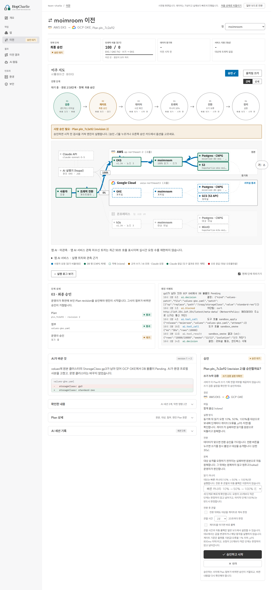

접힌 카드를 모두 펼친 승인 화면입니다.

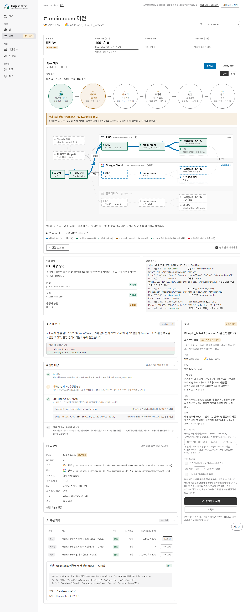

DB가 없는 앱(데모의 docker-doom)은 지도에 DB 노드가 없고, 확인한 내용이 Plan 작성과 시작 전 검사 두 줄입니다.

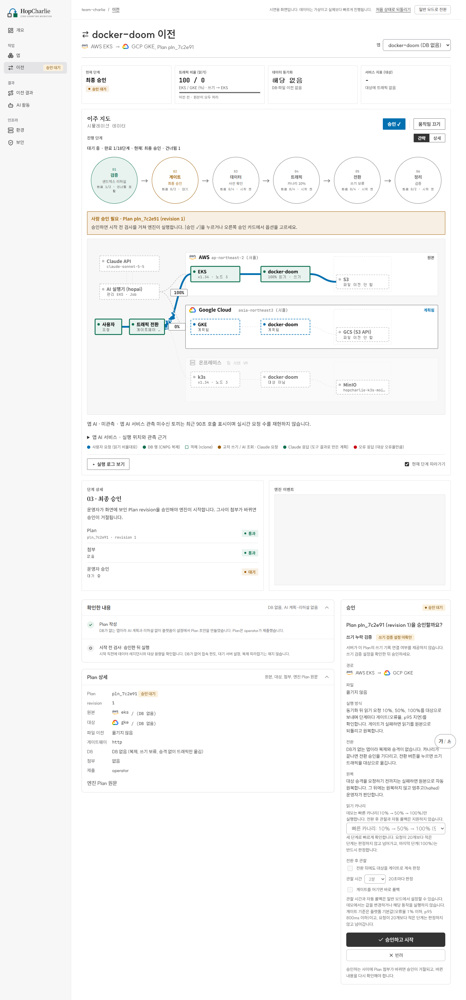

**이주 지도:** 설정을 넘어가면(AI 실행 수락이나 Plan 제출 뒤) 머리글 아래에 이주 지도가 열리고, AI 계획, 리허설, 승인, 실행, 완료까지 같은 지도 하나로 이어집니다. 화면은 지도 요소를 `key="map"`으로 고정해서 중간에 다시 불러오지 않습니다(`MigrateView`의 `page()`). 구성은 다음과 같습니다.

- **요약 4칸:** 현재 단계(상태 칩), 트래픽 비율(읽기, 원본/대상 %와 쓰기 대상, 출처는 "게이트웨이 실시간", "run 기록 기준", "이전 전"), 데이터 동기화(초기 복사, 복제 지연 바이트, 파일 rclone), 서비스 지표(대상 오류율과 p95, 게이트 1%, 800ms).
- **진행 단계:** 큰 원 6개와 상세 18개 단계 카드는 아래 **실행**에서 설명합니다.
- **지도 그림:** AWS, Google Cloud, 온프레미스 3개 레인(`ENV_ORDER`)이고, 원본과 대상 레인만 켜지고 나머지는 흐립니다. 레인마다 클러스터, 앱, Postgres · CNPG, 파일 저장소 노드가 있고, 왼쪽에 사용자와 트래픽 전환(게이트웨이)이, 레인 사이에 읽기 비율 배지(%)가 있습니다. 오른쪽의 동기화 파이프는 초기 복사와 변경분 복제를, 주황 점선은 전환 전 원본으로 가는 교차 쓰기를 나타냅니다. 노드 테두리는 회색 점선(대기), 파랑 점선(계획), 주황(진행), 초록(준비, 운영), 점선(보존), 빨강(문제)입니다.
- **머리글 버튼:** 그 순간 상태가 허락하는 명령만 나옵니다. 승인 ✓(승인 대기 Plan) 또는 다시 시작(승인됐지만 시작 전), 전환(`awaiting_switch`), 중단(승격 요청 전까지), 이어서 실행(failed, aborted, interrupted, **halted**), 롤백(성공한 run), 다른 경로로 이전(끝난 뒤). 이어서 실행은 operator 세션에만 보이고, 롤백은 원본 보존 상태를 읽지 못했거나 원본 정리가 시작됐으면 숨깁니다(`canResume`, `canRollback`). 버튼은 화면의 다른 동작(`v.approve()` 등)과 같은 함수를 부르고 권한 검사는 백엔드가 합니다.
- **실행 로그 보기:** 왼쪽에 그룹별 단계 목록과 소요 시간, 오른쪽에 그 단계의 로그가 있고 "현재 단계 따라가기"로 지금 단계를 따라갑니다. 로그 칸은 왼쪽 목록과 같은 높이까지 늘어나고(최소 320px) 넘치면 칸 안에서 스크롤합니다(#63). 단계 이름은 칸 안에서 줄을 바꿔 옆 단계와 겹치지 않습니다(#64, 지금은 #99의 단계 카드 규칙 `.steps .nm`). 아래에는 **단계 상세**(설명과 증거 항목)와 **엔진 이벤트**(AI 세션과 run 이벤트 시간순, 최근 120개)가 있습니다.

**입자: 토끼와 당근**(#42, #68, #69): 선을 따라 흐르는 점이 토끼와 당근입니다. 색의 뜻은 범례 그대로입니다.

| 모양과 색 | 뜻 |
| --- | --- |
| 파랑 토끼 | 사용자 요청(읽기 비율대로) |
| 빨강 토끼 | 오류 응답(대상 오류율만큼) |
| 초록 토끼 | DB 행 복제, Claude 응답(도구 결과로 만든 계획) |
| 주황 토끼 | AI 조회, 샌드박스 리허설, Claude 요청, 교차 쓰기 |
| 속이 빈 초록 당근 | 파일(rclone) 복제 |

토끼는 선이 가는 쪽을 보고(왼쪽으로 가면 좌우 반전) 선의 기울기(±35도)에 맞춰 기울며 뜁니다. 한 번 뛸 때마다 길이(선 위 45~130)와 높이를 새로 뽑고(대개 3~9, 약 22%는 14~24의 큰 점프), 토끼마다 빠르기(선 속도의 0.5~1.7배)가 다르며 한 번 뛸 때마다 0.6~1.6배를 다시 곱합니다. 뛰는 중간에서 시작해 박자가 겹치지 않습니다. 당근은 뛰지 않습니다. 값은 `public/migration-map-live.html`의 `HOP_LEN`, `HOP_LOW`, `HOP_HIGH`, `LEAP`, `PACE`, `HOP_PACE`입니다. 토끼 수는 실제 요청 수가 아니라 비율을 보여 주는 모양입니다. 움직임은 OS의 동작 줄이기 설정을 따르고, 지도의 "움직임 끄기/켜기"로 바꿉니다(localStorage `hc.motion`). 끄거나 상태 스트림이 끊기면 입자를 만들지 않습니다.

**AI 노드: AI 실행기(hopai)와 Claude API**(#71, #73, #74): 클라우드 상자 밖 왼쪽에 두 노드가 있습니다. hopai는 관리 EKS에서 Job으로 돕니다.
- AI 계획 단계: Claude 노드가 "도구 호출 요청 → 계획", hopai가 "클러스터 읽기 전용 조회"로 켜지고, 두 클러스터로 읽기 전용 조회(주황 토끼), hopai와 Claude 사이로 요청(주황)과 응답(초록)이 오갑니다. 샌드박스 리허설 단계는 hopai가 "샌드박스 리허설"로 켜지고 **대상** 클러스터로만 조회가 나갑니다(`MapSnapshot.activity`).
- 평소 문구: 일반 모드는 최근 60분의 실제 숫자입니다. Claude 노드는 `2회 · 15k/2.6k 토큰`(모델 호출 수, 입력/출력 토큰), hopai 노드는 `실행 15종 · 차단 9`(실행한 단계의 종류 수, 샌드박스가 일부러 막은 점검 수)이고, 활동이 없으면 "최근 60분 호출 없음", "최근 60분 실행 없음"입니다. 마우스를 올리면 모델 이름, 정확한 토큰 수, 리허설 횟수, 마지막 시각이 나옵니다.
- 출처: `GET /v1/ai-activity?minutes=60`(관측 로그의 hopai 기록)을 10초마다 읽습니다(`useAIActivity`, `aiFacts`). 502나 503이면 숫자를 빼고 기본 문구("claude-sonnet-5-5", "관리 EKS · Job")로 돌아가며 0으로 보이지 않습니다. **데모는 이 숫자를 보여 주지 않습니다**(가상 데이터에 진짜처럼 보이는 숫자를 넣지 않음). 숫자는 최근 60분 전체이고 특정 run에 묶여 있지 않으며, "실행 N종"에는 모델이 요청한 읽기 도구 외에 샌드박스와 리허설 엔진 단계가 들어 있습니다(#73).
- 노드 안 둘째 줄은 글자 수가 아니라 너비로 자르고(한글 10.5px, 영문과 숫자 6.3px 근사) 넘으면 `…`로 끝냅니다. 전체 문구는 툴팁에 있습니다(#74, `fitSub`).

**앱 AI 서비스**(#109): 이전하는 앱이 실제로 쓰는 모델의 실행 위치와 호출 경로를 hopai의 계획과 따로 그립니다(`docs/adr/0012-ai-service-map-provenance.md`). 호출하는 앱이 있는 환경과 모델이 실행되는 곳을 나눠서, 직접 실행(GPU 증거가 있을 때만 GPU 아이콘, 아니면 CPU나 미확인), 클라우드 관리형 AI, 클러스터 밖 외부 API("외부 AI API · 클러스터 밖" 상자), 위치 미확인("환경을 추정하지 않음" 상자)을 다른 카드로 놓습니다. 최근 90초 안에 양수 호출이 관측된 경로에만 파랑 토끼가 나오고, 유휴, 오래된 관측, 조회 오류에서는 멈추며 실제 RPS를 재현하지 않습니다. 위치별 카드는 최대 4개이고 초과는 "추가 AI 서비스 N개" 카드로 묶습니다. 지도 아래 한 줄 요약(관측됨, 오래된 관측, 미관측, 조회 오류, 미연결)과 접힌 목록 "앱 AI 서비스 · 실행 위치와 관측 근거"에 서비스별 근거를 모두 둡니다. 이 서비스가 있으면 지도가 가로(최소 1280px)와 세로로 늘어납니다. 출처는 `GET /v1/apps/{name}/ai-services?minutes=5`(10초마다, `useAppAIServices`)이고 응답 모양이 다르면 502 `invalid_ai_service_topology`로 처리합니다(`getAppAIServices`, `isAIServiceTopology`). **데모는 이 조회를 하지 않아** "앱 AI · 미관측 · 앱 AI 서비스 관측 미수신"으로 나옵니다.

**상세 보기의 검증 카드**(#52, #65, #86): "상세"를 누르면 동등성 검증과 레지던시 검증 카드가 목적, 검사 항목, 판정, 근거로 나뉘어 나옵니다. 카드는 `snap.validations`로 오고 iframe은 `textContent`로만 그립니다.
- **동등성:** 인증·권한, 시크릿, 감사 로그, 모니터링·알림, 백업·복구를 비교합니다. 판정은 플랫폼이 시작 요청(`POST /v1/migrations`) 감사 기록의 `parity`에 남긴 결과를 읽어(`listAudit`, `preflightOf`의 `parityPart`) 통과, 불일치, 확인 불가, 참고, 검사 안 함으로 표시하고, 항목별 결과와 설정 digest를 근거로 보여 줍니다. 기록 전용이라 시작을 막지 않습니다. 기록이 없으면 "결과 미수신"이며 이전 완료나 리허설 성공에서 통과를 추론하지 않습니다(`src/data/preflight.ts`). 시작이 거부된 기록과 롤백 기록은 검사하지 않았다고 밝힙니다. 데모의 시작 전 검사 기록(`simPreflight`)에는 `parity`가 없어서 "결과 미수신"입니다.
- **레지던시:** 허용, 차단, 확인 불가, 참고, 검사 안 함, 검사 기록 없음을 구분하고 검사 시각과 정책 digest를 보여 줍니다. 기록 없음은 허용이 아닙니다.
- **데이터 검증 근거**(#86): run이 검증 단계에서 `engine.steps.verify.evidence.report`를 남기면 완료 상태의 대상 DB 노드 둘째 줄이 `테이블 5개 · 누락 0`으로(빠진 행이 있으면 빨강, 테이블 오류는 `테이블 검증 오류 N개`), 대상 파일 노드가 `파일 634개 일치`로(차이가 있으면 `파일 차이 N개`) 바뀝니다(`runNodes`). 지금 엔진은 `tables`를 비워 보내므로 실서버는 DB 줄이 기존 문구로 남고 파일 줄만 바뀝니다.

**멈춘 run과 대상 앱 시작**(#39): 대상 승격 뒤 멈춘 `halted` run에는 이어서 실행 버튼이 나오고, 성공하면 `useRun(runId, epoch)`의 epoch를 올려 닫힌 SSE를 다시 엽니다(`src/api/hooks.ts`). halted는 롤백으로 그리지 않고 DB 역할을 "역할 확인 필요"로 둡니다. 엔진에 `switchover`와 `cutover` 사이 단계 `start-target`(대상 앱 시작: 콜드 모드에서 대상 앱을 띄우고 웜 모드는 할 일 없이 통과)이 생겼습니다. 이 단계가 생기기 전의 run은 지도에서 "건너뜀"입니다(`mapSteps`, `src/data/migrationMap.ts`). 트래픽은 앱별 게이트웨이 범위로 읽습니다(`GET /v1/traffic?window=30s&app=<앱>`, 2초마다).

**세 번째 환경**(#75): DB 복제 그룹의 세 환경 표시와 환경 추가 제한은 앱 상세(`src/pages/Apps.tsx`)와 `dbRoles`(`src/data/migration.ts`)의 변경이고, 이주 지도 코드는 바뀌지 않았습니다. 지도는 처음부터 3개 레인을 그립니다.

**지도가 쓰는 데이터**(일반 모드는 `LiveFrame`, 데모는 `MapFrame`에 시뮬레이션 상태만):
부모(`src/components/MigrationMapFrame.tsx`)가 `buildMapSnapshot(v, ctx)`(`src/data/mapSnapshot.ts`)로 스냅샷을 만들어 같은 출처 iframe(`public/migration-map-live.html`)에 `postMessage`로 보내고(`hc-snapshot`), iframe은 그리기만 합니다. 지도 → 부모는 `hc-ready`, `hc-height`, `hc-cmd`이고, 양쪽 모두 출처와 상대 창을 확인합니다. `hc-cmd`는 그 순간 스냅샷이 제시한 명령이고 `busy`가 아닐 때, 다음 스냅샷이 올 때까지 한 번만 실행합니다. 모르는 값은 0으로 채우지 않습니다(게이트웨이 정보가 없으면 읽기 비율은 `? / ?`). 설계 결정은 `docs/adr/0001-state-driven-migration-map-iframe.md`(대체됨), `0002-migration-map-validation-details.md`, `0009-migration-map-acceptance-and-progress.md`, `0012-ai-service-map-provenance.md`에 있습니다.

| AI 계획 단계 | 샌드박스 리허설 단계 |
| --- | --- |
| 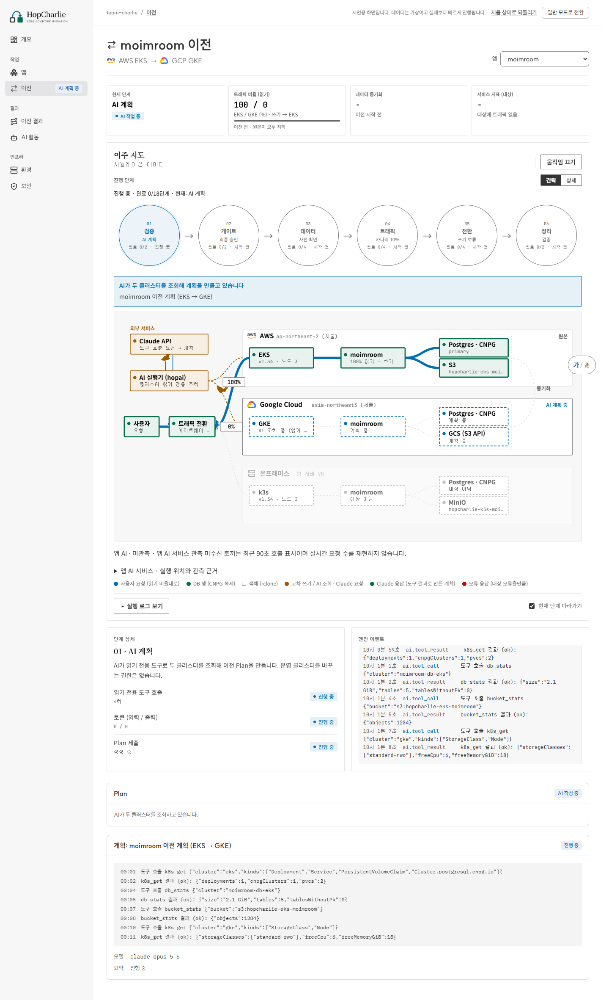 | 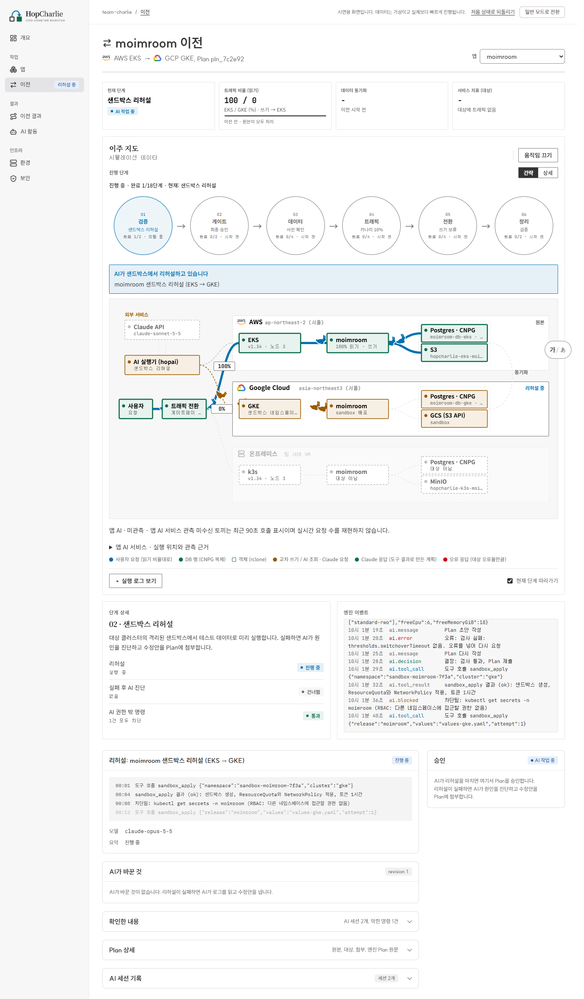 |
| **상세 보기 (18개 단계 카드, 동등성·레지던시 검증 카드)** | |
| 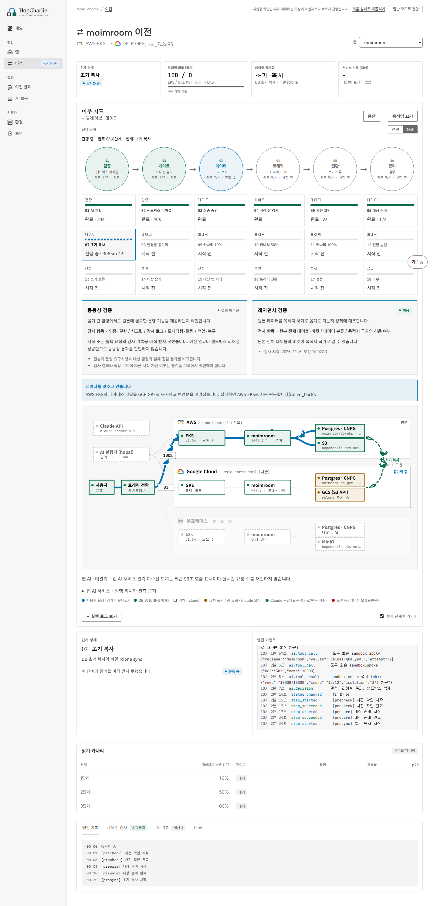 | |

**실행:** 승인하면 같은 화면이 실행 화면으로 이어집니다. 위에서 아래로 다음이 있습니다.

1. 화면 머리: `<앱> 이전`, 경로와 run ID, 앱 고르기. 성공하거나 정지(`halted`)한 run에는 그 아래에 **전환 판단** 패널이, 성공한 run에는 **완료 영상 보기** 버튼이 붙습니다(완료 화면 소절).
2. **이주 지도**(`src/components/MigrationMapFrame.tsx`, `public/migration-map-live.html`): 맨 위 요약 카드 4개(현재 단계와 상태 칩, 트래픽 비율(읽기), 데이터 동기화, 서비스 지표(대상))와 그 아래 지도 카드입니다. 지도 카드 오른쪽 위에 지금 상태가 허용하는 명령 버튼이 있습니다: 승인 ✓(또는 다시 시작), 전환, 중단, 이어서 실행, 롤백, 다른 경로로 이전. 그 아래 **진행 단계**, 지도, 앱 AI 서비스 접힘, 범례, "실행 로그 보기", 단계 상세와 엔진 이벤트가 이어집니다.
3. 지도 아래 기록 카드: 시작 전 검사가 막혔을 때만 그 이유 카드, 전환 후 관찰(켠 경우), 끝난 뒤에는 이전 리포트·데이터 검증·원본 보존·구간별 시간, 읽기 카나리 표, 맨 아래 탭(엔진 기록, 시작 전 검사, AI 기록, Plan)입니다(`RunView`, `RunRecords`).

**진행 단계(간략):** 큰 원 6개와 화살표입니다. 원 안에 번호, 이름, 지금(끝났으면 마지막) 내부 단계, `완료 n/m · 상태`를 함께 두고(#111 #113), 위에 `진행 중 · 완료 6/18단계 · 현재: 초기 복사` 같은 한 줄 요약이 있습니다. 완료는 초록, 진행 중은 파랑, 승인 대기·판단 보류는 주황, 실패는 빨강, 아직 안 한 것은 회색입니다. 시간으로 계산한 진행률은 만들지 않고 엔진이 기록한 완료 단계 수만 셉니다. 현재 진행 중이거나 승인을 기다리는 원만 맥동하고, 끝난 run, 연결이 끊긴 상태, 지도의 "움직임 끄기"와 OS의 동작 줄이기에서는 멈춥니다. 긴 문구는 두 줄까지만 보이고 전체는 원의 `title`과 접근성 이름에 있습니다(`docs/adr/0013-migration-progress-result-density.md`). "상세"를 누르면 내부 단계 막대와 동등성·레지던시 검증 설명이 펼쳐지고, 고른 보기는 브라우저 localStorage `hc.stepView`에 남습니다.

| 원 | 내부 단계 (기본 카나리 3단계, 전환 후 관찰 끔 = 18단계) |
| --- | --- |
| 검증 | AI 계획, 샌드박스 리허설 |
| 게이트 | 최종 승인, 시작 전 검사 |
| 데이터 | 사전 확인, 대상 준비, 초기 복사, 변경분 동기화 |
| 트래픽 | 카나리 10%, 50%, 100%, 전환 승인 |
| 전환 | 쓰기 보류, 대상 승격, 대상 앱 시작, 트래픽 전환 |
| 정리 | 검증, 마무리 (전환 후 관찰을 켜면 "전환 후 관찰" 추가) |

점진 카나리(7단계)를 고르면 트래픽 원의 단계가 늘어납니다(`src/data/mapSnapshot.ts`의 `phasesOf`).

**데이터 출처:** 일반 모드의 요약 카드와 지도의 트래픽은 앱별 게이트웨이(`GET /v1/traffic?app=<앱>&window=30s`, 2초마다)에서 읽습니다. 기본 게이트웨이를 읽으면 실제와 다른 쓰기 대상이 나오기 때문입니다(#77). 환경은 `GET /v1/envs` 30초, 앱은 `GET /v1/apps/{이름}` 15초, 앱 AI 호출 수는 10초마다 읽습니다. run 자체는 `GET /v1/migrations/{runId}/events` SSE(`useRun`)입니다. 화면에 올라온 Plan이 다른 곳(다른 브라우저, CLI)에서 시작되면 실행 목록에서 같은 `planRef`의 run을 찾아 따라가므로 단계와 요약이 멈추지 않습니다(#82). 데모는 같은 화면을 시뮬레이션 상태(`src/sim/mig.ts`)로 그리고, 전환 후 관찰과 자동 롤백, 원본 정리, 지난 검사 기록은 없습니다. 엔진 단계는 10개(사전 확인, 대상 준비, 초기 복사, 변경분 동기화, 쓰기 보류, 대상 승격, 대상 앱 시작, 트래픽 전환, 검증, 마무리)입니다(`src/sim/mig.ts`의 `ENGINE_STEPS`).

읽기 카나리는 기본이 10%, 50%, 100%를 5초씩이고, 승인할 때 1%, 10%, 25%, 50%, 75%, 90%, 100%를 10초씩 하는 점진 카나리를 고를 수 있습니다. 단계마다 게이트를 확인하고, 요청이 모자란 단계는 판단 보류로 넘어갑니다. 카나리는 플랫폼 게이트웨이(http)를 거치는 Plan에서만 합니다. 데이터가 맞으면 **전환 승인 대기**(`awaiting_switch`)에서 운영자가 전환을 누릅니다. 승인할 때 전환 후 관찰을 켰으면, 전환 뒤에도 정한 시간 동안 대상을 게이트로 판정하고 위반하면 기록하거나 자동 롤백합니다(실제 API 모드).

**카나리 판정 표기:** 단계마다 세 가지로 나눕니다. 통과, 판단 보류(대상에 닿은 요청이 20건보다 적어 판정하지 않고 다음 단계로 넘어감), 실패입니다. 판단 보류를 실패로 보지 않습니다. 플랫폼은 마지막 단계만 요청 부족으로 실패시킵니다. 읽기 카나리 표, 전환 안내 문장, 전환 판단 패널은 같은 요약 함수(`src/data/canaryVerdict.ts`의 `canaryVerdict`)를 써서 "게이트 모두 통과", "통과 2단계 · 판단 보류 1단계", "게이트 실패" 중 하나로 같게 말합니다(#97). 일반 모드는 실시간으로 받은 `gate_result` 이벤트의 `verdict`를 단계에 저장해 run을 다시 받기 전에도 판단 보류가 빨강으로 보이지 않습니다(`src/api/hooks.ts`, #58). 지도에서는 판단 보류 단계가 경고색(주황) "판단 보류" 표시이고 원의 상태에 "판단 보류 포함"이 붙으며, 표의 단계 칩은 회색 "판단 보류: 요청 부족, 다음 단계로"입니다. 전환 승인은 `awaiting_switch`일 때 별도 "전환 승인 가능" 칩으로 알립니다(#97). 카나리 표와 전환 후 관찰 표의 p95는 정수 ms로 반올림해 씁니다(#86).

| 동기화 (초기 복사) | 전환 승인 대기 (통과 2단계, 판단 보류 1단계) |
| --- | --- |
| 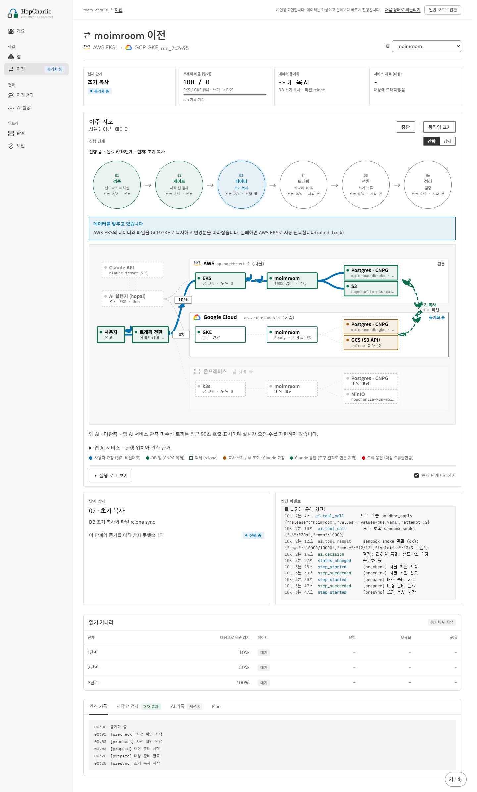 | 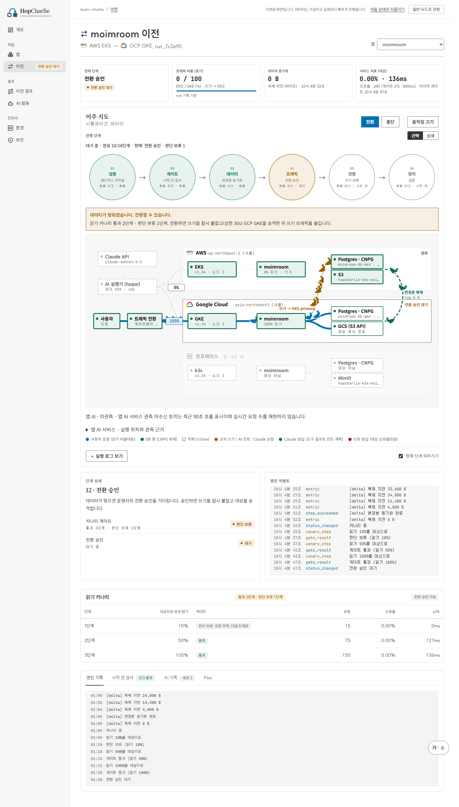 |
| **완료 영상 팝업** | **이전 완료** |
|  | 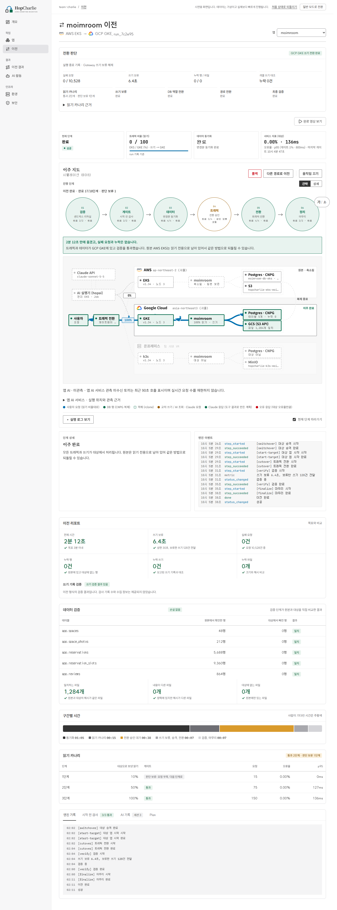 |

이전이 끝나면 화면 맨 위(지도 위)에 **전환 판단**, 지도 아래에 리포트 카드들이 나옵니다. 지도의 진행 원은 끝난 뒤에도 남아 `이전 완료 · 완료 17/18단계 · 판단 보류 1`처럼 요약하고, 성공한 이전은 지도의 **롤백**(1-click, 반대 방향의 새 run)으로 되돌립니다. 지도 오른쪽 위의 "다른 경로로 이전"은 화면을 설정으로 되돌립니다.

- **전환 판단**(`src/components/RunDecisionPanel.tsx`, #90): run 기록만으로 계산하는 읽기 전용 패널이고 성공이나 정지한 run에서만 나옵니다. 머리 칩은 "GCP GKE 쓰기 전환 완료", "전환 후 관찰 위반", "쓰기 전환 확인 필요", 정지면 "DB 역할 전환에서 중단"입니다. 성공이면 실패 요청(n / 전체), 쓰기 보류 시간, 누락 행 / 파일, 개별 쓰기 대조(미설정, 미측정, 누락 n건) 네 칸을, 정지면 종료 시 Gateway 기록, 대상 경로 전환, 현재 DB primary("실시간 확인 필요"), 실패 요청을 보여 줍니다. 다음 줄에 읽기 카나리, 쓰기 보류, DB 역할 전환, 경로 전환, 최종 검증의 상태(완료, 실패, 미실행, 기록 없음)가 있고, 읽기 카나리 근거(요청, 오류율, p95)는 접혀 있습니다. 정지한 run에는 "재개·원복 전 확인" 세 항목(실제 CNPG primary, Gateway 쓰기 대상과 보류 상태, WAL 재생 위치)을 보여 주고, 원본 강등 토큰 대기 시간 초과로 멈췄으면 그 원인을 따로 적습니다. 요청 수가 음수이거나 실패가 전체보다 크면 이 패널과 리포트, 이전 결과 카드 모두 "집계 이상"으로 씁니다(`invalidRequestCounts`).
- **이전 리포트**(`ResultBox`): 전체 시간, 쓰기 보류, 실패 요청, 누락 행, 누락 쓰기, 누락 파일을 목표와 비교합니다(전체 시간 목표 3분). 측정하지 못한 값은 0이 아니라 "측정 안 됨"입니다. 누락 쓰기는 이번 이전에 고정된 쓰기 기록의 검사 기록이 1건 이상일 때만 숫자를 보여 주고, 아니면 "측정 안 됨"입니다(`measuredWriteMissing`, #70). 그 아래 **쓰기 기록 검증**(`src/components/WriteVerification.tsx`)은 상태 칩(쓰기 기록 미연결, 수집 기록 없음, 쓰기 검증 미실행, 쓰기 검증 오류, 쓰기 누락 발견, 쓰기 검증 완료, 쓰기 검증 확인 필요, 이전 형식이면 쓰기 검증 결과 있음, 정보가 없으면 쓰기 검증 정보 없음)과 이유 한 줄을 보여 줍니다. 쓰기 기록이 연결된 run은 검증 입력 기록, 검사 기록, 쓰기 누락, 입력의 마지막 쓰기 기록 시각 네 칸과 기록 스트림 이름, 검사 범위(앱 DB 커밋 기준, 예약 생성 기록)를 더하고, 미연결이면 숫자 줄 없이 칩과 이유만 보여 줍니다(#70 #78 #81). 데이터는 run 기록의 `RunResult.writeVerification`이고 데모는 이전 형식(`missingWrites`만 있음)이라 "쓰기 검증 결과 있음"으로 나옵니다.
- **데이터 검증**(`VerifyBox`, `src/data/verifyReport.ts`, #86): 검증 단계가 원본과 대상을 직접 비교한 결과(`engine.steps.verify.evidence.report`)입니다. 테이블별 표(원본에서 확인한 행, 대상에서 빠진 행, 결과: 일치, 누락 있음, 건너뜀, 오류)와 파일 칸 3개(일치하는 파일, 내용이 다른 파일, 대상에 없는 파일), 머리의 "손실 없음" 또는 "차이 있음" 칩입니다. 검증이 성공하지 않았거나 원복된 run의 근거는 보여 주지 않습니다(`verifiedReportOf`). 지도에서는 대상 DB 노드가 `테이블 5개 · 누락 0`, 대상 파일 저장소가 `파일 1,284개 일치`로 바뀝니다(`mapSnapshot.ts`).
- **원본 보존 및 자동 정리**(일반 모드, `src/components/SourceRetention.tsx`, #60): 끝난 run마다 서버의 정리 예약(`GET /v1/migrations/{runId}/retention`, 15초마다)을 보여 줍니다. 상태는 이전 완료 대기, 정리 예약, 정리 보류, 정리 진행 중, 원본 DB 정리 완료, 자동 정리 취소, 예약 없음이고, 정리 예정 시각과 보류 이유를 적습니다. 정리가 시작되면 즉시 역방향 롤백할 수 없고 PVC·백업·공유 클러스터는 자동 삭제하지 않는다고 알립니다. operator에게만 **보존 24시간 연장**, **원본 계속 보존**(`POST …/retention`)이 보이며 처리 중, 조회 오류 중, 삭제 시작 뒤에는 막고 권한과 시각은 서버가 다시 검사합니다. 조회에 실패하면 마지막 받은 상태임을 밝히고 성공으로 바꾸지 않습니다. 브라우저가 삭제를 실행하거나 예약을 만들지 않으며, 데모에는 가짜 정리 상태를 넣지 않았습니다(`docs/adr/0003-source-retention-controls.md`).
- **구간별 시간**은 동기화, 읽기 카나리, 전환 승인 대기(주황), 쓰기 보류·승격·전환, 검증·마무리, 전환 후 관찰입니다.
- **완료 영상**(`src/components/CompletionVideo.tsx`, #122): 화면에 올라와 있던 run이 `succeeded`로 바뀌는 순간 "이전이 끝났습니다" 팝업에 영상(`public/media/migration-complete.mp4`, 4초)이 나옵니다. 이미 끝난 run의 화면을 열거나 새로고침했을 때, 다른 탭에서 끝났을 때, 롤백과 실패에는 저절로 뜨지 않습니다(`justSucceeded`). 소리를 끈 채 자동 재생하고, OS가 동작 줄이기를 켰으면 자동 재생 없이 컨트롤로 직접 재생합니다(`prefersReducedMotion`). 닫기 버튼, Esc, 바깥 클릭으로 닫고 닫으면 이전 초점으로 돌아갑니다. 닫은 뒤에는 화면 위쪽의 **완료 영상 보기** 버튼(성공한 이전, 롤백 제외)으로 다시 봅니다. 데모와 일반 모드가 같은 `MigrateView`를 쓰므로 둘 다 같습니다. 팝업에는 흰 틀이 없어 영상이 팝업 전체를 채우고 닫기 버튼이 영상 위 오른쪽에 얹힙니다(#125). 영상을 불러오지 못하면(파일이 없거나 형식을 읽지 못함) 영상 대신 "영상을 불러오지 못했습니다."와 닫기 버튼을 보여 주고, 닫았다 다시 열면 영상을 다시 시도합니다(#125).
- **DB 없는 앱**(#80): 리포트의 쓰기 보류, 누락 행, 누락 쓰기는 "DB 없음", 파일이 없으면 누락 파일은 "파일 없음"이고 쓰기 기록 검증 상자는 없습니다. 머리 문장(`heroText`)도 "DB가 없는 앱이라 승격 없이 쓰기 트래픽을 옮깁니다"로 바뀝니다. 지도는 DB가 없으면 DB 노드를 그리지 않고, DB도 파일도 옮기지 않으면 동기화 파이프를 숨기며 요약 카드의 데이터 동기화를 "해당 없음 · DB·파일 이전 없음"으로 씁니다(`mapSnapshot.ts`, `public/migration-map-live.html`).

### 이전 결과 (`#routes`)
사이드 메뉴 결과 묶음의 "이전 결과"입니다(예전 이름은 경로별 결과). 끝난 이전을 실행마다 카드로 쌓아 보여 줍니다. 진행 중인 run은 넣지 않고, 종료 시각이 최근인 것부터 정렬합니다(`src/pages/Routes.tsx`). 일반 모드는 `GET /v1/migrations`를 5초마다 읽고(`useRuns`) 갱신에 실패하면 마지막으로 받은 결과를 두고 알립니다. 데모는 시뮬레이션의 이전 기록(`appHistory`)을 씁니다. 개요의 "경로별 결과" 3×3 격자는 이 화면과 별개입니다.

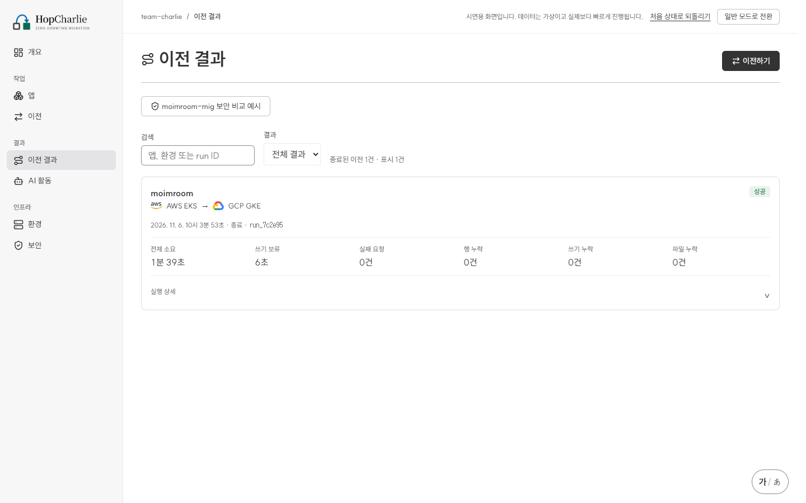

- **검색과 거르기:** 앱, 환경, run ID, Plan ID로 찾고 결과(성공, 원복됨, 정지, 실패, 중단됨, 멈춤)로 거릅니다. "종료된 이전 N건 · 표시 M건"을 보여 줍니다.
- **10건씩:** 처음 10건만 보여 주고 `이전 결과 N건 더 보기 (M건 남음)`으로 10건씩 더 엽니다. 검색어나 결과 필터를 바꾸면 다시 10건부터입니다. 실패와 원복 기록도 숨기지 않고 최신순으로 나눌 뿐입니다(#79).
- **카드의 기본 정보:** 앱, 경로(환경 아이콘), 상태 칩("검증 오류", "관찰 위반"이 붙을 수 있음), 종료 시각과 run ID(롤백이면 원본 run), 6개 지표(전체 소요, 쓰기 보류, 실패 요청, 행 누락, 쓰기 누락, 파일 누락)입니다. 측정하지 못한 값은 0건이 아니라 "미측정", 요청 집계가 맞지 않으면 "집계 이상"입니다(#70 #90 #111).
- **실행 상세:** 카드 아래 "실행 상세"를 누르면 쓰기 기록 검증, 정지와 관찰 위반 경고, 실패 사유, 전환 판단 패널, Plan·시작·요청 수·실패 단계·엔진 단계 목록이 펼쳐집니다. 펼침은 카드마다 따로이고 5초 갱신에도 유지됩니다(#111, `docs/adr/0013-migration-progress-result-density.md`). 쓰기 검증의 `not_configured`는 숫자 줄 없이 칩과 이유 한 줄만 보여 카드마다 같은 미측정 블록이 반복되지 않게 합니다(#78).
- **AI 검증 카드**(`src/components/RunAIVerification.tsx`, #118): 성공한 `moimroom-mig`의 GCP GKE → 온프레미스 이전의 실행 상세에만 나옵니다. 이전·이후 검증 JSON 두 개를 고르면 브라우저에서만 읽어 측정 조건이 같은지 확인한 뒤(`src/data/aiVerification.ts`) 응답 시간 중앙값, 실패 건수, 품질 통과 건수와 대표 답변 Q01, Q10을 비교합니다. 두 파일이 격리 환경 재현 결과면 "이전 후 재현 측정"으로 표시하고 비교 쪽을 노트북 시험 앱으로 적습니다. 파일을 올리기 전에는 "미측정"입니다.
- **보안 비교 예시**(데모 전용, #107): 상단의 "moimroom-mig 보안 비교 예시"를 누르면 EKS → GKE 시연 실행의 실행 상세가 펼쳐진 채 열리고, `HC-POL-02` 특권 컨테이너 금지의 이전 전(통과)과 전환 직전 결과를 "통과 → 실패"(대상 web 컨테이너의 `securityContext.privileged: true`, 새 위반)와 "통과 → 미확인"(Pod 조회 권한 없음, 403) 중에서 골라 비교합니다. 실행과 판정은 명시한 시연 데이터이고 일반 모드에는 이 버튼과 카드가 없습니다(`src/components/MigrationSecurityComparison.tsx`, `src/sim/securityComparison.ts`, `docs/migration-security-comparison.md`).

| 실행 상세 펼침 | 보안 비교 예시 |
| --- | --- |
| 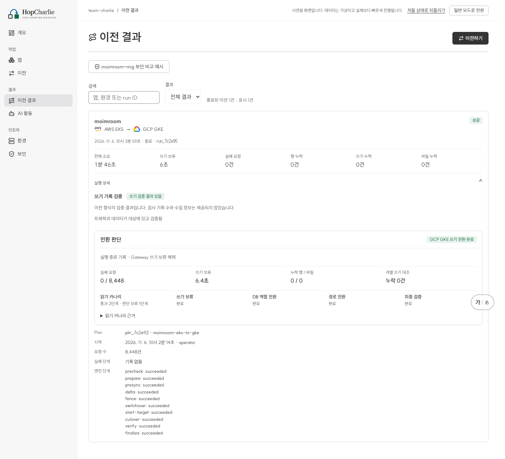 | 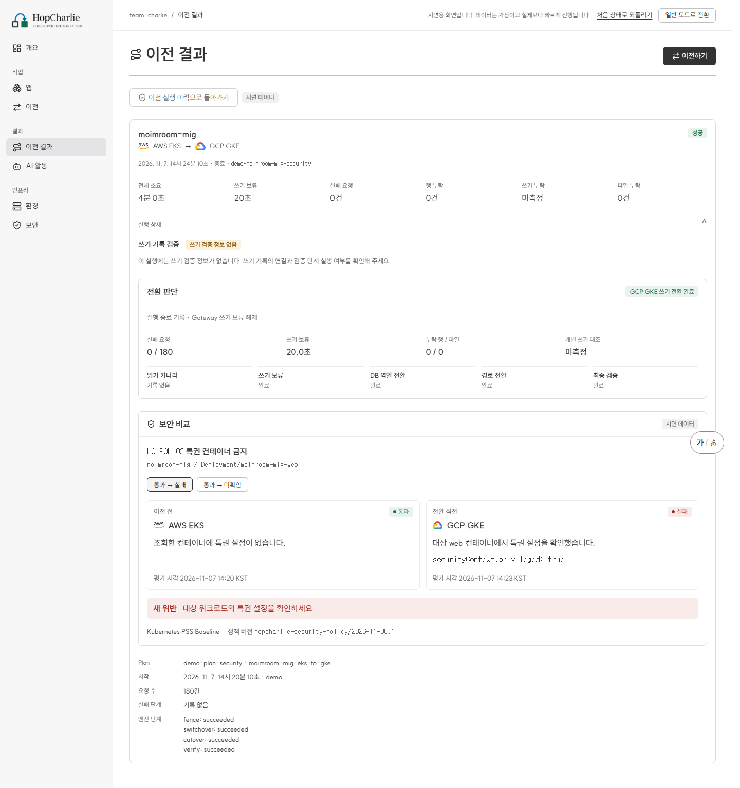 |

### AI 활동, 보안

**AI 활동**(`#agents`)은 에이전트 세션과 이벤트(도구 호출, 결과, 막힌 명령, 결정)를 모읍니다.

**AI 활동 화면** (`src/pages/Agents.tsx`, `src/components/agent.tsx`)

- 위에 "세션 N개, 토큰 입력 … / 출력 …" 합계가 있고, 아래에 세션 표와 고른 세션의 기록(제목, 상태, 시각과 이벤트 줄, 모델, 요약), 오른쪽에 **막힌 명령**(AI 권한으로 시도했다가 플랫폼이 막은 명령과 막은 장치)이 있습니다. 세션이 없으면 "AI 세션이 아직 없습니다."와 이전 화면으로 가는 버튼을 보여 줍니다.
- 표 칸: 종류(계획, 리허설, 진단, 설명, 기타), 앱, From, To, 제목, 상태, 도구 호출, 토큰(입력 / 출력), 기록 보기. 앱·From·To는 #115에서 더했습니다. 모델을 부르지 않은 세션(샌드박스 리허설)의 토큰은 "0 / 0" 대신 "-"입니다(#78).
- 기록의 문장(`eventText`, #79): 리허설 첫 줄은 JSON 원문 대신 `대상 Plan: <planId> (<planRef>)`, 격리 점검에서 열려 있어야 하는 명령은 `예상대로 허용됨: <명령>`이고, 출력이 빈 결과는 `engine.precheck 결과 (ok)`처럼 콜론 없이 끝납니다. 막힌 명령은 `차단됨: …`입니다.
- **일반 모드:** `LiveAgents`가 `useAgentSessions(5_000, { limit: 50 })`로 `GET /v1/agent/sessions?limit=50`을 5초마다 읽고, 고른 세션(처음에는 목록 첫 세션)의 이벤트는 `useAgentSession`이 SSE(`GET /v1/agent/sessions/{id}/events`)로 따라갑니다.
- **앱·From·To 연결(#115):** 세션에 `planRef`나 `runId`가 하나라도 있을 때만 계획·실행·앱 목록(`usePlans`, `useRuns`, `useApps`)을 읽고, `src/data/agentContext.ts`의 `sessionContext`가 정확한 참조로만 잇습니다. 제목이나 Plan ID를 해석하지 않습니다. 앱은 실행·계획에 적힌 값이고, 없으면 두 끝점의 namespace와 DB 클러스터가 유일하게 맞는 등록 앱입니다. 연결되지 않았거나 모호하면 "미확인"입니다. 목록 중 하나를 못 읽으면 "맥락 조회 실패: 계획 · 실행 · 앱"과 "맥락 다시 읽기" 버튼이 나옵니다. 연결된 새 계획·실행이 생길 때만 이 목록을 다시 읽습니다.
- **데모 모드:** `SimAgents`가 시뮬레이션 상태의 세션(`allSessions`: 진행 중인 세션과 지난 계획·리허설·진단)을 그대로 보여 줍니다. 계획·실행·앱을 잇지 않아 앱·From·To는 모두 "미확인"입니다(`src/pages/Agents.tsx`).

**보안**(`#security`)은 두 모드에서 같은 6개 탭(마지막은 OCSF 내보내기)을 사용합니다.

- **개요**: 환경 × 공통 통제, 평가·이미지·실행 자산 건수, 우선 확인할 항목을 봅니다. 평가를 아직 관측하지 못했거나 미지원인 범위는 통과나 안전한 0건이 아니라 수집 중, 미관측, 미지원으로 표시합니다.
- **통제 점검**(`/controls`): 통과·실패·미확인·해당 없음과 개별 증거·공식 근거·권장 조치입니다. 시연용 프로젝트 정책은 공식 표준 등급과 구분합니다.
- **취약점**(`/vulnerabilities`): CVE와 패키지·이미지 digest·실행 자산 관계를 살펴봅니다. 원본 CVSS와 출처, KEV 등재 여부와 기한, EPSS(데모 모드는 "(예시)"가 붙는 설명용 값), 수정 버전을 구분하고 고유 advisory·이미지·실행 workload·패키지 발생 건을 따로 셉니다.
- **발견 항목**(`/findings`): 설정·위협·거버넌스·취약점을 검색하고 심각도, 원본 분류, 예외 여부로 거릅니다. 앱 저장소 키 표는 만든 시각과 허용 범위(버킷, 작업, permissions boundary)를 유지합니다(플랫폼 ADR 0027).
- **수집 상태**(`/sources`): 출처별 성공·실패·미연결·미지원과 시각을 확인합니다. API 조회 시각을 스캐너 실행 시각으로 간주하지 않습니다.
- **OCSF 내보내기**(`/ocsf`, SEC-09, #56): 플랫폼이 보안 데이터를 OCSF로 내보낸 결과(`GET /v1/security/ocsf`)를 읽습니다. OCSF 버전과 생성 시각, 종류별(발견 항목 2004/2003, 취약점 2002, 통제 평가 2003) 건수와 상태를 표로 보여 주고, 종류와 이벤트를 골라 JSON 원문을 보며 "JSON 내려받기"로 `hopcharlie-ocsf-<날짜>-<시각>.json`(KST)을 받습니다. 고른 환경은 요청에 적용하고, 앱 선택은 적용되지 않는다고 알려 줍니다. 탭을 열 때 한 번 읽습니다(`src/components/SecurityOCSF.tsx`).
- **취약점 우선순위**(SEC-07, #50): 기본 정렬은 KEV 등재 → 실행 중 → 심각도 → EPSS이고(같으면 advisory 순, KEV 미확인은 미등재와 같은 순위), 행마다 이유를 한 줄로 씁니다(예: `KEV 등재 · 실행 중 · 수정 버전 있음`). 칩은 `KEV 등재 (기한 11/18)`, `랜섬웨어 사용`, `EPSS 4.2% (상위 8%) · 11/06 기준`, `CVE 없음`, `KEV 미확인`이고, "악용 근거" 필터(전체, KEV 등재, KEV 미확인)가 있습니다. KEV와 EPSS는 순서와 설명에만 쓰고 심각도를 바꾸지 않습니다(`src/data/vulnPriority.ts`).
- **실행 컨테이너 스캔·배포 기록**(SEC-05, SEC-06, #43, 일반 모드): 취약점 탭 맨 아래 표가 실행 중인 컨테이너마다 이미지 digest, 스캔 상태(스캔됨, 스캔 실패, 미검사, digest 미확인, 미지원)와 배포 기록 비교(일치, 다름, 기록 없음, 비교 불가)를 보여 줍니다. 스캐너가 연결되지 않았거나 성공한 스캔이 없어도 표는 보이고, 실패와 미검사는 취약점 0건이 아니라고 적습니다. 개요와 취약점 탭 위에는 "선택 범위 · 검사됨 X/Y 컨테이너", 취약점 상세의 영향 자산 표에는 "배포 기록" 칸이 있습니다.
- **수집·검사 시각**(#50, #51): 수집 상태 표는 "수집"(플랫폼이 결과를 가져온 시각, 굵게)과 "검사"(출처가 직접 검사한 시각)를 나눕니다. 검사 시각을 모르는 출처는 `(검사 시각 미확인) ⓘ`이고, 그 줄에 마우스를 올리거나 ⓘ에 포커스를 두면 이유가 나옵니다(Esc로 닫힘, 키보드로 접근 가능). 일반 모드는 `이미지 취약점 스캔`(마지막 검사 시각, 스캐너 버전, DB 기준 시각, 성공·실패 digest 수), `CISA KEV`, `FIRST EPSS` 행을 더합니다.
- **예외 등록·해제**(SEC-08, #55, 일반 모드): 발견 항목 상세와 취약점 상세 아래에서 사유(최대 500자)와 만료일을 넣어 예외를 등록하고 "예외 해제"로 지웁니다. 만료일은 오늘부터 30일까지(KEV 등재 취약점은 7일까지)이고 한국 시간 그날 끝으로 보냅니다. 목록에는 `예외 · MM/DD까지` 칩과 흐린 행이 붙고, "예외" 필터(제외, 포함, 예외만)의 기본값은 "제외"입니다. 취약점 정렬은 예외 묶음을 맨 뒤로 보냅니다. 예외는 심각도를 바꾸지 않으며 만료되면 다시 미처리로 보입니다. 통제 점검에는 예외가 없습니다. 요청은 `POST /v1/security/exceptions`(`targetType`, `targetId`, `reason`, `expiresAt`)와 `DELETE /v1/security/exceptions/{id}`이고, 성공하면 보안 읽기를 모두 다시 합니다(`src/components/SecurityException.tsx`). 화면 코드에는 역할 검사가 없어 권한은 서버가 판단하고 거절 메시지를 그대로 보여 줍니다. 데모 모드에는 등록·해제 버튼이 없습니다.

환경·앱 필터와 상세에서 목록으로 돌아오는 흐름은 탭 사이에 유지됩니다. 일반 모드는 `GET /v1/security`의 발견 항목과 출처·저장소 키를 표시하고 원본 심각도를 유지하며, 통제 평가는 `GET /v1/security/controls`, CVE와 실행 컨테이너는 `GET /v1/security/vulnerabilities`에서 읽습니다. 응답이 없거나 오류이거나 계약과 다른 형식이면 그 탭은 이유와 함께 "결과 없음"입니다. 앱과의 관계는 실행 컨테이너 보고에만 있어서 앱 선택은 취약점 탭에만 있고, 통제 평가와 발견 항목은 앱으로 거를 수 없습니다. 데모의 통제·CVE·자산 관계는 실제 점검 결과가 아닙니다. 이 화면은 스캐너 실행과 정책 변경을 하지 않습니다. 일반 모드에서 발견 항목과 취약점의 예외를 등록·해제할 수 있습니다.

**보안 구현:** `src/pages/Security.tsx`가 모드를 나누고 그리는 코드는 `src/pages/SecurityWorkspace.tsx` 하나입니다. 일반 모드(`LiveSecurity`)는 60초마다 `GET /v1/security`(발견 항목, 출처, 저장소 키), `GET /v1/envs`(등록된 클러스터), `GET /v1/security/controls`(통제 평가와 범위), `GET /v1/security/vulnerabilities`(CVE, 실행 컨테이너, 스캔, KEV·EPSS)를 읽고(#41), `src/data/security.ts`의 `securityData`가 한 `SecurityDataset`으로 만듭니다. 통제와 CVE는 각 API 응답만 쓰고, 응답이 없거나(구버전 404 포함) 오류이거나 계약과 다른 형식이면 이유와 함께 "결과 없음"이며 데모 데이터나 0건으로 채우지 않습니다. 데모 모드는 `src/sim/securityWorkspace.ts`의 시연 데이터(`DEMO_SECURITY_DATA`)와 `src/sim/securityOCSF.ts`의 예시 이벤트를 같은 화면에 넣습니다.

- **점검 범위와 앱 필터**(#106): 일반 모드의 "점검 범위"는 클러스터(`GET /v1/envs`에 등록된 환경), 계정·프로젝트·플랫폼(AWS Cloud, GCP Cloud, Cloudflare, Platform), 기타 관측 범위로 묶습니다. 앱 선택은 취약점 탭에만 있고, 고른 범위에서 실행 컨테이너 보고에 앱이 달린 것만 고를 수 있습니다. 고르면 취약점, 실행 컨테이너 표, 검사 집계가 함께 좁아집니다. 앱이 연결된 이미지가 없으면 선택이 꺼지고 이유를 적습니다. 통제 점검과 발견 항목 탭에는 "앱별 실행 이미지와 취약점 보기" 링크가 있습니다. 통제 평가와 발견 항목에는 앱 정보가 없어서 앱으로 거를 수 없습니다. 데모 모드는 환경(EKS, GKE, k3s)과 앱(moimroom, platform)으로 모든 탭을 거릅니다.
- **환경 이름**(#47, #48): 등록된 클러스터는 `/v1/envs`의 표시 이름을 쓰고, 그 밖의 ID는 `AWS EKS`, `GCP GKE`, `onprem k3s`, `onprem`, `AWS Cloud`, `GCP Cloud`, `Cloudflare`, `Platform`으로 보여 줍니다(`src/data/security.ts`의 `ENV_LABEL`). 보안 화면의 환경 이름에도 환경 아이콘이 붙습니다(`aws-account`는 AWS, `gcp-project`는 GCP 로고, #94).
- **관측 상태와 근거**(#102, `docs/adr/0010-security-observation-provenance.md`): 일반 모드는 탭 아래에 발견 항목, 통제 평가, 취약점 세 보고서의 상태(수집 중, 관측됨, 미관측, 수집 오류, 미지원)를 접이식으로 보여 줍니다. 열면 이유, 호출 경로, 수집 시각이 나오고 "인증된 보고서 보기"는 OCSF 탭으로 갑니다(API 주소를 새 탭으로 열면 인증 헤더가 없고, 토큰을 주소에 넣지 않기 위해서입니다). 서버가 404, 405, 501로 답하면 "미지원", 새로 읽기에 실패하면 마지막 성공 결과임을 알립니다. 발견 항목이 먼저 도착해도 아직 수집 중인 통제·CVE를 미연동으로 바꾸지 않고, 평가가 없는 환경은 통과 0이나 0/0이 아니라 "미관측"입니다. 선택한 범위에 성공한 컨테이너 스캔이 없으면 다른 환경의 스캔으로 취약점 0건을 추정하지 않고 "미관측"입니다.
- **판정 근거 접기**(#102): 통제 행의 "근거"에는 출처(수집 `source`와 `controlId`로 맞춘 것), 출처 상태, 수집 코드·판정 구현·공식 근거 링크가 있고, 취약점 행에는 저장 스캔 ID와 이미지 digest, 스캐너와 검사 시각, DB 기준 시각이 있습니다. 스캔 정보는 `scanId`와 digest가 모두 맞을 때만 잇습니다. 구현 링크는 검토한 platform 커밋 `31540bbe`의 `internal/security/`를 가리키며 배포된 버전을 증명하지 않습니다(`src/data/securityEvidence.ts`). 외부 링크는 http(s)이고 인증 정보가 없는 것만 엽니다.
- **개요 알림에서 발견 항목으로**(#104): 개요 "지금 볼 것"의 "보안 발견 항목" 알림은 치명·높음 발견 항목만 세고, 눌러서 가는 `#security/priority-findings`가 같은 항목을 "치명·높음 발견 항목"으로 보여 줍니다(예외 포함, 취약점 행 제외, 점검 범위 선택 적용). 사이드 메뉴의 보안에는 배지가 없습니다.

| 보안 개요 (6개 탭) | 통제 점검 |
| --- | --- |
| 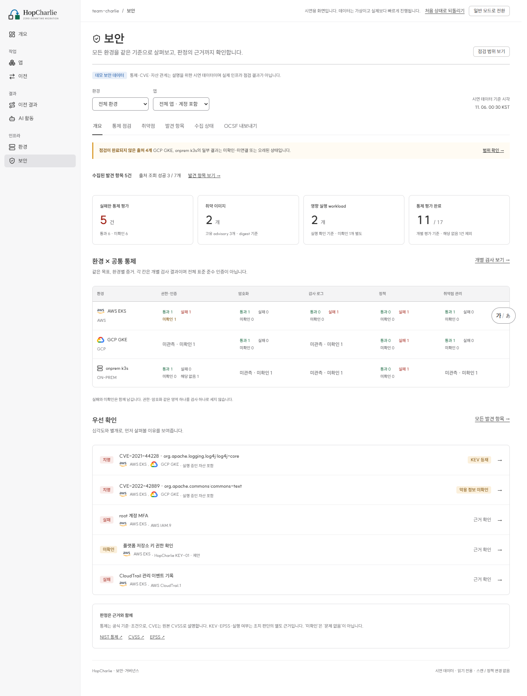 | 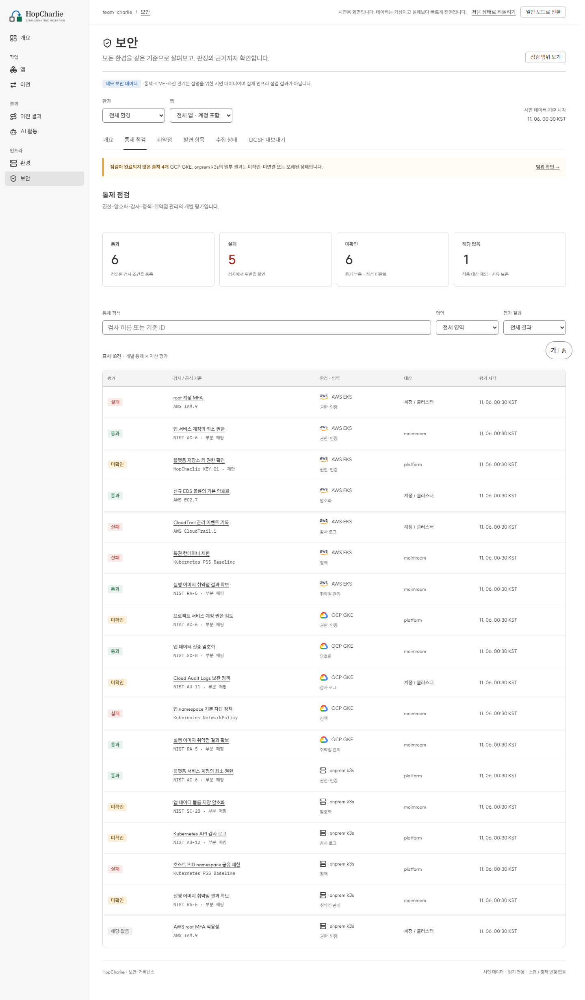 |
| **취약점** | **발견 항목** |
| 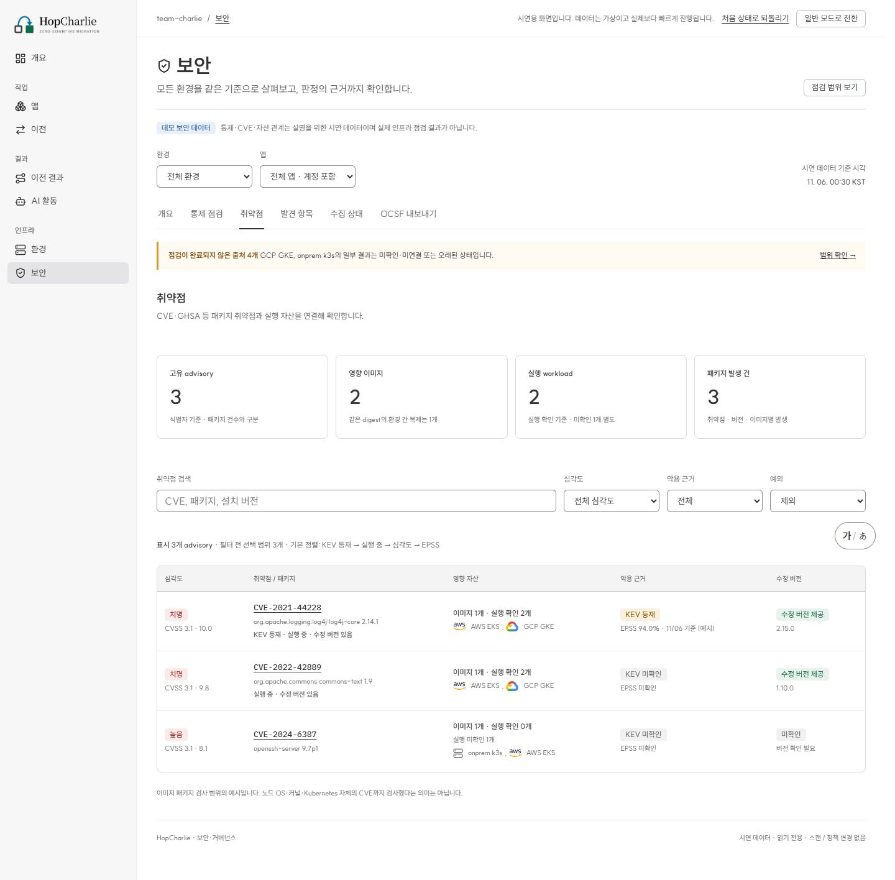 | 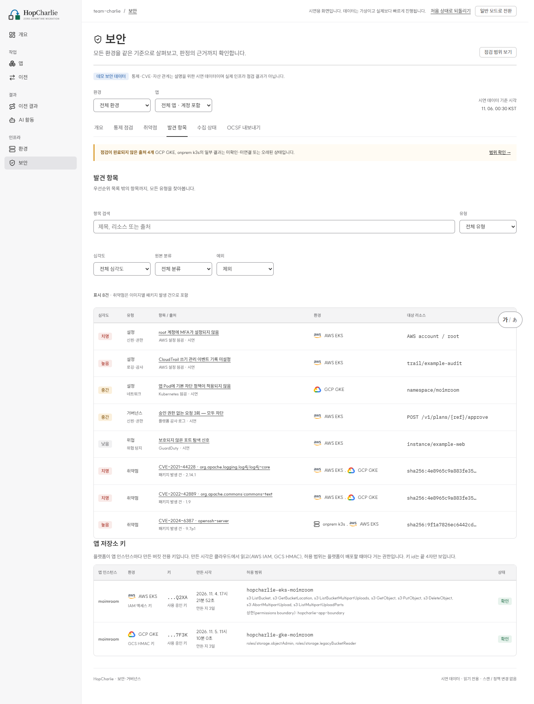 |
| **수집 상태** | **OCSF 내보내기** |
| 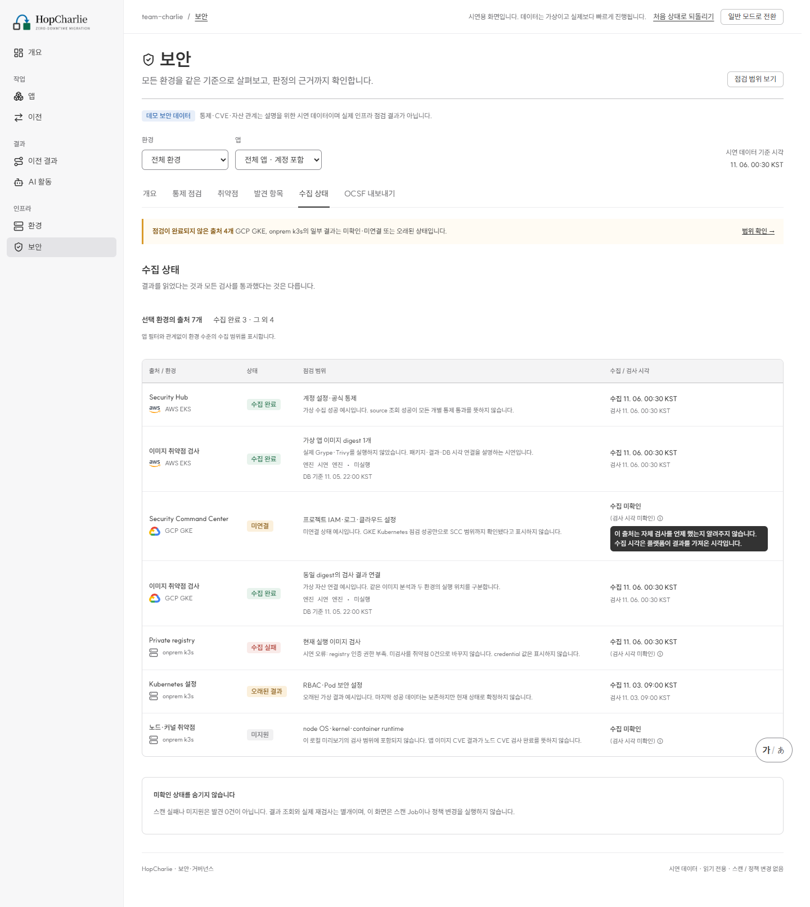 | 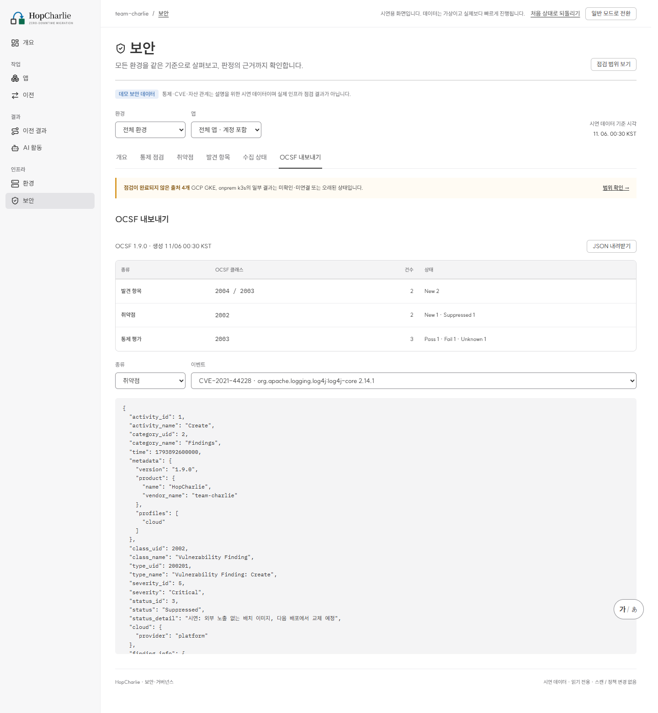 |
| **개요 알림에서 이동한 치명·높음 발견 항목** | **AI 활동 (이전을 마친 뒤, 세션 3개)** |
| 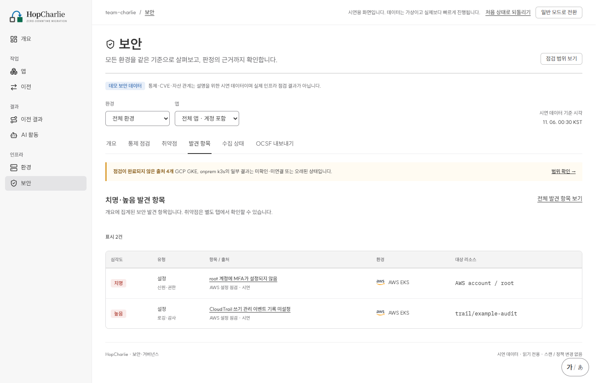 |  |
| **AI 활동 (세션이 없을 때)** | |
| 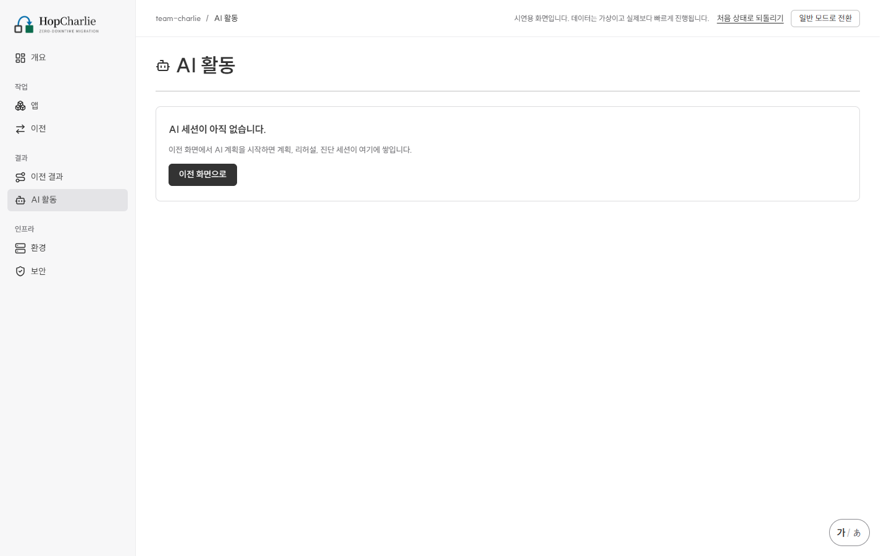 | |

### 앱, 새 앱 배포, 환경

GitHub 레포로 앱을 등록하고 배포하는 화면입니다(ADR 0011).

- **새 앱 배포**(`#new`): GitHub App이 볼 수 있는 레포, 브랜치(기본은 레포의 기본 브랜치), 배포 환경, push 자동 배포를 고릅니다. 고르는 대로 platform.yaml을 확인해서, 통과하면 서비스와 포트, 공개 주소(`https://<이름>.hopcharlie.dev`), 리소스를 보여 주고, 아니면 바로 배포할 수 없다는 안내와 **직접 고쳐야 하는 항목**(위치, 내용, 고칠 방법)을 보여 줍니다. 플랫폼 기본값을 쓰는 항목도 따로 보여 줍니다. 레포에는 서비스마다 Dockerfile, 루트에 platform.yaml이 있어야 합니다.
  - 배포 환경은 EKS와 GKE가 처음부터 체크돼 있고 온프레미스는 꺼져 있습니다(`src/pages/NewApp.tsx`의 `DEFAULT_ENVS`, 플랫폼 ADR 0030). 두 환경을 고르면 목록에서 앞선 환경의 DB가 primary, 다른 환경의 DB가 읽기 전용 replica가 되어 바로 이전할 수 있다는 안내가 폼에 붙습니다(#44). 일반 모드는 레포를 `GET /v1/github/repos`, 환경을 `GET /v1/envs`에서 받고, 레포와 브랜치를 고를 때마다 `POST /v1/apps/validate`로 platform.yaml을 확인하며, "배포 시작"은 `POST /v1/apps`로 등록과 첫 배포를 한꺼번에 하고 배포 진행 화면으로 갑니다(`src/data/deploy.ts`의 `useLiveNewApp`). 데모는 같은 흐름을 `src/sim/deploy.ts`가 처리합니다.
  - platform.yaml이 레포 루트에 없을 때의 안내는 "레포 루트에 platform.yaml을 두세요. 서비스마다 Dockerfile도 있어야 합니다."입니다(`src/components/deploy.tsx`의 `specHint`, #78).
- **앱 목록**(`#apps`): 파일 앱(이전 대상)과 GitHub에서 등록한 앱을 함께 보여 줍니다. 등록한 앱에는 GitHub 표시, 공개 주소, 최근 배포가 붙습니다. 환경별 상태는 EKS, GKE, On-prem 칩과 그 아래 범례로 보여 주고, 파일 앱은 상태를 몰라서 회색입니다. 위의 전체, 정상, 문제 있음, 배포 중 칸을 누르면 그 상태로 거르고, 거른 목록은 주소(`#apps-healthy`, `#apps-problem`, `#apps-deploying`)로 공유할 수 있습니다.
  - 줄 끝에 `관측`(일반 모드만)과 `이전` 또는 `이전 준비` 버튼이 있습니다. 이전 버튼은 `#migrate-app?app=<이름>`으로 가서 이전 화면이 그 앱을 고른 채 열립니다(#46). 이전 화면 머리의 앱 선택(`이전할 앱`)은 고른 앱을 같은 해시에 남깁니다(#44). 라벨은 이전할 수 있는 환경이 둘 이상이면 `이전`, 아니면 `이전 준비`입니다. DB가 있는 앱은 관측된 DB 환경(`App.environments`)을, DB 없는 앱은 `deploy.environments`까지 합친 환경 수를 셉니다(`src/data/migrationMembership.ts`의 `migrationEntryLabel`). DB 없는 등록 앱에서도 버튼이 빠지지 않습니다(#91).
  - 표는 가로 스크롤 영역(`role="region"`, 이름 "앱 목록")이라 키보드로 초점을 줄 수 있고, 칩의 상태 글은 화면 읽기용으로 함께 들어 있습니다(`src/components/ui.tsx`의 `Table`의 `scrollLabel`, #117). 위 요약 칸은 항목 이름과 건수만 보입니다(#115).
- **앱 상세**(`#app-<이름>`): 화면 머리에 레포, 기본 브랜치, 공개 주소와 **기본 브랜치 다시 배포** 버튼, 더 보기 메뉴가 있고, 그 아래 띠에 기본 인스턴스의 환경별 상태(Argo CD sync와 health, 커밋)가 있습니다. 내용은 탭 네 개로 나눴고(`#app-<이름>/instances`, `/secrets`, `/deploys`), 같은 앱 안에서 탭을 바꿔도 스크롤과 입력 중인 내용은 남습니다.
  - **개요**: 최근 배포, 기본 인스턴스의 platform.yaml 요약, 배포 설정(기본 브랜치, 자동 배포, 공개 주소, 등록), 시크릿 요약, DB 짝(또는 DB 복제 그룹) 카드와 이전 설정 카드
  - **인스턴스**: 브랜치별 인스턴스 표(브랜치, 주소, 환경별 상태, 최근 배포, 자동 배포, 배포 버튼). 브랜치 추가 폼은 **브랜치 추가**를 눌러야 열립니다.
  - **시크릿**: 아래 시크릿 설명
  - **배포 이력**: 배포마다 브랜치, 상태, 트리거, 커밋, 환경, 시작 시각, 걸린 시간

  **기본 브랜치 다시 배포**는 기본 브랜치의 head를 모든 환경에 배포하고, 인스턴스마다 있는 **재배포 (빌드 없이, 커밋 7자리)**는 그 인스턴스의 마지막 정상 배포를 같은 이미지와 지금 시크릿으로 다시 배포합니다(배포 이력의 트리거는 재배포). 그 인스턴스의 배포가 진행 중이면 끝날 때까지 버튼이 꺼집니다. **앱 삭제**는 더 보기 메뉴에 있고, 화면 안에서 한 번 더 확인한 뒤 지웁니다. 파일 앱(이전 대상)은 실행 위치, 리소스, 변경 이력과 이전 버튼을 보여 줍니다.
  - **머리 버튼**: 기본 브랜치 다시 배포, **환경 추가**, `이전` 또는 `이전 준비`, 더 보기(앱 삭제)입니다. 배포가 진행 중이면 환경 추가는 꺼지고 이유를 적습니다.
  - **환경 추가**(#62, #75, 플랫폼 ADR 0037, `src/pages/Apps.tsx`의 `AddEnvironment`): `GET /v1/envs` 중 앱에 없는 환경을 골라 `POST /v1/apps/{name}/environments`(`{environment}`)를 보냅니다. 기본 인스턴스의 마지막 정상 배포를 빌드 없이, 새 환경을 포함한 모든 환경에 다시 배포하고(배포 이력의 트리거는 "환경 변경") 성공하면 그 배포의 진행 화면으로 갑니다. DB 짝이 있는 앱은 처음에는 짝의 상대 환경만 고를 수 있고, 두 환경이 갖춰지면 세 번째 환경(예: 온프레미스)을 더할 수 있습니다. 세 번째 환경은 DB를 처음 primary로 만든 환경에서 복제하므로 그 환경으로 먼저 이전하고 정상 상태를 확인해야 한다고 안내합니다. 서버의 거절(`environment_exists`, `deployment_in_progress`, `migration_in_progress`, `nothing_to_redeploy`, `db_pair_unavailable`, `db_group_full`, `db_bootstrap_primary_required`, `storage_not_configured`, `sealing_not_configured` 등)은 한국어로 바꿔 보여 줍니다(`src/data/deploy.ts`의 `envErrorText`). 방금 뺀 환경은 "(정리 중일 수 있음)"으로 표시하고, 배포가 실패한 환경 칸에는 "환경 추가 다시 시도"가 생깁니다.
  - **환경 빼기**(#62): 환경별 상태 칸의 "환경 빼기"는 앱의 첫 환경(DB가 처음 primary로 태어난 곳)에는 없습니다. 환경 이름을 직접 입력해야 켜지는 확인 상자가 그 환경의 네임스페이스, (DB 짝의 replica면) DB 복제본, 파일(버킷)이 지워지고 되돌릴 수 없다고 알립니다. 요청은 `DELETE /v1/apps/{name}/environments/{env}`이고 성공하면 남은 환경으로 가는 배포가 진행 배너에 나옵니다. 지금 쓰기를 받는 환경, DB primary가 있는 환경, 세 환경 DB 그룹(서버가 아직 지원하지 않음, #75), 배포 진행 중에는 버튼을 끄고 이유를 옆에 적습니다.
  - **트래픽과 DB 역할**(#44, #75, #101): DB 짝이 있는 앱의 환경 칸에 DB 역할 줄이 붙습니다. 일반 모드는 `GET /v1/traffic?app=<이름>`(10초마다)이 답하면 "트래픽 받는 중"/"대기" 칩과 "DB primary"/"DB replica(읽기 전용)"를 보여 주고, 답이 없으면 처음 만든 역할(`dbTopology`)을 ", 처음 만든 역할"과 함께 보여 줍니다. 지금 쓰기를 받는 환경은 상태 칩 왼쪽에 노란 별이 붙습니다. 세 환경 그룹은 처음 만든 역할로 추정하지 않고 readiness가 관측한 역할만 쓰며 읽지 못하면 "역할 미확인"입니다(`docs/adr/0005-three-environment-database-membership.md`). DB 짝의 상대 환경이 앱에 없으면 primary 환경 칸에 "상대 환경 없음" 칩이 붙습니다. 데모는 게이트웨이가 없어서 별과 "트래픽 받는 중"이 없습니다.
  - **DB 짝 카드**(개요 탭, `DBPair`, 세 환경이면 "DB 복제 그룹"): 환경별 짝 상태(준비됨, 준비 중, 확인 불가, 상대 환경 없음), 배포, 게이트웨이 백엔드, DB 역할, CNPG 상태와 머리의 "이전 준비됨"/"이전 준비 안 됨" 칩입니다. 준비되지 않으면 화면 머리 아래에 "이전 준비 안 됨"과 이유(`src/data/migration.ts`의 `readinessBlock`)가 뜹니다. 이전 링크는 막지 않고 경고만 붙이며, 이전 화면은 설정 단계에서만 `GET /v1/apps/{name}`을 10초마다 읽어 이유에 따라 AI 계획과 Plan 작성 버튼을 끄거나 경고만 합니다(`pairCheck`).
- **앱 상세의 시크릿**(ADR 0019): 앱 공통 시크릿과, 고른 인스턴스가 받는 시크릿(앱 공통에서 받은 것과 덮어쓴 것)을 표로 보여 줍니다. 표에는 이름, 바꾼 때, 바꾼 사람만 있고, 보기를 누른 값만 서버에서 불러와 보여 줍니다. 다시 누르거나 페이지를 떠나거나 60초가 지나면 값을 지웁니다. 시크릿 추가와 덮어쓰기 추가 폼은 그 버튼을 눌러야 열립니다. 추가, 수정, 삭제, 덮어쓰기, 덮어쓰기 지우기는 저장하지 않은 변경으로 모았다가 범위마다 저장 한 번으로 보내고, 취소로 버릴 수 있습니다. 저장한 뒤에는 실행 중인 인스턴스가 이전 값을 쓴다고 알리고 인스턴스별 재배포와 모든 인스턴스 재배포 버튼을 보여 줍니다. operator가 아닌 토큰은 이름만 봅니다. 데모 모드에서는 todo-api의 가짜 시크릿으로 같은 흐름을 보여 줍니다.
- **앱 관측**(일반 모드만, #88, #87, #110): 앱 목록 줄의 `관측` 버튼이 `src/components/AppObservation.tsx`의 `AppObservationDialog`를 엽니다. 닫기 버튼, Esc, 바깥 클릭으로 닫고, 열려 있는 동안 뒤 화면은 스크롤되지 않습니다. 앱 목록이 다시 그려져도 초점이 튀지 않게 `onClose`를 ref로 읽습니다(#87).
  - **로그 요약**("HyperDX 분석"): `GET /v1/apps/{name}/observability?minutes=`를 15초마다 읽습니다. 보는 기간은 15분, 1시간(기본), 6시간, 24시간입니다. 한 줄 판정(정상: 오류 0건, 확인 필요: 오류 있음, 문제: 오류가 로그의 5% 이상, 로그 없음), 문장 요약, 5분마다의 로그 수 막대(오류 빨강, 경고 노랑, 막대에 마우스를 올리면 시각과 건수), "이렇게 진행됐습니다" 타임라인(최근 배포 `GET /v1/apps/{name}/deployments`와 "이 기간의 첫 오류", 로그가 가장 많았던 5분), 서비스별 표, 반복되는 오류와 경고입니다. 로그가 하나도 없으면 "정상"이라 하지 않습니다(조용한 앱인지 로그를 안 모으는 앱인지 로그로는 알 수 없음). 문장과 타임라인은 `src/data/observe.ts`가 만듭니다.
  - **로그 원문은 어디에도 나오지 않습니다.** 서버가 오류와 경고를 패턴으로만 주고, 숫자는 `#`로, 비밀로 보이는 값은 «가림»으로 바뀝니다(팝업에 "모든 비밀을 알아볼 수는 없다"고 적음). 패턴의 횟수는 기간 전체가 아니라 최근 오류와 경고 500줄 안에서 센 값입니다(#87). 로그 저장소가 없거나(503) 읽지 못하면(502) 그 사실만 알립니다. `VITE_HYPERDX_URL`이 있으면 아래에 "HyperDX에서 보기" 링크가 있습니다.
  - **Langfuse LLM 관측**(#110, `docs/adr/0011-app-langfuse-observation.md`): 위쪽 "관측 출처"에서 바꿉니다. `GET /v1/apps/{name}/llm-observability?minutes=`를 읽고, 최근 24시간 안에 앱의 AI 호출이 관측됐거나(`GET /v1/apps/{name}/ai-services`) Langfuse 쪽이 `observed`일 때만 버튼이 켜집니다(꺼져 있으면 "AI 사용 미관측"과 이유). 최근 최대 100개 generation의 표본(trace·generation 수, 평균 지연, 토큰, 비용 USD, 오류 generation, 건별 표와 Langfuse trace 링크)이며 전체 요청 집계가 아닙니다. 값이 없으면 "미측정"이고, 미연결, 앱 범위 미설정, 미관측, 수집 오류, 미지원을 구분합니다. 프롬프트와 입출력은 가져오지 않고, 갱신에 실패하면 "마지막 수신 결과"로 표시합니다(`src/components/AppLLMObservation.tsx`, `src/data/llmObservability.ts`).
- **배포 진행**(`#deploy-<id>`): 단계(대기열, 이미지 빌드, gitops 커밋, Argo CD 동기화, 그리고 정상, 실패, 대체됨)와 단계 번호(예: 2/4 빌드), 환경별 상태, 실시간 빌드 로그(자동 스크롤, 멈춤 가능), 배포를 만든 때부터 끝날 때까지의 경과 시간(목표 5분)을 보여 줍니다. 끝나면 맨 위에 결과 카드가 나옵니다. 성공하면 공개 주소를 누를 수 있고, 실패하면 실패한 단계와 오류를 보여 주며 로그 위에 한 줄 요약을 띄우고 첫 오류 줄로 스크롤해서 표시합니다.
  배포 이력의 트리거는 등록, 수동, push, 재배포, 환경 변경입니다(`src/components/deploy.tsx`의 `TRIGGER_LABEL`). 재배포와 환경 변경 배포는 빌드 단계에 "빌드하지 않고 마지막 정상 배포의 이미지를 다시 씁니다"라고 적고, 환경별 상태 표의 환경 이름 앞에도 환경 아이콘이 붙습니다.
- **환경**(`#envs`): 클러스터와 트래픽 게이트웨이 상태입니다.
  - **대상 클러스터 표**: 환경, 위치, Kubernetes, 노드(준비/전체), DB(CNPG), DB 백업, 게이트웨이 백엔드, 상태입니다. 일반 모드는 `GET /v1/envs`를 10초마다 읽습니다. 일부만 읽지 못하면(예: ObjectStore 권한 없음) 상태 칸에 "일부를 읽지 못함: <이유>"를 작게 붙입니다(#36).
  - **DB와 백업**(#36, #115, 플랫폼 ADR 0025, `src/pages/Envs.tsx`): CNPG DB마다 한 줄입니다. DB 칸은 이름(같은 이름이 겹치면 `네임스페이스/이름`, 전체는 툴팁), 준비한 인스턴스 수, 역할(원본, 복제본)이고, 백업 칸은 상태 칩과 최근 성공한 백업 시각, 복구 가능 시작 시각입니다. 칩은 위에서부터 먼저 맞는 것을 씁니다: `WAL 보관 실패`(빨강, 계속되면 DB 디스크가 차고 이전의 원본 강등이 멈춤), `마지막 백업 실패`(노랑, 마지막 성공보다 나중에 실패한 백업이 있음), `백업 기록 없음`(노랑, WAL은 보관하는데 성공한 base backup이 없음), `백업 오래됨`(노랑, 마지막 성공이 26시간보다 오래됨, 매일 백업 기준), `백업 정상`(초록), `미설정`(회색, 백업을 설정하지 않은 DB). 시각은 `Date.parse`로 비교합니다. 목록을 못 읽었으면 "미확인", CNPG가 없으면 "CNPG 없음"/"대상 없음"으로 구분합니다. 서버가 아직 `backup`을 보내지 않아도 모든 DB가 `미설정`으로 보일 뿐 깨지지 않습니다.
  - **트래픽 게이트웨이**(#77): 쓰기 대상, 읽기 비율, 쓰기 보류, 백엔드별 상태·요청(1분)·오류율·p95입니다. 게이트웨이는 앱마다 있어서 제목 옆 `트래픽을 볼 앱` 선택이 고른 앱의 `GET /v1/traffic?window=1m&app=<이름>`을 5초마다 읽습니다. 게이트웨이가 있는 앱(`hasGateway`)만 선택지에 오르고(그 밖의 앱은 서버가 400), 앱 목록이 오기 전에는 읽지 않습니다. 등록 앱이 없을 때만 앱을 지정하지 않은 기본 게이트웨이를 읽고, 앱 목록을 못 읽으면 그 사실을 한 줄로 알립니다.
  - **온프렘 연결**(일반 모드만, #84, #95, `docs/adr/0006-onprem-enrollment-console.md`, `0008-onprem-enrollment-registration-feedback.md`): 화면 위 `온프렘 연결` 버튼이 `src/components/OnpremEnrollment.tsx`의 연결 마법사를 엽니다. 관리자(operator)만 코드를 발급·폐기합니다. 환경 이름을 적고(32자 이내 소문자·숫자·`-`, 처음 제안은 `onprem`) 장비에 k3s가 없으면 설치해도 된다는 동의를 고른 뒤 "등록 코드 발급"을 누르면 `POST /v1/onprem/enrollments`(`Idempotency-Key`, `{environment, installK3s}`)로 일회용 등록 코드, 만료 시각, 장비에서 실행할 설치 명령이 옵니다. 명령은 Linux 또는 WSL2의 Linux 터미널에서 root로 실행하고(curl, python3, sha256sum 필요, k3s를 새로 설치하면 systemd나 OpenRC 필요), Windows PowerShell에서는 직접 실행할 수 없습니다.
    - 브라우저는 코드와 명령을 만들지 않고 서버가 준 문자열만 보여 주며, React 메모리에만 두고 새로고침, 사용, 만료, 폐기, 상태 갱신 실패, 관리자 권한 상실 때 숨깁니다. 다시 발급하기 전에는 기존 요청을 `POST /v1/onprem/enrollments/{id}/revoke`로 폐기해야 합니다.
    - 이름이 `GET /v1/envs`에 이미 있으면 발급을 막고 다른 이름을 요구하며 기존 환경을 교체하지 않습니다(환경 목록을 못 읽었을 때도 발급하지 않음, #95).
    - 상태는 `GET /v1/onprem/enrollments/{id}`를 5초마다 읽어 칩(장비 연결 대기, 등록 코드 사용됨, 검증 중, 검증 결과 수신, 연결 실패, 코드 만료, 코드 폐기됨), 서버가 알려 준 연결 단계(`stage`), 다섯 검사(k3s 실행, 네트워크 연결, 배포 권한, 이미지 다운로드, Hello World 응답)의 결과와 관측 시각을 보여 줍니다. 서버가 `ready`로 답하고 다섯 검사가 모두 통과해야 "클러스터 연결과 기본 배포 검증을 통과했습니다"라고 표시하고, 검사 결과가 빠졌으면 완료로 표시하지 않습니다. 확인 범위는 Kubernetes 연결과 제한된 Hello World 배포 검사까지이고 DB·MinIO·GPU 설치와 환경 동등성은 확인하지 않습니다.
    - 서버가 지원하지 않으면(404, 405, 501) 안내만 하고 발급 버튼을 끄며, 503 `enrollment_issuer_unavailable`은 서버 설정 미완료로 설명합니다.
  - **데모 모드의 환경**: "시연용 데이터" 안내와 함께 정상(EKS), 부분 조회(GKE: CNPG 조회 권한 없음), 연결 실패(온프레미스), 백업 실패(`demo-report-db`)의 가상 사례를 보여 줍니다. 쓰기 대상과 읽기 비율은 시뮬레이션의 이전 진행을 따라 움직입니다. 온프렘 연결과 앱 선택은 없습니다.
- 시뮬레이션 레포: `notice-board`(바로 배포 가능, `dev` 브랜치는 빌드 실패), `photo-album`(`main`은 규칙 위반, `fix-worker`는 통과), `analytics-worker`(platform.yaml 없음). `todo-api`(EKS, GKE, 온프레미스 3곳)와 `wiki`(EKS 한 곳, DB 짝의 상대인 GKE가 아직 앱에 없어 "이전 준비 안 됨")는 처음부터 등록되어 있습니다(`src/sim/deploy.ts`의 `freshDeploy`).

| 앱 목록 | 새 앱 배포 |
| --- | --- |
|  |  |
| **새 앱 배포: 규칙 위반 (photo-album)** | **새 앱 배포: platform.yaml 없음 (analytics-worker)** |
|  |  |
| **배포 진행 (진행 중, 2/4 빌드)** | **앱 목록: 문제 있음 필터** |
|  |  |
| **앱 상세 (todo-api, GitHub에서 등록, 개요 탭)** | **앱 상세 (이전 대상 moimroom, GKE로 이전한 뒤)** |
|  |  |
| **배포 진행 (완료)** | **배포 진행 (빌드 실패, `dev` 브랜치)** |
|  |  |
| **환경** | **앱 상세 (wiki, DB 짝의 상대 환경이 없음)** |
|  | 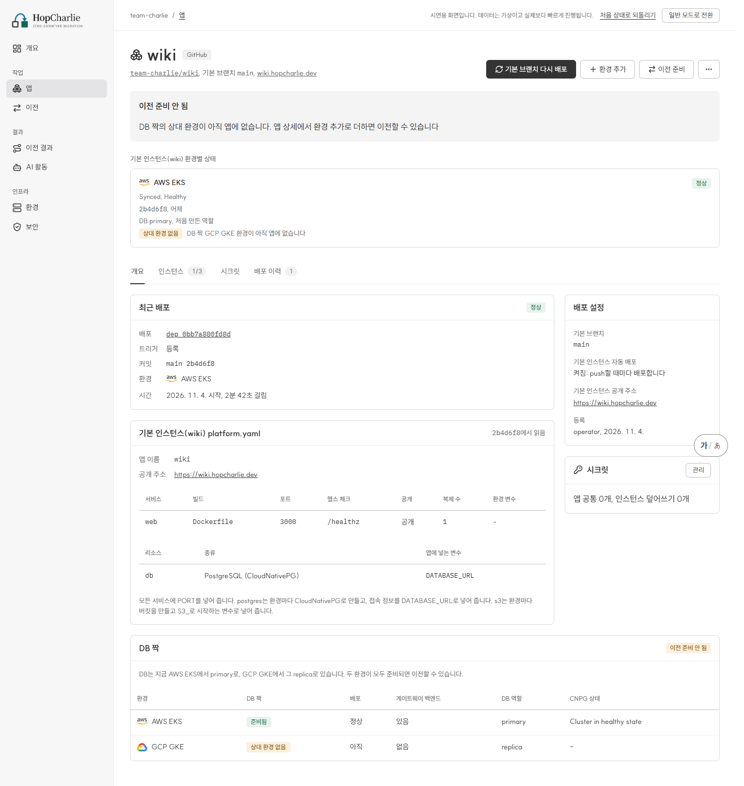 |
| **앱 관측 팝업** (일반 모드 전용. 목 API로 그린 미리보기이며 실제 콘솔 화면이 아닙니다) | |
| 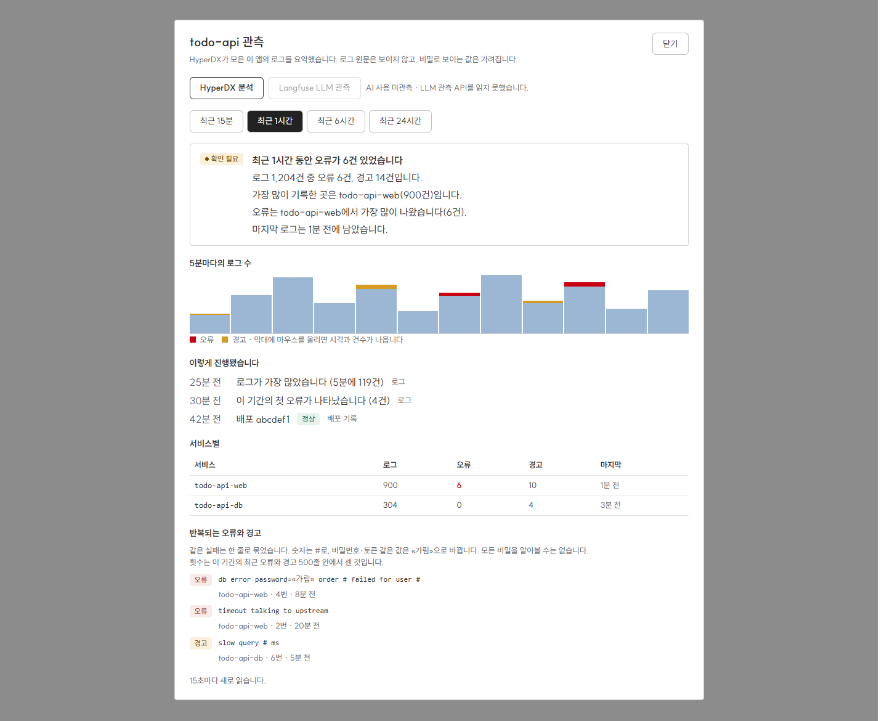 | |

### 디자인 시스템 (`#design-system`)
메뉴에는 없는 화면입니다. 주소창에 `#design-system`을 붙여서 엽니다. 원칙, 로고, 색(대비 포함), 글꼴, 간격과 모서리, 상태 표현, 컴포넌트, 움직임을 화면과 같은 토큰과 클래스로 보여줍니다.

**구현:** `src/pages/DesignSystem.tsx` 한 파일이 원칙, 로고, 색, 글꼴, 간격과 모서리, 상태 표현, 컴포넌트, 움직임 여덟 구역(`Section`의 `id`)을 그립니다. API를 읽지 않으며 모드와 상관없이 같습니다. 견본은 화면이 쓰는 컴포넌트(`Chip`, `Ind`, `LogBox`, `Table`, `EnvLabel` 등)와 클래스를 그대로 쓰지만, 색 견본의 값은 이 파일에 직접 적혀 있어서 `src/styles/tokens.css`와 같게 유지해야 합니다(파일 머리 주석). 컴포넌트 구역의 트래픽 비율 견본 범례는 `EnvLabel`로 AWS·GCP 로고를 붙입니다(#94). 모드를 아직 고르지 않았으면 모드 선택이 먼저 나옵니다(`App`).


### Figma로 옮기기
- **이미지로:** `docs/screenshots/`의 PNG를 Figma에 끌어다 놓습니다.
- **편집 가능한 레이어로:** html.to.design 크롬 확장을 설치하고, `npm run dev`로 띄운 화면(`http://localhost:5173/#...`)에서 확장을 눌러 캡처한 뒤 Figma의 html.to.design 플러그인에서 불러옵니다. 진행 상태가 있는 화면(승인 대기, 전환 중, 리포트)은 그 상태까지 진행한 뒤 캡처합니다.

## 실제 API에 연결하기

1. 프로젝트 루트에 `.env.local`을 만들고 `VITE_PLATFORM_URL=<플랫폼 주소>`를 적은 뒤 `npm run dev`를 다시 시작합니다 (자세한 내용은 `src/api/README.md`).
2. 처음 화면에서 **일반 모드**를 고르거나, 데모 모드 위쪽 막대의 **일반 모드로 전환**을 누릅니다.
3. 로그인 화면에서 관리자 아이디와 비밀번호를 넣습니다. 관리자 세션의 역할은 operator라서 승인, 시작, 전환, 중단, 롤백, 앱 등록, 다시 배포, 앱 삭제를 모두 할 수 있습니다. 환경 추가·빼기, 온프렘 등록 코드 발급과 폐기, 기존 앱 가져오기의 시작·승인·전환·정리·삭제도 operator 역할만 할 수 있습니다.
4. 로그인하면 위쪽 막대에 관리자 이름, "로그아웃", "데모 모드로 전환"이 나오고, 개요, 앱, 새 앱 배포, 배포 진행, 이전, 이전 결과, AI 활동, 보안, 환경, 기존 앱 가져오기, CLI 연결 화면이 API를 읽습니다. 기존 앱 가져오기(`/v1/onboardings`)와 온프렘 연결(`/v1/onprem/enrollments`)은 서버가 그 기능을 켜 두어야 하고, 아니면 안내만 나옵니다. 앱 관측 팝업(`/v1/apps/{name}/observability`, `/llm-observability`)과 개요의 AI 이전 판단(`/v1/migration-recommendations`)은 일반 모드에만 있고 서버에 해당 API가 배포돼 있어야 값이 나옵니다. "HyperDX에서 보기" 링크는 빌드할 때 `VITE_HYPERDX_URL`이 있을 때만 나옵니다.

로그인 세션(토큰, 만료 시각, 관리자 이름)은 localStorage `hopcharlie.session`에, 고른 모드는 `hopcharlie.mode`에 둡니다. 새로고침하거나 새 탭을 열어도 세션이 끝날 때(12시간)까지 로그인이 유지되고, 한 탭에서 로그인하거나 로그아웃하면 다른 탭도 따라갑니다. 모드는 탭마다 따로입니다. 세션이 만료되거나 서버가 401로 답하면 "세션이 만료되었습니다. 다시 로그인하세요"와 함께 로그인 화면으로 돌아갑니다. 로그아웃은 서버에서 세션을 끝내고(`POST /v1/auth/logout`), 서버에 닿지 않아도 이 브라우저에서는 바로 로그아웃합니다. 화면과 로그에는 토큰을 보여 주지 않습니다.

## 이전 흐름

| 단계 | 시뮬레이션 | 실제 API |
| --- | --- | --- |
| Plan | AI 실행기(ai-sandbox `hopai run`)가 계획하는 동안, 그 앱의 진행 중인 계획 세션(아직 planRef 없음, 제목 `<앱> 이전 계획 (…)`)을 AI 계획 단계로 실시간 표시. 남아 있는 승인 대기 Plan보다 나중에 시작한 계획이면 그 Plan 대신 계획을 보여 줌. 계획 세션이 끝나도 그 세션이 제출한 Plan이 올 때까지 남기고, 그 Plan이 오면 승인 대기(`pending_approval`)로 넘어감. Plan 없이 실패하면 이유와 "설정으로 돌아가기"를 보여 줌. 서버에 AI 실행기가 있으면 버튼 이름은 **AI 없이 Plan 작성**이고 옆에 **AI 계획·리허설 실행**이 있음("Plan 작성"은 실행기가 없거나 DB 없는 앱일 때의 이름) | `GET /v1/agent/sessions?limit=20`, 세션 SSE / `POST /v1/plans/draft` → `POST /v1/plans` |
| 리허설·진단 | AI 세션(리허설, 진단, 운영자 데모 설정)과 이벤트, 수정안 첨부로 revision 상승. planRef가 없는 계획 세션은 리허설 세션이 시작할 때 남긴 계획 세션 ID(`tool: plan`)를 따라가 함께 보여 줌 | `GET /v1/agent/sessions?planRef=`, `GET /v1/agent/sessions/{id}/events?format=json`, `GET /v1/agent/sessions/{id}`, 세션 SSE |
| 승인 | 보고 있는 revision으로 승인. 다르면 다시 확인하라는 안내 | `POST /v1/plans/{ref}/approve` `{revision}` (바뀌었으면 409) |
| 시작 | 게이트웨이(http) Plan은 읽기 카나리(기본 10/50/100% 5초씩, 선택 시 1→100% 7단계 10초씩). 승인 화면에서 카나리 단계, 전환 후 관찰(1~10분)과 위반 시 자동 롤백을 고름 (실제 API 모드) | `POST /v1/migrations` (Idempotency-Key, `canary`, `observe`) |
| 진행 | 10단계(사전 확인, 대상 준비, 초기 복사, 변경분 동기화, 쓰기 보류, 대상 승격, 대상 앱 시작, 트래픽 전환, 검증, 마무리), 카나리 게이트(통과, 판단 보류, 실패), 복제 지연, 쓰기 보류 | run SSE (`useRun`, `GET /v1/migrations/{runId}/events`) |
| 전환 | `awaiting_switch`에서 전환 버튼 | `POST /v1/migrations/{id}/switch` |
| 중단·재개 | 승격 요청 전까지 중단 가능, 중단·실패·정지(halted)·서버 재시작으로 멈춘(interrupted) run은 이어서 실행(operator) | `/abort`, `/resume` |
| 롤백 | 성공한 이전을 반대 방향으로 (전환 대기 없이) | `POST /v1/migrations/{id}/rollback` |
| AI 실행 시작 | **AI 계획·리허설 실행**이 로컬 시나리오를 재현. 실제 AI 실행기와 클라우드는 호출하지 않음 | `GET /v1/ai-runs?app=`(5초, 답할 때만 버튼 표시), `POST /v1/ai-runs`(409 `ai_run_active`, 409 `no_database`면 Plan 초안으로 대체, 503 `ai_runner_not_configured`) |
| 지도 보조 조회 | 시뮬레이션 상태만 씀. AI 호출 숫자, 앱 AI 서비스 없음 | `GET /v1/traffic?window=30s&app=`(2초), `GET /v1/envs`(30초), `GET /v1/apps/{name}`(15초), `GET /v1/ai-activity?minutes=60`(10초), `GET /v1/apps/{name}/ai-services?minutes=5`(10초), run SSE |
| 첨부 확인 | 첨부 이름과 values diff만 보여 줌 | `GET /v1/plans/{ref}/attachments/{name}` (SHA-256을 Plan 기록과 비교) |
| 시작 전 검사 기록 | 시뮬레이션이 같은 모양의 기록을 만듦. 지난 기록은 없음 | `GET /v1/audit` (한 쪽 200건, 최대 5쪽을 넘겨 찾음) |
| 쓰기 기록 | 승인 카드는 "설정 미확인", 리포트는 이전 형식 | `GET /v1/written-records/{stream}` (설정 화면, 5초), `PlanSummary.writtenRecordsConfigured`(승인 카드), `RunResult.writeVerification`(리포트) |
| 종료 후 | 완료 영상만 있고 원본 정리 상태는 없음 | `GET /v1/migrations/{runId}/retention`(15초), `POST …/retention` (보존 24시간 연장, 원본 계속 보존) |

상태는 계약의 8가지(`running`, `awaiting_switch`, `succeeded`, `rolled_back`, `halted`, `failed`, `aborted`, `interrupted`)를 각각 다르게 표시합니다. 대상 승격을 요청하기 전(`promoteRequested` 전)에는 실패하면 원복하고, 그 뒤에는 멈춥니다.

지도의 AI 호출 숫자와 앱 AI 서비스는 실제 관측 로그에서 오므로 일반 모드에서만 나옵니다. 조회가 실패하거나 아직 관측이 없으면 숫자 대신 기본 문구나 "미관측"을 보여 주고 0건이나 정상으로 바꾸지 않습니다.

- 시뮬레이션의 이전 대상은 팀 샘플 앱 moimroom의 구성(서비스 `web` 레플리카 2개, CNPG `moimroom-db`, 스키마 `app` 테이블 5개, 사진 버킷)을 따릅니다. 파일 수와 DB 크기 같은 수치, 보안 시연 데이터는 자리표시입니다. `MOCK:` 주석을 검색하면 나옵니다. 기존 앱 가져오기 데모는 moimroom을 예로 들고, 끝나면 moimroom이 등록되어 이전 데모로 이어집니다.

## 구조
```
src/api/            플랫폼 API 데이터 계층 (계약 타입, 클라이언트, SSE, 훅) — #3. onprem.ts는 온프렘 연결(등록 코드) 응답 타입, llm-, recommendations-, migration-context-schema.d.ts는 npm run gen:* 로 만든 계약 타입
src/data/live.ts    모드와 로그인 세션(localStorage, 탭 사이 동기화, 만료, 401 처리), Plan 목록 폴링, 오류 문구
src/data/migration.ts  이전 화면용 보기 모델: 시뮬레이션과 실제 API를 같은 모양으로
src/data/mapSnapshot.ts   이주 지도 스냅샷(buildMapSnapshot): 이전 보기 모델, 게이트웨이, 환경, AI 활동으로 지도가 그릴 값 계산
src/data/migrationMap.ts  run 기록과 이벤트에서 단계 상태, 트래픽, 복제 지연을 읽음 (타이머나 추정 없음)
src/data/aiServices.ts    앱 AI 서비스 관측 응답 검사와 지도용 노드, 경로 (aiServiceMap)
src/data/mapDatabase.ts   앱 DB 유무 판정 (present, none, unknown)
src/data/canaryVerdict.ts, verifyReport.ts, attachment.ts, preflight.ts, aiVerification.ts  카나리 판정, 데이터 검증, Plan 첨부, 시작 전 검사 기록, AI 검증 파일
src/data/migrationMembership.ts  앱의 이전 가능 환경 수와 이전·이전 준비 라벨
src/data/deploy.ts  새 앱 배포, 앱 목록과 상세, 배포 진행 화면용 보기 모델
src/data/secrets.ts 앱 시크릿 보기 모델 (이름 목록, 값 하나 불러오기, 저장)
src/data/security.ts  보안 화면 보기 모델: 플랫폼 보고서(발견 항목, 통제 평가, 취약점)를 SecurityDataset으로
src/data/securityEvidence.ts  관측 상태(수집 중, 관측됨, 미관측, 수집 오류, 미지원)와 근거 링크 검사
src/data/securityMatrix.ts, vulnPriority.ts  환경 × 분류 매트릭스, 취약점 우선순위 정렬과 KEV·EPSS 문구
src/data/observe.ts, llmObservability.ts  앱 관측 팝업의 문장·타임라인과 Langfuse 응답 검사
src/data/recommendations.ts, useRecommendations.ts  개요 AI 이전 판단의 응답 검사, 세션별 캐시와 갱신 제한
src/sim/mig.ts      계약 모양으로 만드는 이전 시뮬레이션 (Plan, Run, RunEvent, AgentSession)
src/sim/deploy.ts   계약 모양으로 만드는 GitHub 앱 배포 시뮬레이션 (App, Deployment, DeploymentEvent, AppSpecValidation)
src/sim/secrets.ts  앱 시크릿 시뮬레이션과 서버의 이름, 값 규칙
src/sim/onboard.ts  계약 모양으로 만드는 기존 앱 가져오기 시뮬레이션 (Onboarding, OnboardingEvent)
src/sim/securityWorkspace.ts, securityOCSF.ts  보안 화면의 데모 데이터와 OCSF 예시 이벤트 (실제 점검 결과 아님)
src/sim/state.ts    시뮬레이션 상태 머신 (배포, 가져오기, 이전)
src/sim/store.tsx   100ms 틱, React 구독
src/router.ts       해시 라우팅 (#overview, #apps, #apps-<상태>, #app-<id>, #app-<id>/instances|secrets|deploys, #deploy-<id>, #new, #onboard, #onboard-<id>, #migrate, #migrate-app(?app=<이름>), #routes, #agents, #security, #security/<탭>(controls, vulnerabilities, findings, sources, ocsf)와 #security/<탭>/<id> 상세, #security/priority-findings, #envs, #device, #design-system)
src/pages/          화면 (실제 API 모드와 시뮬레이션 모드를 각각 감싸고, 그리는 코드는 하나). Entry.tsx는 모드 선택과 로그인, Device.tsx는 CLI 연결
src/components/     공통 UI (Chip, Tabs, Skeleton, LoadError, Ind, LogBox, Table, PageHead, Icon, EnvLabel, AI 세션 표, 배포 화면 조각, 시크릿, 보안 화면 조각), 화면 부품: MigrationMapFrame(이주 지도 iframe과 postMessage 다리), RunDecisionPanel, SourceRetention, WriteVerification, WriteCollection, CompletionVideo, AppObservation(AppLLMObservation), OnpremEnrollment, MigrationRecommendations, HyperDXLink
public/migration-map-live.html  이주 지도 렌더러(같은 출처 iframe). 스냅샷만 그리고 상태를 만들지 않음
src/styles/         tokens.css(색, 간격, 글자 토큰과 SUIT @font-face), app.css(공통), motion.css(움직임), 화면별 migrate.css, overview.css, app-detail.css, apps-list.css, app-observation.css, onboard.css, security.css
```

화면별 CSS는 그 화면 파일이 불러오고, main.tsx가 공통 CSS를 먼저 불러오므로 같은 우선순위에서는 화면별 규칙이 이깁니다. 클래스 이름에는 `ad-`, `ads`, `banner`, `sponsor`, `promo`를 쓰지 않습니다. 광고 차단 확장이 그런 이름의 요소를 숨깁니다(v29).

## 배포 (GitHub Actions)

[Deploy frontend](.github/workflows/deploy.yml)은 **main에 push할 때마다** 자동으로 실행됩니다. 실행은 GitHub-hosted runner(`ubuntu-24.04`)에서 합니다. 11/4(v24)에 조직 self-hosted runner로 옮겼지만, 저장소가 public이 된 뒤 job이 runner에 배정되지 않아 11/7에 되돌렸습니다(#67). Actions의 Run workflow로 main을 다시 게시할 수도 있습니다. 연달아 push하면 진행 중인 이전 실행을 취소하므로 마지막 커밋만 게시됩니다. PR에서는 실행하지 않습니다.

PR에는 별도 workflow [Validate frontend PR](.github/workflows/ci.yml)이 `main` 대상 pull request마다 실행됩니다. Node 24에서 `npm ci`, GitOps helper 시험(`python3 -B -m unittest discover -s .github/scripts -p 'test_*.py'`), `npm test -- --maxWorkers=2`, `npm run build`를 하고 아무것도 게시하지 않습니다(권한 `contents: read`, 같은 PR에 새로 push하면 앞선 실행을 취소, 제한 15분).

게시 workflow는 첫 단계에서 설정을 검사해 하나라도 틀리면 멈춥니다. 필수 변수 `AWS_DEPLOY_ROLE_ARN`, `ECR_CONSOLE_REPOSITORY`와 시크릿 `INFRA_PR_TOKEN`이 있는지, ECR 주소가 개인 ECR 전체 주소이고 `AWS_REGION`, 역할의 계정과 맞는지, `VITE_PLATFORM_URL`이 자격 증명·쿼리·프래그먼트 없는 공개 HTTPS 주소이며 공개 IP로 해석되는지 확인합니다(`.github/workflows/deploy.yml`).

Node 24에서 `npm ci`, GitOps helper 시험, `npm test`, `npm run build`를 통과하면 기존 플랫폼과 같은 Caddy 이미지로 빌드합니다. ECR에 frontend 커밋의 **7자리 SHA 태그** 하나를 게시하고, 빌드 결과의 digest로 infra의 다음 두 파일을 바꾸는 커밋 하나를 **infra main에 바로** 넣습니다(infra ADR 0025). 그사이 infra main이 바뀌면 새 main을 다시 읽어 커밋을 다시 만듭니다.

- `clusters/aws-dev-management/values/hopcharlie-platform.yaml`의 `images.console`: `<ECR 저장소>:<7자리 SHA>@sha256:<digest>`
- `helm/images.lock.json`의 같은 `<ECR 저장소>:<7자리 SHA>` 키: 같은 digest

다른 이미지와 설정은 유지합니다. 같은 이미지가 infra main에 이미 반영돼 있으면 커밋하지 않습니다. `latest` 태그는 게시하지 않으며, 이미지의 `version.txt`에는 추적용 전체 frontend SHA를 둡니다. 인라인 Dockerfile은 platform의 `deploy/console/Dockerfile`과 동기화합니다.

**workflow 성공은 ECR 게시와 infra main 커밋까지입니다.** 실제 콘솔 `https://console.hopcharlie.dev` 반영은 관리 EKS의 Argo CD Application이 infra main을 동기화해야 완료됩니다. workflow는 EC2·SSM·클러스터를 직접 갱신하지 않습니다.

### 최초 준비

Settings → Secrets and variables → Actions → **Variables**에 다음 값을 설정합니다. ECR 저장소와 OIDC 역할은 먼저 준비돼 있어야 합니다.

| 변수 | 값 / 출처 |
| --- | --- |
| `AWS_DEPLOY_ROLE_ARN` | 필수. frontend 이미지 게시용 GitHub OIDC 역할 ARN |
| `ECR_CONSOLE_REPOSITORY` | 필수. infra `terraform/platform/aws`의 `console_repository_url`. 태그 없는 전체 ECR 주소이며 현재 infra 콘솔 저장소와 같아야 합니다 |
| `AWS_REGION` | 선택. 기본 `ap-northeast-2`, ECR과 같은 리전 |
| `VITE_PLATFORM_URL` | 선택. 기본 `https://api.hopcharlie.dev`. 빌드에 포함되는 공개 HTTPS API 주소 |
| `VITE_HYPERDX_URL` | 현재 배포 workflow는 이 값을 빌드에 넘기지 않으므로 Actions 변수로 넣어도 배포본에 반영되지 않습니다. 로컬 `npm run dev`, `npm run build`에서 환경 변수로 줄 때만 읽습니다(`src/components/HyperDXLink.tsx`). 비우면 "HyperDX에서 보기" 버튼이 나오지 않고, 버튼은 일반 모드의 이전 화면 머리글에만 있습니다(데모는 앱이 로그에 없어서 없음). 기본으로는 공개 주소가 없어서(클러스터 안 Service만 있음) 시연 PC에서는 `kubectl port-forward`로 연 주소를 씁니다 |

Terraform output의 소유 위치는 infra `terraform/platform/aws`입니다. 그중 `api_url`, `console_url`, `instance_id`는 기존 EC2 호스트용 값이므로 이 EKS 배포의 입력으로 쓰지 않습니다. `PLATFORM_INSTANCE_ID`와 `CONSOLE_URL` 변수는 필요하지 않습니다. 콘솔 로그인에 쓰는 관리자 계정(`PLATFORM_ADMINS`)은 플랫폼 서버 설정이라 이 workflow에서 다루지 않습니다.

**Secrets**에는 `INFRA_PR_TOKEN`을 준비합니다. 대상 infra 저장소에만 접근하는 fine-grained PAT 또는 GitHub App installation token이며, `Contents: read/write` 권한이 필요합니다(infra main에 바로 커밋). frontend의 기본 `GITHUB_TOKEN`은 다른 비공개 infra 저장소에 쓸 수 없습니다. 토큰은 helper 단계에서만 전달하며 npm 설치·빌드에는 전달하지 않습니다. 토큰의 유효기간과 조직 승인을 확인하고, installation token을 직접 등록했다면 만료 전에 새 실행용 토큰을 준비합니다.

AWS 역할에는 `ecr:GetAuthorizationToken`과 지정된 콘솔 ECR 저장소의 이미지 push 권한이 필요합니다. SSM·EC2 변경·EKS 관리 권한은 필요하지 않습니다. OIDC 신뢰 정책은 `aud=sts.amazonaws.com`과 **이 저장소 main**으로 제한합니다. 조회한 immutable subject는 다음과 같습니다. GitHub Environment를 쓰도록 바꾼다면 subject도 다시 확인합니다.

```text
repo:2026-Softbank-Hackathon-Charlie@350278309/frontend@1441992854:ref:refs/heads/main
```

공식 설정: [AWS용 GitHub OIDC](https://docs.github.com/en/actions/how-tos/secure-your-work/security-harden-deployments/oidc-in-aws), [GitHub 토큰 권한](https://docs.github.com/en/rest/authentication/permissions-required-for-fine-grained-personal-access-tokens).

### 배포 순서

1. main에 push합니다. 다시 게시할 때는 Actions → **Deploy frontend** → **Run workflow**에서 main을 고릅니다.
2. 실행 요약에서 이미지 digest와 infra main 커밋을 확인합니다.
3. `charlie-management-hopcharlie-platform` Application이 그 커밋을 동기화했는지 확인합니다.
4. `https://console.hopcharlie.dev/version.txt`가 전체 frontend SHA와 일치하는지 확인하고, 일반 모드로 로그인해 화면이 실제 API를 읽는지 확인합니다.

롤백은 infra main의 해당 커밋을 되돌리는(revert) 것으로 합니다. workflow는 IAM 역할·토큰·저장소 변수를 만들지 않고, Terraform apply·클러스터 생성·앱 데이터 이전도 수행하지 않습니다.
