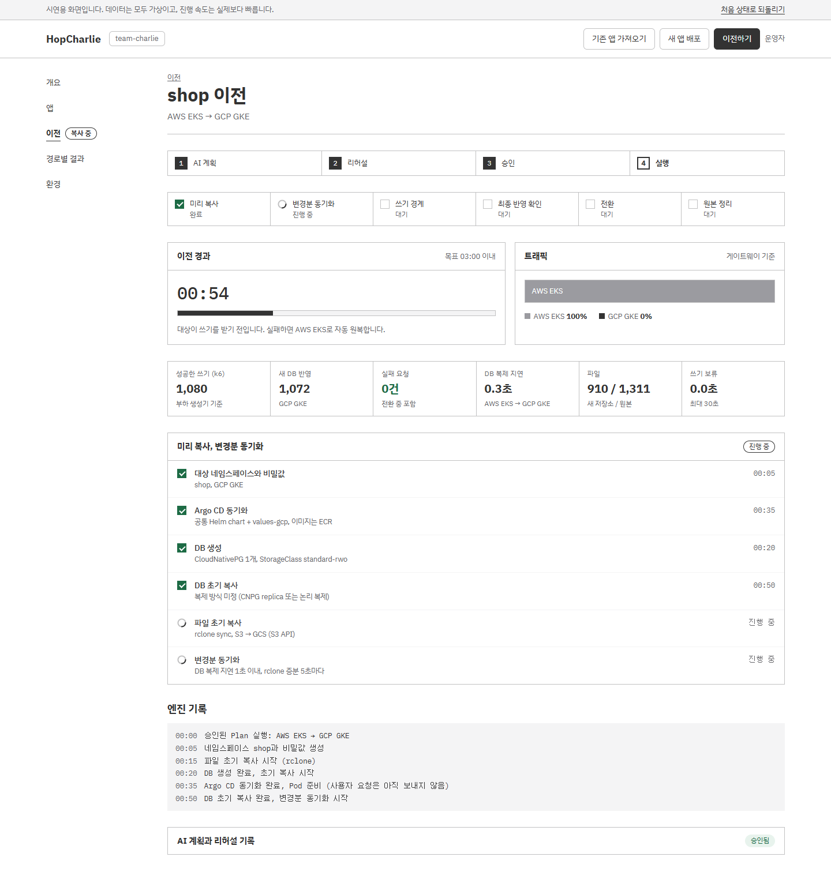
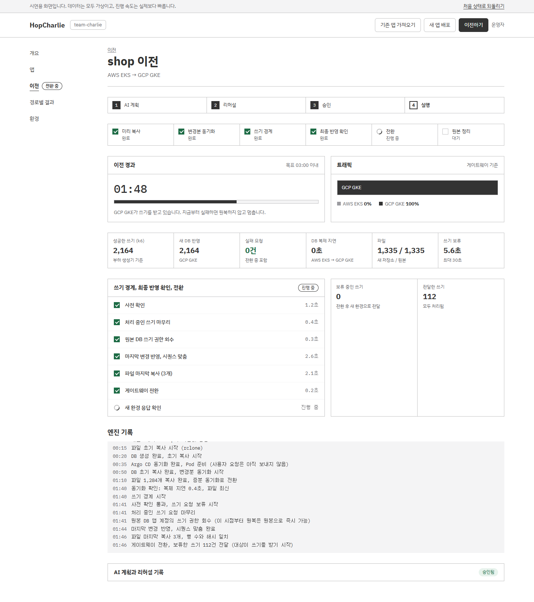
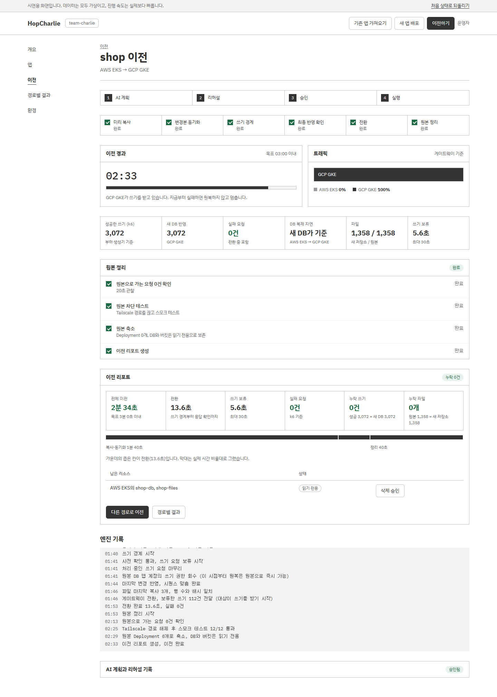

# HopCharlie 콘솔 (frontend)

HopCharlie 운영 콘솔입니다. 지금은 **시연용 시뮬레이션**입니다. 모든 데이터는 가상이고, 화면 상단 배너에 그 사실이 표시됩니다.

- 스택: Vite 8 + React 19 + TypeScript, 테스트는 Vitest + Testing Library
- 디자인: SoftBank 디자인 시스템 토큰 (`src/styles/tokens.css`)

```bash
npm install
npm run dev        # 개발 서버
npm test           # 시뮬레이션·화면 테스트
npm run build      # 타입 검사 + 프로덕션 빌드
```

## 화면

시연용 시뮬레이션 화면입니다. 숫자와 로그는 모두 가상입니다. (1440px 너비, 전체 페이지)

### 개요
클러스터 3개의 상태, 6개 경로 결과표, 앱, 최근 활동을 한 화면에서 봅니다.


### 기존 앱 가져오기
플랫폼 밖(EC2, RDS, S3)에서 돌던 앱을 AI가 점검하고 고쳐서 클러스터에 첫 배포합니다. AI 범위 결정(3장 7번) 전 시안입니다.

| 1. 연결 정보 | 2. AI 점검 |
| --- | --- |
|  |  |
| **3. 샌드박스 테스트** | **4. PR 승인과 첫 배포** |
|  |  |

### 이전
**설정:** 원본은 앱이 지금 있는 클러스터이고, 옮겨 갈 클러스터를 고릅니다.


**AI 계획 → 리허설 → 승인:** Plan JSON과 플랫폼 검사 결과, 샌드박스 리허설(1차 실패 → AI 수정안 → 2차 통과), AI 권한으로 시도했다가 막힌 명령을 보고 운영자가 승인합니다.


**실행:** 엔진이 6단계를 순서대로 실행합니다. 3분 목표 타이머, 트래픽 비율, 복제 지연, k6 지표, 원복 경계 안내가 함께 보입니다.

| 미리 복사, 변경분 동기화 | 쓰기 경계 → 전환 |
| --- | --- |
|  |  |

**이전 리포트:** 전체 시간, 전환 시간, 쓰기 보류, 실패 요청, 누락 쓰기·파일을 남기고, 원본 삭제는 따로 승인받습니다.



### 경로별 결과
EKS, GKE, k3s 사이 6개 방향의 결과표입니다.


### 앱, 새 앱 배포, 환경

| 앱 목록 | 앱 상세 (shop) |
| --- | --- |
|  |  |
| **새 앱 배포** | **환경** |
|  |  |

### 디자인 시스템 (`#design-system`)
메뉴에는 없는 화면입니다. 주소창에 `#design-system`을 붙여서 엽니다. 색(대비 포함), 글꼴, 간격과 모서리, 상태 표현, 컴포넌트, 움직임을 화면과 같은 토큰과 클래스로 보여줍니다.


### Figma로 옮기기
- **이미지로:** `docs/screenshots/`의 PNG를 Figma에 끌어다 놓습니다.
- **편집 가능한 레이어로:** html.to.design 크롬 확장을 설치하고, `npm run dev`로 띄운 화면(`http://localhost:5173/#...`)에서 확장을 눌러 캡처한 뒤 Figma의 html.to.design 플러그인에서 불러옵니다. 진행 상태가 있는 화면(승인 대기, 전환 중, 리포트)은 그 상태까지 진행한 뒤 캡처합니다.

## 이전 흐름

(기존 앱 가져오기 →) AI 계획 → 리허설 → 승인 → 실행 순서입니다. 운영자가 누르는 버튼은 승인(또는 반려)과 원본 삭제 승인뿐이고, 나머지는 자동으로 진행합니다.

| 단계 | 화면에 보이는 것 |
| --- | --- |
| AI 계획 | 읽기 전용 조회 기록, Plan JSON, 플랫폼 검사(스키마, 고정 규칙). 1차 스키마 실패 후 재요청 |
| 리허설 | 대상 클러스터의 샌드박스, 1차 실패 → AI 진단·수정안(values diff) → 2차 통과, 막힌 명령 |
| 승인 | 경로, 예상 시간, 검사·리허설 결과, 원복 경계 |
| 실행 | 미리 복사 → 변경분 동기화 → 쓰기 경계 → 최종 반영 확인 → 전환 → 원본 정리, 3분 타이머, 트래픽 비율, 복제 지연, k6 지표 |

결과는 `#routes`(경로별 결과)에 6개 방향별로 쌓입니다. 이전이 끝나면 앱의 현재 위치가 바뀌고, 그 위치에서 다른 경로로 다시 옮길 수 있습니다.

- DB 이전 방식은 아직 정하지 않았습니다(주제 정리 3장 2번). 화면에는 "복제 방식 미정"으로 표시합니다 (`DB_METHOD`).
- 샘플 앱 서비스 목록은 자리표시입니다. `MOCK:` 주석을 검색하면 바꿀 곳이 나옵니다.
- 기존 앱 가져오기(AI 점검 → 샌드박스 테스트 → PR 승인 → 첫 배포)는 AI 범위 결정(3장 7번) 전 시안입니다. 가져오기가 끝나면 shop이 고른 클러스터에 배포되고, 그때부터 이전할 수 있습니다. 이전 화면의 "가져오기 완료 상태로 건너뛰기"로 바로 이전 시연을 시작할 수 있습니다.

## 구조
```
src/sim/data.ts     시연 데이터 (클러스터 3개, 경로 6개, Plan, 리허설, 로그 타임라인)
src/sim/state.ts    시뮬레이션 상태 머신 (배포, 가져오기, 이전) — 실제 API로 바꿀 경계
src/sim/store.tsx   100ms 틱, React 구독
src/router.ts       해시 라우팅 (#overview, #apps, #app-<id>, #new, #onboard, #migrate, #migrate-shop, #routes, #envs, #design-system)
src/pages/          화면
src/components/     공통 UI (Chip, Ind, LogBox, Table, PageHead)
```

실제 엔진과 연결할 때는 `src/sim/`를 migration-engine의 상태(`.hopcharlie/runs/*.json`)와 이벤트(JSON Lines / SSE)를 읽는 데이터 계층으로 바꿉니다. 그때는 상단 시연 배너를 지우고, `halted` / `rolled_back` / `failed`를 각각 따로 표시해야 합니다.
